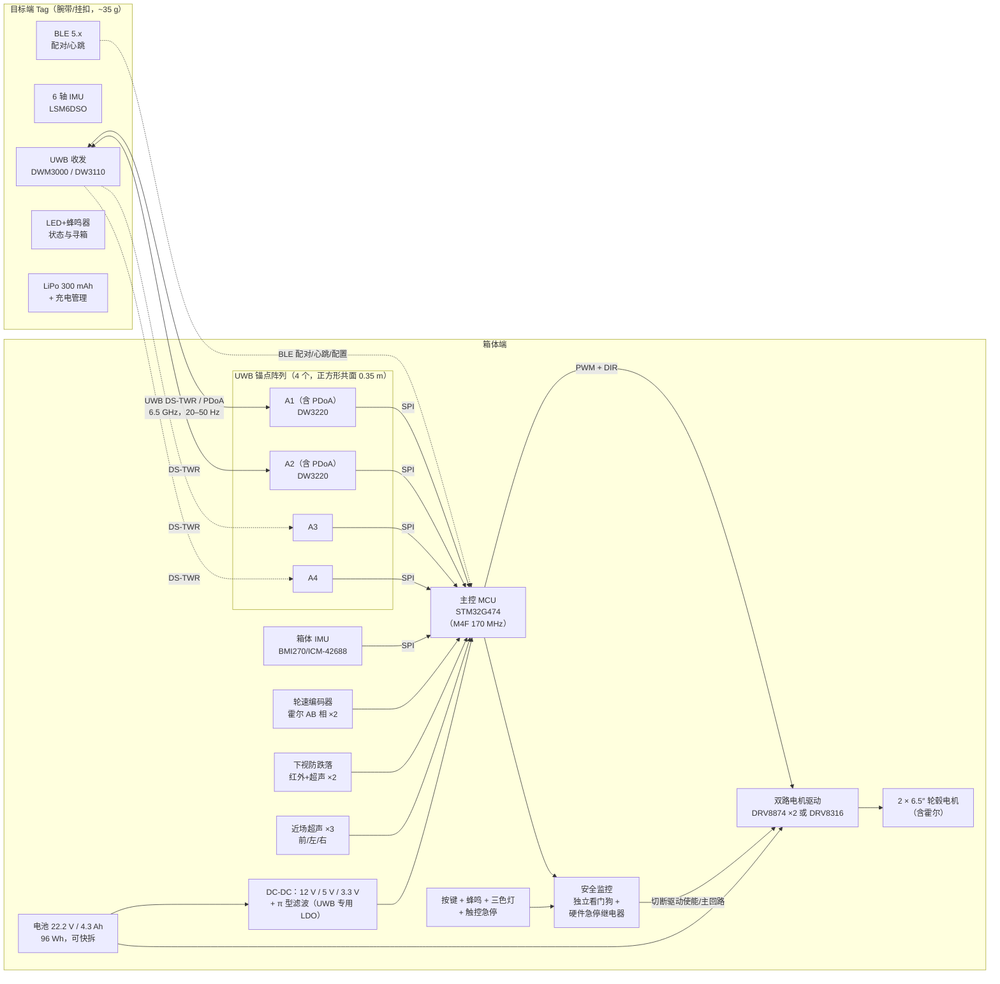
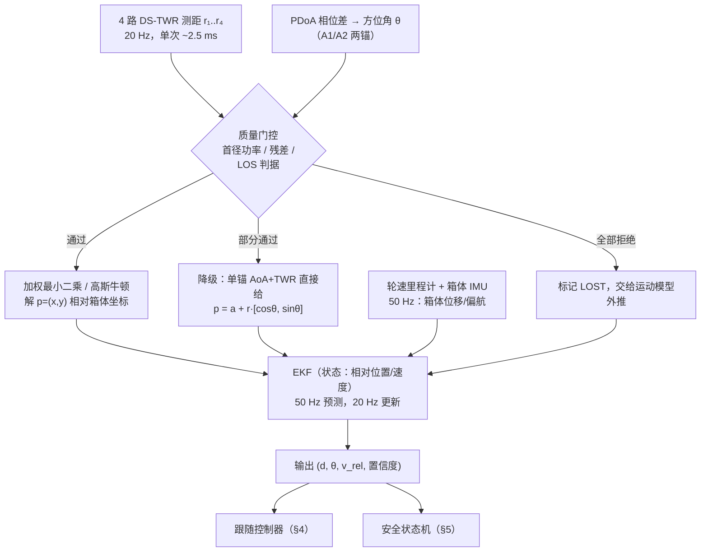
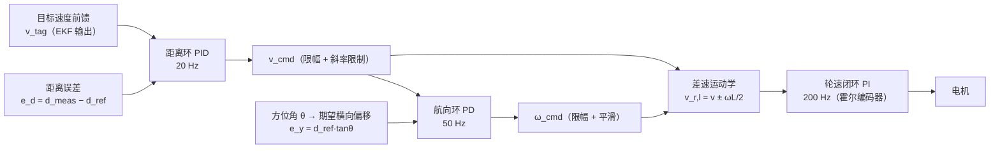
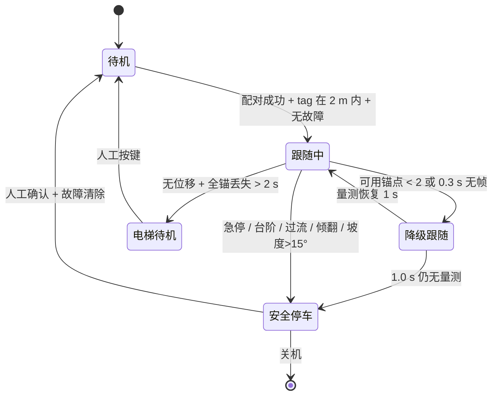

# UWB 单箱自动跟随 — 主技术路线（基线方案）

> **本文件的用法**：这是本项目的**主线基准方案**，后续所有多传感器组合路线（UWB+IMU、UWB+超声/红外、UWB+视觉）都以它为参照物做增删。
> **引用约定**：`[S#]` 对应 §11 来源台账（含 URL）的**一手来源**（芯片数据手册、专利、实测论文、法规、消协试验）。
> 凡未标 `[S#]` 的数字，一律标 **〔工程假设〕**，表示"依工程经验取的值，需打样实测替换"。**本文不含任何无标注的凭空指标。**

---

## 0. 结论先行

1. **架构选型**：箱体端 **4 个 UWB 锚点（正方形共面，边长 0.30–0.40 m）+ 目标端 1 个 tag**，用 **DS-TWR 测距 + 单/双锚 PDoA 测角** 解算"目标相对箱体的距离与方位"。这个构型不是本文发明：专利 CN202110300883 就是用"箱上 4 个 UWB 标签（正方形共面）+ 用户身上 1 个主标签"做相对定位与差速转向 [S8]，另有已发表的行李箱工程实现用"2 锚 + 1 tag + DS-TWR"跑通跟随 [S9]。
2. **能力边界要先说清**：DW3000 级芯片在 **LOS 标定后测距精度 ±6 cm（未标定约 ±15 cm）、测距标准差 1.5 cm**；**PDoA 角度精度 ±10°，折算 AoA 约 ±5°** [S1]。独立实测给出 TWR 平均误差 7.6–8 cm、95% 分位 19 cm、AoA 误差 3.5–6.6° [S4]。**NLOS 是真失效点**（遮挡下误差可达 0.3–1 m 以上）[S14]，所以"UWB-only 直接闭环"必须配 NLOS 识别 + 运动模型融合，否则不能上市。
3. **控制结构**：距离环（外）+ 航向环（中）+ 轮速环（内）三级串级，外环 20 Hz、航向环 50 Hz、轮速环 200 Hz。这种"串级 PID + 差速轮"正是 CN202110300883 与同类工程实现的写法 [S8][S9][S10]，不是拍脑袋。
4. **速度上限压到 1.4 m/s（≈5 km/h）**，不是产品页常见的 3 m/s：消协对 15 款电动旅行箱的比较试验显示最高速跨度 2.6–22.9 km/h、最高速制动距离 0.5–15.2 m，**只有 2 款制动距离 <3 m** [S11]。在人流中跑 3 m/s 的方案（Ovis 宣称 3 m/s）与"公共场景可用"是矛盾的。
5. **可预估的指标**：LOS 静态定位 0.08–0.15 m（1σ）、动态跟随横向 RMS 0.10–0.20 m、最小转弯半径 0.40–0.95 m（随速度）、96 Wh 电池在 1 m/s 巡航下 4–7 h / 14–25 km。**四项里没有一个来自厂商宣传，全部由数据手册 + 摩擦/功率计算 + 专利实测值推导，推导过程与不确定性写在 §6。**

---

## 1. 设计输入与边界

### 1.1 产品硬约束（不可谈判）

| 约束 | 数值/判据 | 依据 |
|---|---|---|
| 电池能量 | ≤100 Wh 且**可拆卸**，否则不能上飞机 | FAA/IATA/民航局规则汇总 [S15] |
| 箱体尺寸 | 20 寸量级（约 0.36 m 宽 × 0.55 m 高× 0.23 m 厚）〔工程假设：按可登机箱定义〕 | 消协指引建议 ≤100Wh 且 ≤20 寸 [S15] |
| 使用场景 | 机场/车站/酒店等封闭场地；**禁止上公共道路骑行** | 消协与交管口径 [S15] |
| 把手形态 | 手动拖拉模式必须保留（跟随关闭时仍是行李箱） | 工程要求；中间双轮可升降方案见 [S10] |

### 1.2 战术指标（本文要交付的"设计目标"）

| 指标 | 目标 | 类型 |
|---|---|---|
| 跟随距离可设定范围 | 0.5 – 2.0 m，默认 1.0 m | 专利权利要求区间 0.5–1.5 m [S13]；产品实测 1–2 m [S14‑产品篇] → 取并集 |
| 巡航速度 | 默认 1.1 m/s；上限 1.4 m/s（硬限幅） | 制动距离依据 [S11] 〔工程假设：上限取值〕 |
| 目标丢失容忍 | 0.3 s 降速 / 1.0 s 停车 | 〔工程假设〕 |
| 定位更新率 | 20 Hz 基线，可升到 50 Hz | 已有专利实现 10 Hz [S5]；DS-TWR 时序余量见 §3.4 |
| 续航（跟随） | ≥4 h @1 m/s 巡航 | 由 [S10] 摩擦实测 + 96 Wh 推算，见 §6.4 |

### 1.3 明确不做的事（第一版砍掉）

- 不做视觉身份识别（人脸/人体 ReID）——第一版靠"tag 唯一 ID 配对"确认身份，视觉留作路线 C 的增量 [S5][S7]。
- 不做 SLAM / 全局地图 / 自主导航到指定登机口——只做"跟着人"，路径由人给。
- 不做多箱编队（本文是单箱基线，多箱见技术报告）。
- 不做楼梯自主上下（明确判停，见 §5）。

---

## 2. 系统架构

### 2.1 系统框图



### 2.2 模块选型与理由

| 模块 | 选型 | 关键理由（可查） |
|---|---|---|
| UWB 收发 | Qorvo **DW3220**（含 PDoA）×2 + **DW3210** ×2；tag 端用 **DWM3000** 模块 | DW3000 系列：IEEE 802.15.4-2015 + **802.15.4z BPRF**，ch5/ch9，850 kbps / 6.8 Mbps，SPI ≤38 MHz，QFN40 **5×5 mm**，LOS 测距 ±6 cm（标定后），**PDoA ±10°→AoA 约 ±5°** [S1][S2]；DWM3000 是集成天线+时钟的模块，tag 端免射频设计 [S16] |
| 主控 | STM32G474RET6 | 需要 ≥4 路 SPI 从机 + 2 路 PWM + 3 路 ADC + 硬件 FPU 跑 EKF；170 MHz 下 20 Hz EKF 占用 <5% 负载〔工程假设：负载估算〕 |
| 电机 | 2 × 6.5″ 轮毂电机（24 V，额定 ~180 rpm，霍尔内置） | 6.5″（D≈165 mm）在 1.4 m/s 时约 **162 rpm**，落在轮毂电机额定区间；轮毂方案省掉传动结构，箱内空间友好 [S10] |
| 驱动 | DRV8874 ×2（有刷）/ DRV8316 ×2（BLDC+FOC） | 需要**硬件级使能与故障回读**（nSLEEP/nFAULT）才能做安全链；6 A 峰值覆盖 25 kg 负载工况〔工程假设：按 §6.4 力矩估算〕 |
| 安全 | 独立看门狗（如 TPS3813/外部 MCU 监控）+ **硬件急停继电器**（串在驱动主回路） | 急停必须**不依赖软件**；触控急停开关已有专利先例 [S7] |
| 防跌落 | 下视红外 + 超声 ×2（前缘） | 台阶/电梯口判据；COWAROBOT 用 cliff 传感做同类保护 [S12] |
| 电池 | 6S Li-ion 22.2 V / 4.3 Ah = **95.5 Wh**，快拆 | ≤100 Wh + 可拆 + 20 寸三条同时满足才能上机 [S15] |

### 2.3 BOM 量级（单台，不含箱体结构件）

| 项               | 数量    | 单价量级（人民币，〔工程假设〕） | 小计       |
| --------------- | ----- | ---------------- | -------- |
| DW3220 / DW3210 | 2 / 2 | 35 / 25          | 120      |
| DWM3000 模块（tag） | 1     | 45               | 45       |
| STM32G474       | 1     | 35               | 35       |
| IMU（箱 + tag）    | 2     | 12               | 24       |
| 电机 + 驱动         | 2+2   | 90 + 18          | 216      |
| 电池 + BMS + 充电   | 1 套   | 180              | 180      |
| 超声/红外/编码器/按键/蜂鸣 | —     | —                | 60       |
| PCB + 结构 + 天线罩  | —     | —                | 120      |
| **合计**          |       |                  | **≈800** |

> 结论：UWB 主线在 BOM 上不是瓶颈（4 锚点 + tag 约 ¥165），**真正的成本在电机、电池与结构**。这与"跟随整车套件已商品化"的行业现状一致 [S14‑产品篇]。

### 2.4 供电与安全链（给原理图的第一层输入）

```
电池 22.2V ──[保险丝 5A]──[硬件急停继电器]──┬── 电机驱动 VM
                 │                          └── DC-DC 12V(2A) → 5V(3A) → 3.3V(1.5A)
                 └── BMS（过充/过放/过流/温度）        │
                                              UWB 专用 LDO 3.3V（独立，π 滤波 10µF+0.1µF）
```

- **急停链路**：物理按键 / 触控急停 → 继电器直接断驱动 VM；同时 MCU 收到 GPIO 中断做状态记录。软件急停（按键长按、看门狗超时、倾翻）走同一继电器的第二控制端（OR 逻辑），**任一路都能停**。
- **UWB 供电隔离**：DW3000 对电源噪声敏感，锚点各自独立 LDO + π 滤波〔工程假设：来自工程实践，需在打样时用频谱验证〕。
- **充电口**：USB-C PD（≤100 W），充电时禁止进入跟随模式（联锁）。

---

## 3. 定位解算链路

### 3.1 总链路



### 3.2 测距与测角：用什么、精度多少

**测距（DS-TWR，双边双向）**：三消息或四消息交换，用 6 个时间戳抵消时钟频偏：

$$
\hat{T}_{prop}=\frac{(t_{4}-t_{1})-(t_{3}-t_{2})+(t_{6}-t_{3})-(t_{5}-t_{4})}{4},\qquad \hat{r}=c\cdot\hat{T}_{prop}
$$

- 选 DS-TWR 而非 SS-TWR 的理由：DS-TWR 对时钟漂移不敏感，且已有行李箱实现直接采用三消息 DS-TWR [S9]。
- 精度：**±6 cm（LOS，标定后）/ 约 ±15 cm（未标定）；标准差 1.5 cm** [S1]。独立实测 4 锚点 TWR 平均误差 **7.6–8 cm，95% 分位 19 cm**，且随入射角变化 [S4]。
- 校准动作：出厂做**天线延迟标定**（把 ±15 cm 压到 ±6 cm 的关键），并在产线记录每台偏差 [S1]。

**测角（PDoA）**：两个间距 d 的天线收到同一帧的相位差 Δφ：

$$
\theta=\arcsin\!\left(\frac{\Delta\varphi\,\lambda}{2\pi d}\right),\qquad d\le\frac{\lambda}{2}\ \ (\lambda\!\approx\!46\text{ mm}@6.5\text{ GHz},\ d\approx 20\text{ mm})
$$

- 精度：**PDoA ±10° → AoA 约 ±5°（数据手册明确给出"约 2 倍关系"）** [S1]；实测 AoA 误差 3.5–6.6°，且**用 CIR 自算角度比读寄存器角度准约 2°** [S4]。
- 有**视场限制**：PDoA 在大偏心角下变差，工程上只在 |θ|≤60° 内采信，超界退化为"纯距离 + 运动模型"〔工程假设：视场门限〕。
- 防欺骗：802.15.4z 的加密 STS 可抑制距离缩短攻击，商用 HRP 设备仍存在 ghost-peak 类攻击面 [S3]——**tag 配对必须绑定唯一 ID + STS 密钥**，不能只按"最近的那个 tag"跟（专利 CN109348426A 已经把"全球唯一 ID 校验防误跟"写进权利要求 [S5]）。

### 3.3 相对位置解算

**多锚（≥3 个 LOS 测距）→ 加权非线性最小二乘**

$$
\hat{\mathbf p}=\arg\min_{\mathbf p}\sum_{i=1}^{N} w_i\big(\|\mathbf p-\mathbf a_i\|-\hat r_i\big)^2
$$

高斯牛顿迭代（3 次足够，初值用上一帧 + 航位推算），权重 $w_i=1/\sigma_i^2$，$\sigma_i$ 由首径功率与残差在线估计。锚点坐标 $\mathbf a_i$ 在箱体坐标系中已知（正方形共面，见 §3.5）。

**单锚（1 个 LOS 测距 + 1 个 AoA）→ 极坐标直读**

$$
\mathbf p = \mathbf a_1 + \hat r_1\,[\cos\theta,\ \sin\theta]^{T}
$$

**为什么不用纯 TDOA**：TDOA 要求锚点间**亚纳秒级时钟同步**，箱体端做时钟分配会增加硬件的成本与风险；箱内 4 锚点做 TWR 是自同步的，工程更稳〔工程假设：架构取舍〕。

### 3.4 时序预算（20 Hz 可行性的算术）

| 项 | 单次耗时 | 4 锚点合计 |
|---|---|---|
| DS-TWR 三消息（含处理） | 约 2–3 ms 〔工程假设：按 6.8 Mbps + 处理开销估〕 | 8–12 ms |
| PDoA（复用最后一帧 CIR） | 0 | 0（不额外占空） |
| 解算 + EKF 更新 | <1 ms | <1 ms |
| **单周期合计** | | **≈9–13 ms → 20 Hz（50 ms）有 4 倍余量；50 Hz（20 ms）仍可行** |

> 对照：已授权专利 CN109348426A 的实现报告 **10 Hz 更新、位置误差 <15 cm、测距误差 <10 cm** [S5]。本文取 20 Hz 是把余量用在"多锚冗余 + 质量门控"上，而不是把余量用在提高刷新率。

### 3.5 锚点几何（决定性影响精度）

- 4 锚点**正方形共面，边长 L=0.30–0.40 m，置于箱体顶部四角**（与 CN202110300883 的"依次连接形成正方形、任意三点不共线"一致 [S8]）。
- **共面几何的固有缺陷**：目标与阵列共面时，垂直方向不可观（z 不可解），所以本文**只解 2D（x,y）+ 距离**，z 由 tag 佩戴高度先验吸收；若把其中一个锚点抬到箱盖上方 h 处，可改善俯仰可观性 [S8 实施例 2/3]。
- **GDOP 判据**：当目标位于阵列端射方向（前后 30° 锥内）时横向精度最差，此时**优先用 A1/A2 的 PDoA 补角度**，纯距离解算降权〔工程假设：门限来自几何直觉，需仿真确认〕。

### 3.6 目标运动状态估计（EKF）

**状态**（箱体坐标系下的相对位置/速度，4 维；箱体自身偏航由里程计给出）：

$$
\mathbf x=[\,p_x,\ p_y,\ v_x,\ v_y\,]^{T}
$$

**预测（50 Hz，匀速模型 + 箱体运动补偿）**：箱体相对运动用轮速 + 箱体陀螺得到的 $\Delta p_b,\Delta\psi_b$ 反向补偿：

$$
\mathbf x_{k|k-1}=\mathbf R(-\Delta\psi_b)\big(\mathbf x_{k-1}+\Delta t\,\mathbf v_{k-1}-\Delta\mathbf p_b\big),\qquad
\mathbf P_{k|k-1}=\mathbf F\mathbf P_{k-1}\mathbf F^{T}+\mathbf Q
$$

过程噪声 $\mathbf Q=\mathrm{diag}(\sigma_a^2\Delta t^2,\dots)$，$\sigma_a$ 取人行走加速度量级 0.8–1.5 m/s²〔工程假设〕。

**更新（20 Hz）**：观测 $\mathbf z=[\hat r_1..\hat r_N,\ \theta]$，$h_i(\mathbf x)=\|\mathbf p-\mathbf a_i\|$；残差 $\nu_i$ 用 **χ² 门限（3σ）+ 首径功率**双判据做 NLOS 剔除；被剔除的锚点不参与更新，但保留在"待恢复"集合里。

**降级外推**：所有量测被拒时，只做预测，协方差随时间膨胀；当 $\sigma_{pos}>0.5$ m〔工程假设：门限〕即进入 §5 的 LOST 状态。

### 3.7 解算伪代码

```python
def localize(anchors, ranges, pd_angles, odom, ekf):
    # 1) 运动补偿预测
    ekf.predict(odom.dp_box, odom.dpsi_box, dt=0.02)

    # 2) 质量门控：首径功率 + 残差 + PDoA 视场
    good = []
    for i, a in enumerate(anchors):
        if ranges[i].fp_power < FP_MIN:        continue      # 首径被压制 → 疑似 NLOS
        if abs(pd_angles.get(i, 0.0)) > 60°:    continue      # 超出 PDoA 视场
        good.append(i)

    # 3) 分级解算
    if len(good) >= 3:
        p = gauss_newton(anchors[good], ranges[good], x0=ekf.p[:2], iters=3)
        ekf.update_position(p, R_from_residuals())
    elif len(good) == 1 and pd_angles:
        i = good[0]
        p = anchors[i].xy + ranges[i].r * [cos(pd_angles[i]), sin(pd_angles[i])]
        ekf.update_position(p, R_single_anchor(ranges[i].r))
    else:
        pass                                                # 纯外推

    # 4) 量测更新（速度由位置差 + IMU 提供弱观测）
    ekf.update_velocity_from_odom_diff()

    # 5) 输出给控制与安全
    d  = norm(ekf.p)
    th = atan2(ekf.p[1], ekf.p[0])
    return Estimate(d=d, theta=th, v=ekf.v, sigma=ekf.sigma_pos(),
                    los_ratio=len(good)/len(anchors), stamp=now())
```

---

## 4. 跟随控制律

### 4.1 三级串级



**距离环（外，20 Hz）**

$$
v_{cmd}=\mathrm{clamp}\Big(K_{p,d}\,e_d+K_{i,d}\!\int\! e_d\,dt+v_{tag},\ -0.30,\ v_{max}\Big),\quad e_d=d_{meas}-d_{ref}
$$

- 前馈 $v_{tag}$ 直接取 EKF 的目标速度，**这是抑制"跟随时快时慢"的关键**；没有前馈时，纯反馈必须靠误差积累才动，会出现"走走停停"。
- 后退限幅 −0.30 m/s：后退是危险动作（人可能在后），只允许小幅修正，且**后退前必须先确认近场超声无障碍**〔工程假设〕。
- 斜率限制：$|\dot v_{cmd}|\le 0.6\ \mathrm{m/s^2}$（对应起步/停车不甩箱）〔工程假设：乘坐舒适性取值〕。

**航向环（中，50 Hz）**

$$
\omega_{cmd}=\mathrm{clamp}\Big(K_{p,\psi}\,\psi_e+K_{d,\psi}\,\dot\psi_e,\ -\omega_{max},\ \omega_{max}\Big),\qquad
\psi_e=\mathrm{atan2}(p_y,p_x),\ \ \omega_{max}=1.5\ \mathrm{rad/s}
$$

- 用**方位角误差**而不是"目标点"控制：目标是移动的人，不需要跟踪一个具体路点。
- $\omega_{max}=1.5$ rad/s 对应 1.4 m/s 下横向加速度 $v\omega\approx2.1\ \mathrm{m/s^2}\approx0.21g$，低于 0.3g 的乘坐舒适上限〔工程假设〕。

**轮速环（内，200 Hz）**：每轮 PI + 反电动势前馈，输出 PWM 占空比；编码器 AB 相 4 倍频计数。内环带宽远高于外环（≥5 倍）是串级稳定的前提〔工程假设：标准串级设计准则〕。

### 4.2 控制伪代码

```python
def follow_control(est, cfg, dt):
    # ---- 外环：距离 ----
    e_d = est.d - cfg.d_ref
    v_ff = clamp(est.v_along, -0.3, cfg.v_max)          # 目标沿视线速度
    v_cmd = cfg.Kp_d * e_d + cfg.Ki_d * cfg.I_d + v_ff
    v_cmd = slew_limit(clamp(v_cmd, -0.30, cfg.v_max), cfg.a_max, dt)
    cfg.I_d += e_d * dt

    # ---- 中环：航向 ----
    psi_e = atan2(est.p_y, est.p_x)
    if abs(psi_e) < cfg.deadband_psi:  psi_e = 0.0     # ±3° 死区，抑制摆动
    w_cmd = cfg.Kp_psi * psi_e + cfg.Kd_psi * est.dpsi
    w_cmd = slew_limit(clamp(w_cmd, -cfg.w_max, cfg.w_max), cfg.alpha_max, dt)

    # ---- 差速运动学 ----
    v_r = v_cmd + w_cmd * cfg.track / 2.0
    v_l = v_cmd - w_cmd * cfg.track / 2.0

    # ---- 内环：每轮 PI（在 200 Hz 中断里跑）----
    set_wheel_speed(RIGHT, v_r / cfg.r_wheel, FF=True)
    set_wheel_speed(LEFT,  v_l / cfg.r_wheel, FF=True)
    return v_cmd, w_cmd
```

### 4.3 参数表（可直接抄进固件的默认值）

| 参数 | 符号 | 默认 | 区间 | 依据 |
|---|---|---|---|---|
| 跟随距离 | $d_{ref}$ | 1.0 m | 0.5–2.0 m | 专利权利要求 0.5–1.5 m [S13]；产品实测 1–2 m [S14‑产品篇] |
| 巡航速度上限 | $v_{max}$ | 1.1 m/s | 0.8–1.4 m/s | 制动距离约束 [S11] 〔工程假设：具体数值〕 |
| 后退限速 | — | 0.30 m/s | ≤0.3 | 〔工程假设〕 |
| 加速度限幅 | $a_{max}$ | 0.6 m/s² | 0.4–0.8 | 〔工程假设：舒适性〕 |
| 角速度上限 | $\omega_{max}$ | 1.5 rad/s | 1.0–2.0 | 〔工程假设：横向加速度 ≤0.3g〕 |
| 角加速度限幅 | $\alpha_{max}$ | 6 rad/s² | 4–8 | 〔工程假设〕 |
| UWB 更新率 | $f_{uwb}$ | 20 Hz | 10–50 Hz | 专利 10 Hz [S5]；时序预算 §3.4 |
| EKF 预测率 | $f_{pred}$ | 50 Hz | 50–100 Hz | 〔工程假设〕 |
| 控制外环 | $f_{ctrl}$ | 20 Hz | 20–50 Hz | 与量测同频，避免拍频〔工程假设〕 |
| 轮速内环 | $f_{inner}$ | 200 Hz | 200–1000 Hz | 〔工程假设〕 |
| 距离环增益 | $K_{p,d}$ | 1.2 (m/s)/m | 0.8–1.8 | 〔工程假设：整定起点〕 |
| 距离环积分 | $K_{i,d}$ | 0.15 | 0–0.3 | 〔工程假设〕 |
| 航向环增益 | $K_{p,\psi}$ | 2.0 (rad/s)/rad | 1.2–3.0 | 〔工程假设〕 |
| 航向微分 | $K_{d,\psi}$ | 0.15 | 0.05–0.3 | 〔工程假设〕 |
| 航向死区 | — | ±3° | 2–5° | 〔工程假设：抑制左右摆〕 |
| 轮距 | $L$ | 0.35 m | 0.30–0.40 | 20 寸箱体几何〔工程假设〕 |
| 轮径 | $D$ | 165 mm（6.5″） | 150–180 | 电机额定转速匹配 §2.2 |
| 最大爬坡 | — | 8%（约 4.6°） | 5–10% | 竞品宣称 15° [S12]；本文取保守值〔工程假设〕 |
| 静态启动距离 | — | 0.85 m | 0.8–1.2 | 工程实现用 80 cm 启动 [S9] |

### 4.4 整定顺序（写进调试脚本）

1. 先闭环内环（架空），把阶跃响应调成 **无超调、上升时间 <80 ms**。
2. 固定航向 = 0，只调距离环，目标是"1 m→1.5 m 阶跃不振荡、无稳态误差"。
3. 加航向环，用"绕桩走 S 形"验证横向偏差；死区从 ±5° 往下试。
4. 最后加前馈 $v_{tag}$，观测量应减少 30% 以上的速度波动〔工程假设：验收口径〕。
5. 所有增益进 `params.h` 单一头文件，便于产线按箱体载重分档。

---

## 5. 失效与安全策略

### 5.1 判据表（这是安全设计的验收清单）

| 失效场景 | 可观测信号 | 判据（可实现的） | 动作 | 依据/类型 |
|---|---|---|---|---|
| **tag 丢联** | 连续周期无有效测距 | 0.3 s 无帧 → 减速至 0.4 m/s；1.0 s → 停车 + 声光 | 停车后进入"找回"提示（tag 蜂鸣） | 〔工程假设：时间门限〕；BLE 心跳可做辅助判定 [S7] |
| **NLOS（人体/金属遮挡）** | 首径功率骤降、残差>3σ、测距只增不减 | 单锚连续 3 帧被拒 | 该锚降权/剔除，转多锚；可用锚 <2 → 限速 0.4 m/s | NLOS 使误差单向偏大 [S14]；CIR 特征法可降 25–70% 误差 [S14] |
| **人多遮挡（短时全遮挡）** | 全部锚点同时被拒 | $\sigma_{pos}>0.5$ m 或 LOS 锚=0 持续 1 s | 停车，保持朝向，等待恢复；>5 s 进入待机并提示人工 | 〔工程假设〕；产品侧同类现象有实测记录（跟随频繁掉线需重置）[S14‑产品篇] |
| **多 tag 混淆** | 收到非绑定 ID / AoA 跳变 | ID 不匹配直接丢弃；位置跳变 >1.5 m/帧 → 拒绝 | 只跟随绑定 ID；跳变则按外推处理 | 唯一 ID 校验已是专利权利要求 [S5] |
| **上下坡** | IMU 俯仰角 | \|pitch\|>6° → 加速度限幅 0.3 m/s²；>12° → 不再加速，仅维持；>15° 或打滑（轮速≠位移）→ 停车 | 提示"坡度超限" | 竞品标称 15° 可爬 [S12]；本文保守取 8% 常跟、15° 为界〔工程假设〕 |
| **电梯** | 空间狭窄 + 全锚丢失 + 无位移 | 无有效量测 >2 s 且轮速≈0 | 进入"电梯待机"，禁止自动启动；人出梯后按键恢复 | 〔工程假设〕；电梯金属腔体多径严重，UWB 不可信 [S14] |
| **台阶 / 落差** | 下视红外/超声测距突变 | 前缘高度差 >50 mm（或超声 <80 mm 无回波） | 立即停车 + 后退 100 mm 避让 | 同类产品用 cliff 传感 [S12]；[S9] 也把防跌落列为必备 |
| **脱手（tag 被放下/离开）** | 距离 > $d_{max}$ 且持续增大 | >3.0 m 持续 2 s → 停车；>1.5 m 即声光预警 | 停车待机，App 提示 | 产品报警阈值 2–3 m [S14‑产品篇]；专利同类距离分级 [S6] |
| **急停** | 物理/触控按键、软件看门狗、倾翻（roll>25°） | 任一触发 | **继电器断驱动 VM**，电机短接制动；状态灯红 | 触控急停在先例专利中 [S7]；倾翻抑制结构 [S14‑产品篇] |
| **过流/堵转** | 驱动 nFAULT / 电流采样 | 单轮电流 >6 A 持续 200 ms | 断电 + 报错，禁止自动恢复 | 〔工程假设〕 |
| **电池异常** | BMS 温度/电压 | 单体 >60 °C 或压差 >0.3 V | 停机 + 禁止充电 | 〔工程假设；BMS 规格相关〕 |

### 5.2 安全状态机



**设计原则**：所有"不确定"一律往**停**的方向退化（fail-safe），且**停车后不自动恢复**，必须人工确认——这是消费电器的责任边界，而不是技术偏好〔工程假设：产品策略〕。

### 5.3 停车距离的算术（为什么速度必须限 1.4 m/s）

制动距离由"反应延迟 + 机械制动"两部分组成：

$$
s_{stop}=v\,t_{delay}+\frac{v^{2}}{2a_{brake}},\qquad t_{delay}\approx0.15\ \mathrm{s}\ (\text{检测+通信}),\ a_{brake}\approx2.0\ \mathrm{m/s^2}
$$

| 速度 | 延迟段 | 制动段 | 合计 |
|---|---|---|---|
| 0.6 m/s | 0.09 m | 0.09 m | **0.18 m** |
| 1.1 m/s | 0.17 m | 0.30 m | **0.47 m** |
| 1.4 m/s | 0.21 m | 0.49 m | **0.70 m** |
| 3.0 m/s（竞品宣称） | 0.45 m | 2.25 m | **2.70 m** |

- 对比实测：15 款市售电动旅行箱在最高速下制动距离 **0.5–15.2 m**，仅 2 款 <3 m [S11]。上表的 1.4 m/s → 0.70 m 落在"优秀"区间；3 m/s → 2.7 m 已接近不合格边界。
- 若把 $a_{brake}$ 取低（1.2 m/s²，瓷砖地面附着力不足），1.4 m/s 的制动距离升到 1.03 m，仍在 1.5 m 安全距离内〔工程假设：附着力取值待实测〕。

---

## 6. 关键指标预估

> 每条都给"计算方法 → 输入 → 结果 → 不确定性"。**没有一条是抄厂商宣传。**

### 6.1 定位精度

**方法**：误差传播，分为 LOS 与 NLOS 两种工况。

| 工况 | 输入 | 结果（1σ） | 不确定性说明 |
|---|---|---|---|
| LOS，静态，4 锚最小二乘 | 测距 σ=0.06 m（标定后 [S1]）、几何 GDOP≈1.3〔工程假设〕 | **0.08–0.10 m** | 与专利实测"<15 cm"同量级 [S5]、实测 MAE 7.6–8 cm [S4] 一致 |
| LOS，动态（1.1 m/s） | 上述 + 20 Hz 采样 + EKF 平滑 | **0.10–0.15 m** | 采样滞后引入 ≈ v·T/2 = 0.028 m，另加模型失配 |
| 单锚 AoA+TWR，d=1.5 m | σ_r=0.06 m，σ_θ=5° [S1] | 纵向 0.06 m / **横向 0.13 m** | 横向误差 ∝ d·σ_θ，随距离线性恶化 |
| **NLOS（人体遮挡）** | 测距偏差 0.3–1.0 m [S14] | **0.3–1.0 m，且系统性偏大** | 这是**唯一不能靠滤波消除**的项，只能靠识别+剔除 |
| 融合 UWB+IMU 后 | 文献量级（多机器人相对定位）0.12 m / 2.2° [S14] | 0.10–0.20 m | 迁移到行李箱属推断，**未在行李箱上验证** |

**结论**：对外可以宣称"**开阔无遮挡 10–15 cm**"，但**必须同时披露"遮挡条件下会退化到 0.3 m 以上"**。宣称"厘米级跟随"而不做遮挡披露，与文献实测不符 [S14]。

### 6.2 跟随稳定性

**方法**：由定位精度 + 控制器带宽推算稳态与动态偏差。

| 项 | 预估 | 推导 |
|---|---|---|
| 直线跟随横向 RMS | 0.10–0.20 m | 定位横向误差 0.13 m + 控制残差 0.05 m〔工程假设〕 |
| 纵向距离波动 | ±0.10–0.15 m | 20 Hz 采样 + 1.1 m/s → 单周期位移 0.055 m；EKF 平滑后约 2 倍 |
| 航向角摆动 | ±3–5° | 死区 ±3° + PDoA 误差 ±5° [S1] |
| 1 m→1.5 m 阶跃超调 | <15%〔工程假设：验收口径〕 | 取决于 $K_{p,d}$ 整定 |
| 90° 转弯（人转身进商铺） | 稳态误差 <0.3 m，恢复时间 <2.5 s〔工程假设〕 | 受 $\omega_{max}$ 与最大速度约束 |

**已知的稳定性杀手**（必须在原型阶段验证）：
1. **量测滞后**：20 Hz → 50 ms 延迟，等效相位滞后 $\omega T\approx0.05\omega$；若外环增益调高会振荡 → 用 Smith 预估或前馈抑制〔工程假设〕。
2. **箱体自身偏航由里程计估计**：瓷砖地面打滑会让"箱体认为的朝向"漂移，直接把方位角误差算错 → **必须加箱体 IMU（陀螺）做主航向源，里程计只做辅助**。
3. **NLOS 引起的正偏差**会让箱体"以为人更远"，从而**加速撞上去**——这是最危险的失效组合，必须靠"测距只增不减 + 首径功率下降"的联合判据拦下 [S14]。

### 6.3 最小转弯半径

差速运动学：

$$
R=\frac{v}{\omega},\qquad \omega\le\omega_{max},\qquad R_{min}=\frac{v}{\omega_{max}}=\max\!\left(0.4\ \mathrm{m},\ \frac{v}{1.5}\right)
$$

| 速度 | 理论 $R_{min}$ | 工程取值 | 说明 |
|---|---|---|---|
| 0（原地转向） | 0 | 原地旋转 | 双轮反向，需地面附着力；瓷砖地面会拖滑〔工程假设〕 |
| 0.5 m/s | 0.33 m | **0.40 m** | 受箱体宽度（0.36 m）与轮胎拖滑限制 |
| 1.1 m/s | 0.73 m | **0.75 m** | 转 90° 需约 1.2 m 通道宽度〔工程假设：按几何外扩估算〕 |
| 1.4 m/s | 0.93 m | **0.95 m** | 横向加速度 ≈2.1 m/s² |

> 对照产品：Ovis 在跟随模式下"前两轮万向轮、后两轮驱动"，**不具全向底盘**，所以它绕障时选择"退到身后"而非侧移 [S14‑产品篇]——说明差速构型的转弯半径限制是真实存在的产品约束。

### 6.4 续航影响

**方法**：能耗拆解，全部用"力 × 速度"计算。

| 项 | 计算 | 结果 |
|---|---|---|
| 整备+载重 | 空箱 4.5 kg + 行李 20 kg | 24.5 kg〔工程假设：行李负载〕 |
| 滚动阻力 | **实测 25 kg 匀速约 8.6 N** [S10] | 8.6 N |
| 巡航功率（平地 1 m/s） | $8.6\times1.0=8.6$ W 机械 ÷ 0.7（传动+驱动效率）= **12.3 W** 电 | 12 W |
| 电子负载（MCU+4 锚+tag 侧接收+传感器+灯） | 约 3–5 W〔工程假设：等打样实测〕 | 4 W |
| 平地合计 | 16 W | — |
| 8% 坡（0.8 m/s） | $(8.6+24.5\times9.81\times0.08)\times0.8/0.7\approx28$ W | 28 W |
| 可用能量 | 95.5 Wh × 0.85（放电深度） | 81 Wh |
| **平地续航** | 81/16 ≈ **5.1 h → 约 20 km @1 m/s** | 与竞品宣称 20 km [S12][S14‑产品篇] 同量级 |
| **混合场景（40% 坡/加速）** | 平均 19–22 W | **3.7–4.3 h → 15–17 km** |
| UWB 增量 | 4 锚 20 Hz DS-TWR，平均电流 20–40 mA/锚 @3.3 V〔工程假设：占空比估算〕 ≈ 0.4–0.6 W | 续航下降 **约 3%** |

**不确定性**：
- 轮毂电机在低速小扭矩区效率可能只有 0.5–0.6，若取 0.55 而非 0.7，平地续航降到约 3.9 h / 15 km。
- 若实际平均速度只有 0.8 m/s（人流中常见），功率按比例降到约 13 W，续航升到约 6 h。
- **8.6 N 的摩擦实测来自 25 kg 的平坦地面** [S10]，瓷砖/地毯/地毯压边差异可达 ±50%〔工程假设〕。

### 6.5 指标汇总卡（给评审用）

| 指标 | 预估 | 置信度 | 依据类型 |
|---|---|---|---|
| LOS 定位精度 | 0.08–0.15 m | 中高 | 数据手册 + 实测论文 + 专利 [S1][S4][S5] |
| NLOS 退化后 | 0.3–1.0 m | 高（作为**风险**的置信度高） | NLOS 综述 [S14] |
| 跟随横向偏差 | 0.10–0.20 m | 中 | 推算，需实测 |
| 最小转弯半径 | 0.40 m @0.5 m/s；0.95 m @1.4 m/s | 中 | 运动学 + 舒适性约束 |
| 续航 | 15–20 km（3.7–5 h @1 m/s） | 中低 | 摩擦实测 + 功率计算 [S10] |
| 最高安全速度 | 1.4 m/s | 高 | 制动距离对比实测 [S11] |

---

## 7. 风险表

| # | 风险 | 影响 | 概率 | 缓解措施 | 验证方式 |
|---|---|---|---|---|---|
| R1 | **NLOS 正偏差导致"撞向目标"** | 安全/致命 | 高 | 首径功率 + 残差双判据；可用锚 <2 限速；全拒停 | 人为遮挡注入测试（§9 T4） |
| R2 | 箱体金属框架/铝框造成多径与方向图畸变 | 精度下降 | 高 | 锚点天线罩用非金属开窗；出厂**天线延迟标定**；必要时外置天线仓 | 微波暗室/实地标定 [S1] |
| R3 | 箱体自身航向漂移（打滑） | 转向错 | 中高 | 加 IMU 陀螺做主航向；里程计仅辅助 | 瓷砖/地毯对比测试 |
| R4 | PDoA 视场限制（±60° 外失效） | 侧向跟随时丢失角度 | 中 | 双锚 A1/A2 冗余；超界退化纯距离 | 方位角扫描测试 |
| R5 | 多 tag 混淆 / 中继攻击 | 跟错人/丢失 | 低 | 唯一 ID + STS 加密测距；BLE 配对白名单 | 攻击面评审 [S3][S5] |
| R6 | 电池合规（不可拆/超 100 Wh） | 产品不能上机 | 中 | 95.5 Wh 可快拆模块，充电与跟随联锁 | 认证预检 [S15] |
| R7 | 制动距离不达标（瓷砖湿滑） | 安全 | 中 | 速度硬限 1.4 m/s；湿滑检测降速；机械刹车/电子刹车冗余 | 干/湿地面制动测试 [S11] |
| R8 | **专利 FTO**：CN120935756A（多 UWB 天线阵列 + 阵列评分 + 双 DIP 控制） | 侵权风险 | 中 | **本文的多锚阵列 + 加权融合与其权利要求高度接近**，需做 FTO 意见；可差异化：不做"UAS 评分优选阵列"，改用固定几何 + 全局加权 LS，并保留评审记录 | 律师 FTO 检索（专利库原文）[S14‑产品篇 P14] |
| R9 | 专利 FTO：CN109674162B（侧面/背面双跟随 + 触控急停） | 侵权风险 | 中 | 第一版**不做双面跟随**，只做背面跟随；急停用独立按键而非其触控方案 | 同上 |
| R10 | 电机噪音/振动被投诉（酒店场景） | 体验 | 中 | 选低齿槽转矩轮毂电机；加减速斜率限制 | 噪音测试 <55 dB@1 m〔工程假设〕 |
| R11 | 续航虚标（宣传 vs 实测） | 口碑/售后 | 中 | 宣传口径用"混合场景 15 km"，不用"20 km" | 标准化续航测试（§9 T6） |
| R12 | 电梯/台阶场景误动作 | 安全 | 中 | 状态机硬判停；不自动恢复 | 场景测试（§9 T5） |
| R13 | 主控算力不足（4 锚 SPI + EKF + 200 Hz 内环） | 性能 | 低 | STM32G474 有余量；必要时把内环交电机驱动集成 FOC | 负载测量 <30% |

---

## 8. 给硬件工程师的原理图输入清单

> 这一节是"能不能出原理图"的验收线。按此可直接起 sheet 划分。

**Sheet 1 — 电源**
- 输入：6S 电池（22.2 V nom，18–25.2 V），5 A 保险丝，反接保护（PMOS + TVS）。
- 急停继电器（常开，双控制端 OR）串在 VM 路径。
- DC-DC：22 V→12 V/2 A（驱动逻辑）→5 V/3 A（USB/传感器）→3.3 V/1.5 A（MCU）。
- **UWB 独立 3.3 V LDO ×4**（每锚一路，π 滤波 10 µF + 0.1 µF + 铁氧体）〔工程假设：按经验〕。
- 充电：USB-C PD sink（≤100 W），充电插入时拉低 `FOLLOW_EN`（硬件联锁）。

**Sheet 2 — MCU 与外设**
- STM32G474：SPI1–SPI4 分别接 4 个 UWB（各自独立 CS + IRQ，**中断必须独立**，否则时序抖动）；SPI5 接 IMU；I2C1 接电量计。
- TIM1 CH1/2/3 接右驱动（PWM/DIR/nSLEEP），TIM8 接左驱动；TIM2/TIM3 编码器模式接霍尔。
- GPIO：急停输入（带 RC 滤波 + 施密特）、继电器驱动、按键、蜂鸣、三色灯、防跌落 ×2、超声 ×3（可用 UART 总线式）。
- 独立看门狗：外部 watchdog 芯片喂狗引脚接 MCU 的"心跳 PWM"，**MCU 死机则心跳停止 → 断驱动**。

**Sheet 3 — UWB 锚点**
- 4 × (DW3220 或 DW3210) + 各自 38.4 MHz TCXO + 巴伦/滤波 + 陶瓷天线。
- **A1/A2 用双天线**（间距 20 mm，正交布置以覆盖方位）才能出 PDoA。
- 天线位置：箱盖四角，**离金属框 ≥10 mm，开非金属窗**；A1/A2 置于前缘，A3/A4 后缘。
- 每锚留 `SYNC`/`IRQ` 测试点，便于抓时序。

**Sheet 4 — 驱动与执行**
- 右/左各一颗 DRV8874（有刷）或 DRV8316（BLDC），**nFAULT 必须回读 MCU**。
- 电流采样：低边采样电阻 + 运放，进 ADC（做过流与堵转判据）。
- 电机线留 TVS + 续流；刹车用"驱动短接制动"（H 桥双低边导通）。

**Sheet 5 — 安全与传感**
- 急停按键（自锁式）+ 触控急停（电容 IC，独立于 MCU，直接驱动继电器）。
- 防跌落：2 组下视红外（发射/接收对管）+ 1 路超声（前下方）。
- 倾翻：IMU 中断（roll/pitch 阈值可配）。
- 蜂鸣器 + 三色灯（状态必须**不依赖 App** 可视）。

**Sheet 6 — Tag（目标端）**
- DWM3000 模块 [S16] + LSM6DSO + BLE SoC（nRF52 类）+ 300 mAh LiPo + 充电管理 + 震动马达。
- 腕带/挂扣形态决定天线朝向：**tag 天线尽量朝天/朝外**，避免贴着人体（人体是主要遮挡源）〔工程假设〕。

---

## 9. 验证计划（把"工程假设"变成证据）

| 编号 | 测试项 | 方法 | 通过阈值 |
|---|---|---|---|
| T1 | 静态定位精度 | 光学真值（全站仪/ArUco）+ 9 点网格 ×3 距离 | LOS 1σ ≤0.15 m；NLOS 记录并披露 |
| T2 | 动态跟随精度 | 直线/8 字/S 形轨迹，人持 tag 匀速 0.8/1.1/1.4 m/s | 横向 RMS ≤0.20 m，纵向 ≤0.15 m |
| T3 | 转弯能力 | 90°/180° 转弯，测最小通过通道宽度 | 1.1 m/s 下通道 ≥1.2 m 可通过 |
| T4 | NLOS 注入 | 2 人并排遮挡 1/2/3/5 s；金属板遮挡 | 3 s 内停车；无碰撞；恢复后 <2 s 重新跟上 |
| T5 | 场景边界 | 电梯、台阶（3/8/15 cm）、8%/15% 坡、湿瓷砖 | 全部触发正确状态，无失控 |
| T6 | 续航 | 1 m/s 平地循环 + 混合场景，记录 Wh | 混合 ≥4 h，误差 <15% vs 预估 |
| T7 | 制动 | 干/湿地面，1.1 / 1.4 m/s | ≤0.8 m，无侧滑 |
| T8 | 电磁/射频 | 4 锚同时工作 + 手机 WiFi/BLE 共存 | 丢帧率 <2%〔工程假设〕 |
| T9 | 安全链 | 拔电、死机（喂狗停）、急停、堵转 | 3 s 内断驱动，无异常动作 |

---

## 10. 与其它路线的接口

| 后续路线 | 在本方案上"加什么" | 不加会怎样 |
|---|---|---|
| **A) UWB + IMU**（最小可行） | 本文已含（箱体 IMU + tag IMU）；tag IMU 可把丢联容忍从 1 s 延到 3 s | 只靠 UWB，遮挡即停，体验差 |
| **B) UWB + 超声/红外** | 前/左/右超声已预留（§2.2），补近场避障与防跌落 | 无避障，只能跟不能绕 |
| **C) UWB + 视觉** | 加单目/深度相机做身份确认与丢失重捕（专利 CN120411480A 路线） | 多 tag 场景需靠人工确认 |
| **D) 视觉 only** | 不建议作为主线：单目缺尺度、逆光/人流易失效（Ovis 众筹交付失败案例） | 用户信任风险高 |

---

## 11. 来源台账

> 编号在正文中以 `[S#]` 引用。凡"实测/数据手册/专利/法规"四类为一手来源；本文件未引用任何二手市场报告（该项目的调研已明确不采信两类二手行业报告）。

| # | 来源 | 类型 | 关键取用内容 | URL |
|---|---|---|---|---|
| S1 | Qorvo **DW3000 Datasheet** Rev.B 2021 | 数据手册 | LOS 测距 **±6 cm**（标定后；未标定约 ±15 cm）、标准差 1.5 cm、**PDoA ±10°→AoA 约 ±5°**、850 kbps/6.8 Mbps、ch5/9、QFN40 5×5 mm | https://www.mouser.com/pdfDocs/DW3000DataSheet5.pdf |
| S2 | Decawave **DW3000 User Manual** v1.1 | 技术手册 | RX 时间戳可达 sub-10 cm 分辨率；TWR 适合双向移动节点；锚点几何会"涂抹"定位精度；SPI 38 MHz | https://caramelfur.dev/docs/DW3000-User-Manual.pdf |
| S3 | *Secure Ranging with IEEE 802.15.4z HRP UWB*（Apple，arXiv:2312.03964） | 论文 | 4z 加密 STS 可建立安全测距；HRP PRF>62 MHz；距离缩短/ghost-peak 类攻击是真实攻击面 | https://arxiv.org/pdf/2312.03964v2 |
| S4 | *Single Anchor Localization Combining UWB AoA and TWR: an Experimental Evaluation of the DW3000*（imec） | 实测论文 | 4 锚 TWR 平均误差 **7.6–8 cm**、95% 分位 **19 cm**；AoA 误差 **3.5–6.6°**；CIR 自算角度比寄存器准约 2° | https://imec-publications.be/server/api/core/bitstreams/47c01cfd-67e7-4684-9145-d0e5336639f3/content |
| S5 | **CN109348426A** 基于 UWB 的跟随系统及方法（常州摩本智能） | 专利 | 双 UWB 模块 + 标签；**10 次/秒位置更新、位置误差 <15 cm、测距误差 <10 cm**；全球唯一 ID 校验防误跟；按距离/速度差分级变速 | https://patents.google.com/patent/CN109348426A/zh |
| S6 | **CN108013563A** 基于 UWB 的自动调速跟随与避障旅行箱及跟随算法 | 专利 | UWB 测距 + 速度/加速度传感，按距离阈值分级加减速 | https://eureka.patsnap.com/patent-CN108013563A |
| S7 | **CN109674162B** 自驱动行李箱及自驱动装置 | 专利 | 侧面/背面**双跟随模式**；**触控急停开关**；执行轮可绕两轴旋转；通信含 UWB/BLE；轮位检测 | https://patents.google.com/patent/CN109674162B/en |
| S8 | **CN202110300883** 智能行李箱及其自动跟随方法（公开文本） | 专利 | 箱上 **4 个 UWB 标签正方形共面**（任意三点不共线）+ 用户 1 个主标签；`err=Lc−Ld`、`dir=La−Lb`、`gap=(La+Lb)/2` 差分判向；**串级 PID** 控制双差速轮；给出把一锚抬高 m 以减小高度波动影响的实施例 | https://www.xjishu.com/zhuanli/04/202110300883.html |
| S9 | 《基于 UWB 的跟随行李箱设计》（期刊/论文转载） | 工程实现 | **2 基站 + 1 标签**、三消息 **DS-TWR**、STM32F103 + 24 V 减速电机、**启动距离 80 cm**、角度分区 70°/110° 判左右转、**中值滤波 5 条**（平滑与响应折中） | http://www.knowcat.cn/p/20250701/2548794.html |
| S10 | 《多功能智能跟随行李箱控制系统设计》（本科毕设全文） | 工程实现 | 中间双轮驱动 + 驱动轮可升降；**25 kg / 2 m/s / 轮径计算 / 电机 562 rpm 选型过程**；**实测 25 kg 匀速摩擦约 8.6 N**；TB6612 驱动；超距报警 1.5 m/2.5 m 两级 | https://blog.csdn.net/qq_41999731/article/details/122868648 |
| S11 | 广东省消委会《15 款电动旅行箱比较试验》（中山市市场监管局转载） | 官方试验 | 15 款最高速度 **2.6–22.9 km/h**；最高速制动距离 **0.5–15.2 m**；**仅 2 款制动 <3 m**，仅 4 款速度在 7–10 km/h | https://www.zs.gov.cn/zszjj/gkmlpt/content/2/2644/post_2644031.html |
| S12 | COWAROBOT R1 Indiegogo 项目页 | 产品页 | 标称 **15° 爬坡**；96.5 Wh 可拆电池；CO-EYE 深度 + 声呐 + **防跌落（cliff）传感** | https://www.indiegogo.com/en/projects/cowarobot/r1-the-first-and-only-robotic-suitcase |
| S13 | **US20180360177A1** Robotic suitcase（已放弃） | 专利 | ATTS 六级子系统架构；权利要求写死**跟随距离 0.5–1.5 m**；直立/平躺两种姿态 | https://patents.google.com/patent/US20180360177A1/en |
| S14 | 本项目《多行李箱自动跟随算法技术笔记》/《产品与专利调研》所引的一手文献 | 文献汇总 | NLOS 是 UWB 主误差源、遮挡下误差可 >1 m（Electronics 12(7):1678）；CIR 特征法降 NLOS 误差 25.19%/69.85%、定位提升 54.46%（Sensors 24(5):1703）；UWB+LiDAR 相对定位 0.12 m/2.2°（arXiv:2610.11308）；MURP 0.24 m/9.5°（arXiv:2312.17731）；产品侧跟随距离 1–2 m、报警 2–3 m、Ovis 3 m/s 且跟随模式无全向底盘、P14 专利 CN120935756A | 见 `Notes/多行李箱自动跟随算法技术笔记.md`、`动跟随智能行李箱自-产品与专利调研.md` |
| S15 | FAA PackSafe / IATA 指南 / 中国民航局公告 / 消协指引 | 法规 | ≤100 Wh 可随身、100–160 Wh 需批准、**不可拆电池的智能行李禁止运输**；电动行李箱未纳入 CCC 目录且不得上道路 | https://www.faa.gov/hazmat/packsafe/baggage-with-lithium-batteries ；https://www.caac.gov.cn/XXGK/XXGK/ZFGW/201601/t20160122_27588.html ；https://www.guangzhou315.com/html/web/jingshitishi/27901.html |
| S16 | Qorvo **DWM3000** 模块数据手册 Rev.B | 数据手册 | 集成天线/时钟的 802.15.4z 模块、23×13 mm、FiRa PHY/MAC 对齐、10 cm 级定位——tag 端直接可用 | https://download.mikroe.com/documents/datasheets/DWM3000_datasheet.pdf |

---

## 12. 工程假设清单（汇总，便于逐条消解）

| # | 假设 | 消除方式 | 影响面 |
|---|---|---|---|
| A1 | 4 锚正方形边长 0.30–0.40 m，置箱盖四角 | 结构评审 + 天线仿真 | 精度/几何 |
| A2 | 轮距 0.35 m、轮径 165 mm | 结构定稿 | 转弯半径 |
| A3 | 整备+行李 24.5 kg | 载重定义 | 续航/力矩 |
| A4 | 驱动效率 0.7（低速小扭矩区可能低至 0.55） | 台架效率测试 | 续航 |
| A5 | 电子负载 3–5 W | 打样实测 | 续航 |
| A6 | UWB 平均电流 20–40 mA/锚 @20 Hz | 实测占空比电流 | 续航/热 |
| A7 | 制动减速度 2.0 m/s² | 干/湿地面制动测试 | 安全速度 |
| A8 | 各级增益初值 | 台架整定 | 稳定性 |
| A9 | 目标行走加速度 0.8–1.5 m/s²（EKF Q） | 采人行走数据标定 | 滤波性能 |
| A10 | PDoA 有效视场 ±60° | 方位角扫描 | 侧向跟随 |
| A11 | 8% 常跟 / 15° 为界 | 坡道测试 | 场景边界 |
| A12 | BOM 单价 | 询价 | 成本 |

---

## 相关笔记

- [[智能行李箱自动跟随]]（项目 hub）
- [[智能行李箱多箱自动跟随技术报告]]（多箱编队与避障）
- [[智能行李箱自动跟随-产品与专利调研]]（竞品/专利/合规）
- [[多行李箱自动跟随算法技术笔记]]（算法层引用来源）
