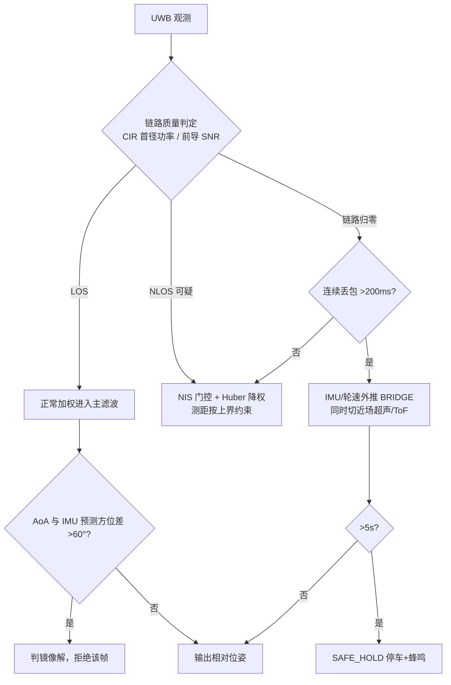

# UWB 跟随定位与多传感器融合：能力边界、融合架构、专利风险点

> 用途：为「UWB 手环 + 多传感器融合的单箱自动跟随」方案设计提供**可引用**的公开技术依据与专利风险清单。
> 所有数值均标注出处（专利号 / 论文标题 + 链接）；**核验列**说明证据等级：
> ✅ = 本次由编排者亲自打开页面核对；○ = 检索阶段打开页面核对（未二次复核）；⚠ = 仅摘要/二手口径。
> 原始检索数据（子任务落盘）：`attachments/uwb_capability_bounds.json`（2026-11-20 由库根移入附件目录）；同批产物 `UWB-IMU-视觉-超声融合架构调研.md` 已归位 `Notes/`。

---

## 0. 结论先行（一页纸）

1. **UWB 的"厘米级"只在 LOS + 单链路 + 校准后成立**：实测 LOS 测距 0±5 cm，但真实工况的合理预期是 **20–30 cm**，金属/人体遮挡下 **0.4–1.5 m**，且误差**永远偏大**（单边正偏置）。[R1][R8][R12]
2. **行李箱场景最致命的不是精度而是三种"硬失效"**：人体遮挡正偏置、金属环境链路归零、拐角几何退化 + 单锚 AoA 前后镜像（见 §1.4）。
3. **架构上"松耦合会被 UWB 位置解限死"，紧耦合的真实价值是少锚可用性**：同一系统松耦合可用时间 6.4%，紧耦合（单锚即可更新）升到 35.9%。[R15]
4. **算力不是紧耦合的门槛**：15 维 ESKF + 8 锚点在机载 MCU 级实现 80 Hz、0.16 m 均值精度。[R13] 真正的成本是**杆臂/时延标定**。[R16]
5. **UKF 相对 EKF 只增益约 3.5%，PF 在 LOS 下反而不如 EKF**——只有强多峰/NLOS 才值得上 PF，且必须配鲁棒权重。[R17][R19]
6. **专利上真正卡脖子的是"方法权利要求"而非硬件结构**：重捕策略（回到最后已知点 / 沿丢失前速度外推）与"标签 ID + 读卡器比对"两族最密；触控急停、模糊"停止"规则大多**只在说明书**，FTO 风险远低于摘要给人的印象。（§3）
7. **最新风险点：CN120935756A/B（宁波巴比，2025-08 申请、2026-06 已授权）** 把"多三角阵列枚举 + UAS 评分选优 + 异常冻结软重启"写进了权利要求 1/7，是本项目最需要回避的宽幅方法权利要求。[P10]

---

## 1. UWB 定位能力边界

### 1.1 四种测距/测角模式对照（决定选型的第一张表）

| 模式 | 原理 | LOS 典型精度 | 刷新/容量 | 节点需求 | 关键脆弱点 | 来源 |
|---|---|---|---|---|---|---|
| **SS-TWR**（单边双向测距） | 2 报文往返，取飞行时间 | **0±5 cm**（DW1000，校准后） | 最高（报文最少） | 1 锚 1 标签即可测距 | 相对钟漂未补偿时误差随温度整体漂移；1 ns 时间戳失配 ≈ 30 cm | [R1] ✅ |
| **DS-TWR**（双边双向测距） | 3 报文，消掉相对钟漂 | 与 SS 同量级，但**不受回环时延影响** | 比 SS 低（airtime ×1.5） | 1 锚 1 标签 | **只解决"钟"，不解决"径"**：多径偏置照样存在 | [R2] ○ |
| **TDoA**（到达时差） | 标签只发，锚点纳秒级同步后解算 | 大厅 p75/90/95/99 = **11/13/15/21 cm** | 最高（标签只发不收） | ≥4 锚 + 严格时间同步 | **走廊 2D 误差 69/89/101/377 cm**；几何/同步一崩就最先失效 | [R3] ✅ |
| **PDoA / AoA**（到达角） | 双/多天线相位差解角 | **±90° 内平均 2.4°**；±45° 内 MSE 0.59° | 高（单锚可出"距离+方位"） | 1 锚（多天线）+1 标签 | 50–60° 处 **wrap-around**、135–225° 扇区给**镜像解**（前后不分） | [R4] ✅ /[R5] ○ |

芯片厂标称可作上界参考：DW3300Q 标称测距 ±6 cm、PDoA ±12.5°、等效 AoA ±6.25°、资产定位 10 cm（均为 BPRF3/LOS/校准后）。[R5] ○

### 1.2 精度量级（按场景，最有用的一张表）

| 场景 | 实测/报告数值 | 说明 | 来源 |
|---|---|---|---|
| 开阔室内 LOS，8 锚 aSDS-TWR | 中位 **5 cm**，p90 **10 cm** | 多锚 + 最优部署 + 无遮挡的天花板成绩 | [R11] ⚠ |
| 商用系统，开阔高位 vs 金属货架低位 | **≈5 cm** vs **>60 cm**；99 分位标准差 12 cm vs 40 cm | 同一套硬件，误差跳一个数量级 | [R7] ○ |
| 4 节点 UWB 纯相对定位（DWM1001） | RMSE **3.2 cm** @10 Hz，最大误差 <17 cm | 非线性最小二乘（scipy trf）解 2D 相对坐标；室外开阔 LOS、静态摆位、1–4 m、线性标定后 | [[多行李箱自动跟随算法技术笔记]] L101 → arXiv:2212.06519（PANS 固件 TDMA + **DS-TWR**，仅 anchor↔tag 可测） |
| 单锚 TWR + 2D AoA | 平均定位误差最好 **43.3 cm**（50 m²） | 单锚天花板；1 m 处 43 cm ≈ ±25° 方位误差 | [R6] ○ |
| 非视距（混凝土墙 / 人体） | 平均 **44–60 cm** | 硬 NLOS 样本 | [R1] ○ |
| 人体自遮挡随朝向 | φ<90°：中位 4 cm / p99 32 cm；φ>160°：中位 32 cm / p99 **1.53 m**（离群 4.05 m） | 绕射波致峰值从 2 cm 漂到 12 cm（60°→150°），反射形成第二个模态 ~70 cm | [R8] ✅（趋势与峰值）/○（分位表） |
| 算法横向基准（11 算法/16 数据集） | 最优条件"数厘米" → **真实条件约 30 cm**；NLOS 对 **TDoA 的伤害显著大于 TWR** | 选定型：遮挡场景优先 TWR | [R12] ○ |

### 1.3 误差机理（三条，直接决定滤波器怎么设计）

- **单边正偏置**：直达径被人体/金属衰减后，接收机锁到绕射或反射径，飞行时间只可能变长 → 误差恒为正、重尾。工程上应把测距当**上界约束**（`d_meas ≥ d_true`）而不是无偏观测。[R8][R10]
- **金属是"开关"不是"衰减"**：0.024 mm 一层铝箔即可完全阻断 UWB 通信；金属密集办公楼内直达径被阻塞概率可高达 **90%**。[R9][R10] ○
- **几何退化**：可见锚点从 4 个掉到 1–2 个时 DOP 急剧放大；TDoA 从大厅 p75 11 cm 变走廊 p75 69 cm 就是同一套硬件的对照实验。[R3] ✅

### 1.4 ★ UWB 单独使用时的 3 个硬失效场景（验收项）

> 这三条是本方案必须写进设计前提的"不可用区"，任何"纯 UWB 闭环跟随"在下列场景都会失效，且失效方式不同。

**失效 1：人体/人群遮挡 → 单边正偏置，且不可被滤波"平均掉"**
- 证据：φ<90° 中位 4 cm/p99 32 cm → φ>160° 中位 32 cm/p99 1.53 m、离群 4.05 m（[R8] ✅）；独立测量中混凝土/人体硬 NLOS 平均 44–60 cm（[R1]）；胸挂标签在真距 <3 m 时曾记录 3 m 误差（[R8]）。
- 机理：绕射（creep wave）与反射被判为首径，误差只可能为正。
- 对本项目：1.5 m/s 跟随、0.5–1.5 m 间距下，一次 0.5 s 遮挡即产生约 0.75 m 的"更远"漂移 → 控制器会把箱子往外推。**必须**：①测距按上界约束做单边滤波；②遮挡窗口内用 IMU/轮速做 ≤0.3 s 外推；③人流密集段主动降速并放大安全间距，而不是相信滤波后的距离。

**失效 2：金属环境 → 整条链路归零，不是精度下降**
- 证据：0.024 mm 铝箔完全阻断通信（[R9]）；金属柜/货架/电梯井环境直达径阻塞概率 ~90%、NLOS 误差只出现正值且重尾（[R10]）；工业现场近金属货架低位点 >60 cm 而开阔高位 5 cm（[R7]）；8 锚系统仅摆几组金属柜就从 5 cm 退化到被可见光反超（[R11]）。
- 对本项目：机场金属行李架、电梯轿厢、闸机金属框会造成**整条链路丢失**。若融合层按"参与解算的锚点数"投票，会在金属旁得到 3 条**全错**的链路而不是 0 条 → 必须逐链路做 CIR 首径功率/NLOS 分类与降权，并在连续丢包 >200 ms 时切近场传感，而不是继续外推。

**失效 3：拐角/闸机几何退化 + 单锚 AoA 的前后镜像**
- 证据：同一 TDoA 系统大厅 p75 11 cm → 走廊 p75 69 cm、p99 377 cm（[R3] ✅）；单锚 TWR+AoA 在 50 m² 内最好 43.3 cm，入射角 >45° 后角度精度明显恶化（[R6]）；PDoA 在 50–60° 出现 wrap-around，135–225° 扇区 MSE 13.5–23.9°（[R4]）。
- 对本项目：目标绕过拐角时 UWB 不是"变差"而是**给出方向完全错误的镜像解**，跟随控制器会朝反方向加速。**必须**：①多锚几何一致性/残差检验做硬门限；②与 IMU 预测方位差 >60° 即判镜像并拒绝；③拐角退化为"沿路径点跟随 + 视觉重捕"。

---

## 2. 融合架构

### 2.1 五种架构对照

| 架构 | 状态/观测 | 典型数值 | 算力（MCU 级） | 主要失效条件 | 来源 |
|---|---|---|---|---|---|
| **松耦合 KF/EKF**（UWB 先解位置再融 IMU） | 状态 p,v；观测 3 维位置 | UWB 单独动态误差最高 **50 cm → 融合后 13.7 cm** | 最低，6–9 维，轻松 >100 Hz | **需 ≥3 有效锚**；NLOS 在解算阶段已被"洗"成位置误差，滤波器看不到单锚残差 | [R14] ✅/○ |
| **紧耦合 EKF / ESKF**（原始测距进量测方程） | p,v,q + 双零偏 | **0.16 m 均值 / 0.39 m 最大**（VICON 真值，对照 vanilla EKF 0.30/0.71 m），**80 Hz** 三维 | 中，15 维 + 8 锚 ≈3–5 k flops/帧 | 杆臂（mm）/时延（ms）未标定则系统性劣化；NLOS 正偏差直接进残差 | [R13] ✅/[R16] ○ |
| **紧耦合 UKF** | sigma 点传播原始测距 | UKF 39.72 cm vs EKF 41.26 cm（**仅优 3.5%**） | 中偏高（2n+1 点，需矩阵平方根） | 高维下 α/β/κ 难调、协方差易非正定；收益不足以抵消复杂度 | [R17] ○ |
| **滑窗因子图 / 优化**（IMU 预积分 + 测距因子） | 滑窗内全状态回改 | **12.3 cm RMSE**（含 NLOS；对照 EKF 27.6、PF 34.1），**21 ms/迭代** → 约 47 Hz 上限；40% 丢包仍工作 | 最高（100×100 Hessian，LM 迭代） | 需 SoC 级算力；协方差未自适应时在 UAV NLOS 场景 2D 仍 0.51 m，反不如松耦合 | [R18] ○ |
| **粒子滤波 / 鲁棒 PF** | 多峰分布 | PF 34.1 cm（**输给 EKF**）；加 IGG-III 鲁棒权重的 RPF 比 PF 好 **20.4%**、比 EKF 好 **39.6%** | 中高，随 N 线性；N=500×8 锚 ≈4000 次距离/帧 | 粒子退化/贫化；维数灾难（只适合 2D）；LOS 下不如 EKF | [R19] ○ |

### 2.2 带出处的结论

- **D1（松耦合的天花板 = UWB 位置解）**：只用 UWB 时动态误差最高 50 cm，KF 融合 IMU 后 13.7 cm（0.6–0.8 m/s、0.6–1.6 m/s² 台架，RPi4 + DWM1001 + BNO055）。这是 LOS 最好情况——NLOS 时 UWB 位置解本身已错，滤波器无残差可判别。[R14]
- **D2（紧耦合的第一价值是少锚可用性）**：松耦合需 ≥3 信标，UWB 可用时间仅 **6.4%**；紧耦合允许单信标更新，可用时间升至 **35.9%**。[R15] ○
- **D3（紧耦合在 MCU 级跑得动）**：15 维状态 + 原始距离量测，机载 **80 Hz**、0.16 m 均值精度、几乎无延迟 → 对 50 Hz 输出要求有 1.6× 余量。[R13] ✅
- **D4（紧耦合的隐藏成本是标定）**：天线装在箱体边缘、IMU 在质心，杆臂与时延必须在线联合标定，可达**毫米级杆臂 + 毫秒级时延**；不标则精度白送。[R16] ○
- **D5（UKF 不值得）**：同数据集 UKF 39.72 cm vs EKF 41.26 cm（3.5%），根因是"距离=位置模长"非线性度不高。[R17]
- **D6（PF 只做副滤波）**：PF 在 LOS 数据上输给 EKF；只有配鲁棒权重的 RPF 才反超（比 EKF 好 39.6%）。另一组 PF-OJ RMSE 0.2967 m vs 紧耦合 ESKF 0.0972 m。[R19][R23]
- **D7（UWB + 视觉的正确分工）**：UWB 给绝对位置与尺度、VIO 给帧间相对位姿；最优结构是"内层紧（UWB/IMU）+ 外层松（与立体 VIO 用 EKF 融合）"，RMSE 比 UWB 单独降 67.6%、比 UWB/IMU 降 50.0%。[R20] ○
- **D8（超声/红外是近场兜底，不进主滤波状态）**：4 路超声（10 Hz）作为 SE(3) 测距因子 + 高度约束与 UWB 20 Hz、IMU 200 Hz 异构融合，收益在垂直精度与 NLOS 鲁棒性；超声只在 LOS cm 级、且 <50 mm 有盲区。[R18] ○
- **D9（丢失桥接的核心是"协方差携带"，不是"猜位置"）**：NLOS + 50% 丢包 + 200 ms 延迟下，自适应量测协方差把 RMSE 从 0.2443 m 降到 0.0668 m（−72.7%）、P95 0.4624→0.1132 m，NIS 命中率 43.1%→91.8%；关键在于"NLOS 与丢包历史信念作用于重捕后的头几帧"。[R21] ○
- **D10（遮挡要按"测距偏差"处理，而不是"信号丢失"）**：NLOS 时锚点仍在通信、只是数值错——必须逐锚 NIS 门控 + 置信权重软剔除 + 观测协方差膨胀（实机平均误差 0.2046 m / 0.1699 m）。[R19][R22] ⚠

### 2.3 面向 MCU 级算力的分层推荐

| 层 | 频率 | 载体 | 内容 | 依据 |
|---|---|---|---|---|
| L0 时间基 | — | UWB/IMU 硬件 | 统一时基；无法硬同步时用固定时延 + 斜率补偿 | D4 |
| L1 传播 | 200–400 Hz | Cortex-M7 单核 | ESKF 名义态传播（p, v, q + 双零偏，9–15 维） | D3 |
| L2 主滤波 | 20 Hz（随 UWB 帧） | 同一 MCU | 逐锚距离残差 + NIS 门控 + Huber 核（4–8 锚） | D2/D10 |
| L3 副滤波 | 5 Hz（按需） | 同 MCU 低优先级 | 2D 4 维 PF（N≈300），仅持续 NLOS/几何退化时启动 | D6 |
| L4 近场 | 10–20 Hz，中断驱动 | 独立小 MCU | 3–4 路超声/红外：0–1.2 m 安全距离、侧向避障、台阶检测；**不接入滤波状态，只覆盖速度指令** | D8 |
| L5 视觉（可选） | 10–15 Hz | 独立 SoC | VIO 出相对位姿，每 1–2 s 作为一次位姿观测进 L2；算力不足时优先砍此层 | D7 |

**丢失重捕状态机（可直接落代码）**：`IDLE → BRIDGE → SOFT_RECOVER / HARD_RESET → IDLE`，`BRIDGE > 5 s → SAFE_HOLD`。

1. 进入 BRIDGE：连续 K=3 帧有效锚 <2，**或** NIS 连续 3 帧超阈（后者更重要，NLOS 大偏差比无测距更危险）。
2. 桥接 0–3 s：只跑 L1，过程噪声按 `σp += α·√Δt` 膨胀（MEMS 典型 0.1–0.3 m/√s），静止时 ZUPT 钳速度。3 s 行走累积 0.3–0.9 m，仍在跟随容差内。
3. 软重捕：重捕首帧把量测协方差乘 κ=9–25 压低增益，连续 3–5 帧 NIS 合格后线性降回 1（对应 [R21] 的"信念跨丢包保持"）。
4. 硬重置：首帧 |innovation| > 3σ 时不平滑，直接 `p ← UWB 解`、`P_pp ← R_uwb`；速度保持、姿态不动；零偏协方差 ×2，防止把桥接漂移误学成零偏。
5. 降级 >5 s：SAFE_HOLD——保持最后可信位置与朝向、停车 + 蜂鸣、不发车。
6. 反模式：①用超声"找目标"（人不是障碍物，超声只测最近回波）；②遮挡期拉起 3D PF（维数灾难）。

---

## 3. 专利风险点（FTO）

### 3.1 专利清单

| 编号 | 公开/授权号 | 名称 | 申请人 | 关键日期 | 法律状态 | 一句话要点 | 核验 |
|---|---|---|---|---|---|---|---|
| P1 | [CN109348426A](https://patents.google.com/patent/CN109348426A/zh) | 一种基于 UWB 的跟随系统及方法 | **个人（发明人黎国溥）** | 申请 2018-11-26 / 公开 2019-02-15 | Pending | 仅 2 个水平间隔 UWB 模块解 L2/L3 得距离+夹角；权利要求 6 末尾写入"标签端全球唯一 ID 芯片 + 跟随端无线射频读卡器读取比对 → 决定是否启动驱动"；说明书称 10 次/s 更新、位置误差 <15 cm、测距误差 <10 cm | ✅ |
| P2 | [WO2017125004A1](https://patents.google.com/patent/WO2017125004A1/zh) | 载物平台的自动跟随方法及载物平台 | Fantem Technologies Shenzhen | 优先权 2016-01-21 / 公开 2017-07-27 | **Ceased** | 权利要求 1–2：锁定配对引导设备、只跟随配对设备；主信号中断超时后改用**第二种信号**（同类不同频或不同类型，如红外+WiFi）重建连接 | ✅ |
| P3 | [US12004046B2](https://patents.google.com/patent/US12004046B2/en) | Object tracking based on UWB tags | Motorola Mobility | 申请 2021-09-13 / 授权 2024-06-04 | **Active**（同族 CN115811787A、DE102022122462A1） | 每个 UWB 标签带"数字标签"标识归属对象 → 建对象身份库 → 按后续定位数据监测异常搬移/成簇/异常接近（数据模型型壁垒，最难绕） | ✅ |
| P4 | [CN107992052B](https://patents.google.com/patent/CN107992052B/zh) | 目标跟踪方法及装置、移动设备及存储介质 | Ninebot（纳恩博北京） | 申请 2017-12-27 / 授权 2020-10-16 | **Active** | 权利要求 1：**检测方向与运动方向的调整相互独立**，绕障时检测方向不被底盘转向带偏（属"预防性防丢"） | ✅（授权/状态）/○（权1 原文） |
| P5 | [CN109674162B](https://patents.google.com/patent/CN109674162B/zh) | 自驱动行李箱及自驱动装置 | 灵动科技（安徽） | 优先权 2017-10-27 / 授权 2019-12-13 | **Active**（预计 2038-07-20 到期） | 权 10：把对象保持在"预定区域"，超出即加减速拉回；**权 11：出现遮挡物时按此前算出的"第一位移速度"继续行进**（速度外推）；前后双跟随模式互切绕障 | ✅ |
| P6 | [CN110166571A](https://patents.google.com/patent/CN110166571A/zh) | 一种基于移动机器人的自动跟随方法和装置 | 深圳市永易达机器人 | 申请 2019-06-06 / 公开 2019-08-23 | Pending | UWB(TDoA)+激光 SLAM 融合；**"在丢失目标的情况下，根据第一位置和第二位置确定第二移动路径，使机器人移动至第二位置"**（回到最后已知点） | ✅（说明书/权利要求文字） |
| P7 | [CN115239759A](https://patents.google.com/patent/CN115239759A/zh) | 一种基于视觉和 UWB 定位的移动机器人跟随方法 | 浙江工业大学 | 申请 2022-05-28 / 公开 2022-10-25 | Pending | UWB 只在多人场景"认人"（标签坐标投影进相机目标框），认准后切 KCF 相关滤波纯视觉跟随；说明书自认"跟随目标丢失时无法重新找回" | ○ |
| P8 | [CN110703810A](https://patents.google.com/patent/CN110703810A/zh)（授权 [CN110703810B](https://patents.google.com/patent/CN110703810B/zh)） | 具有轨迹预测和随机位置跟踪功能的跟随车及跟随方法 | 浙江天尚元 → 上元智行（宁波） | 申请 2019-11-18 / 授权 2022-07-15 | **Active**（预计 2039-11-18） | 超声雷达检测到障碍 → CPU 处理后**向车辆制动系统发制动信号**（舵机拉制动液压缸）；方法含"判断距离是否小于阈值 d"，超阈值且目标未动 → 停止运行 | ✅（摘要/说明书句）/○（权 2 原文） |
| P9 | [CN109188412A](https://patents.google.com/patent/CN109188412A/zh) | 一种自动跟随行李箱及其定位跟随防撞方法 | 江苏大学 | 申请 2018-07 / 公开 2019-01-11 | Google 显示 Pending，法律事件含 **RJ01 驳回** → 应视为驳回 | 4 角超声 + 3 向红外，红外距离经模糊控制出方向指令，模糊规则表含"停止"优先级（0,30 cm）——**均在说明书，未进权利要求** | ○ |
| P10 | [CN120935756A](https://patents.google.com/patent/CN120935756A/zh)（授权 CN120935756B） | 一种基于 UWB 的行李箱设备跟随方法及系统 | 宁波巴比智能科技 | 申请 2025-08-07 / 公开 2025-11-11 / **授权 2026-06-30** | **Active**（预计 2045-08-07） | 多 UWB 天线构建**不同三角定位阵列 → UAS 评分器周期选优 → 加权角度融合 → 双 DIP 控制器算线/角速度**；多因子异常判定 → 冻结输出+清缓存 → 连续 N 周期正常 → 软重启并加载上一稳定周期值（权 1/7） | ✅（时间线/授权）/○（权项细节） |

> **交叉核对修正**：前序笔记把 CN109348426A 记为"常州摩本智能科技"。本次打开 Google Patents 核对，该件 Current/Original Assignee 均为 **Individual（发明人黎国溥）**，常州摩本对应的是另一件描述性记录；引用时请以本条为准。[P1] ✅

### 3.2 四个主题的壁垒与规避

**T1 标签-主机配对与身份校验（防误跟 / 多目标区分）**
- 分布：个人申请、深圳幻腾、Motorola、浙工大；三星/OPPO 在"UWB 标签-对象动态绑定、UWB 权限方向"另有布局（US20230045985A1、CN112102541A，本次未逐条核权项）。
- 写进权利要求的：P1 权 6 的"唯一 ID 芯片 + 读卡器 + 本地 ID 编码比对 → 启停驱动"三要素；P2 权 1–2 的"锁定配对设备 + 只跟随配对设备 + 双信号重建"；P3 权 1 的"数字标签→对象身份库→异常行为判定"；P7 权 2/3 的"UWB 坐标投影进相机框认人"。
- 只在摘要/说明书：P10 无身份校验特征（**不构成配对壁垒**）；P6 的配对只是"第二 UWB 标签"角色。
- 难度：**中**。P1 的"硬件读取式"校验范围窄（必须三要素齐备），易绕；P3 的"数据模型"型最难绕。

**T2 目标丢失后的重捕 / 找回（方法权利要求最密集，本项目最大雷区）**
- 写进权利要求的只有两种套路：①**回到最后已知坐标**（P6："移动至第二位置"）；②**沿用丢失前速度/预测**（P5 权 11"以第一位移速度行进"、P7 的 Kalman/KCF 预测续跟）。另有 P10 权 7 的"冻结→软重启→加载上一稳定周期值"三段式；P4 权 1 的"检测方向与运动方向解耦"（预防性防丢）。
- 只在摘要/说明书：P5 的"触控停止开关 M"（权 1–13 未见）；P7 摘要完全没提重捕（重捕只在说明书背景段自认为痛点）。
- 难度：**中低**——两族写法都可被"惯导 + 建筑地图先验 + 主动搜索"组合绕开。

**T3 安全距离 / 急停 / 防碰撞停机**
- 真正落到权利要求的只有两类：①**障碍物 → CPU → 向车辆制动系统发制动信号**（P8 权 1）；②**距离阈值 d + 目标未动 → 停止运行**（P8 权 2）；以及 P10 权 7 的"异常 → 输出置零/清缓存"（等效软件急停）。
- 只在说明书："触控急停切断电池供电"（P5）、"模糊规则含停止优先级"（P9）、P8 摘要的"避障"。
- 难度：**低–中**。**"触控急停"和"模糊停止规则"都没进权利要求，FTO 风险显著低于摘要给人的印象**——这是本次调研最有商业价值的一条判断。

**T4 多天线阵列定位架构（附带壁垒）**
- P10 权 1–5：顶面两侧 + 后中轴 3 主天线 + 后侧 2 辅助天线；**枚举所有不共线三点组合成"三角组合池"**；UAS 评分器按 5 项子评分（信号一致性/几何稳定性/角度求解灵敏度/历史稳定性/遮挡容错）周期选优。
- P1 权 1：只 2 个水平间隔模块解 L2/L3（不用三角阵列）。
- 难度：**中高**（仅就"组合池枚举 + 逐周期多因子评分选优"这一具体算法）。

### 3.3 设计规避建议（每条注明依据的权项特征）

| # | 建议 | 依据 | 残余风险 |
|---|---|---|---|
| A1 | 身份校验走**协议层绑定**：BLE 带外配对下发凭证，UWB 用 802.15.4z STS/加扰时间戳防中继；**不设读卡器、不设可被读取的唯一 ID 芯片** | P1 权 6 的三要素组合（缺任一即不落入） | 若同时用"标签唯一序列号 + 主机白名单比对"，仍可能被主张等同；建议把校验结果用于"加密测距会话建立"而非"驱动启停" |
| A2 | 急停做**硬件断电回路 + 连续限速包络** `v ≤ sqrt(2·a_max·d_remain)`，不做"异常判定→冻结缓存→软重启"软件三态机，也不把障碍信号接入液压/机械制动 | P10 权 7；P8 权 1/权 2 | "触控急停切断电池供电"（P5）只在说明书，风险低；但若整体复制"开关装拉杆 + 切致动轮供电"结构，仍可能被以说明书+等同主张 |
| A3 | 丢失后**停车 + 原地 AoA 扫描 + IMU 限定扇区搜索**（既不规划路径回最后已知点、也不沿原速度盲走） | P6（移动至第二位置）；P5 权 11（以第一位移速度行进） | 若用独立云台/独立电机做"视场保持"会正面落入 P4 权 1；应改用多天线选通的全向覆盖 |
| A4 | 阵列用**固定一组几何最优三角阵 + 预标定**，不做"组合池枚举 + 逐周期评分选优" | P10 权 1–5 | 若仍需动态选阵，改用"PDOA 角度残差最小"单一判据，回避其 5 项子评分组合 |
| A5 | 多目标区分不用"UWB 坐标投影进相机框"的跨模态认人，改用**角度窗 + 距离窗 + 时序一致性**联合门限 | P7 权 2/3 | 视觉侧若做 ReID 需单独做隐私与算法专利检索 |

---

## 4. 对行李箱方案的 5 条硬约束（可直接进方案书的约束清单）

1. **不能以纯 UWB 闭环跟随出厂**：三个硬失效场景（§1.4）中任一个都会导致"朝错误方向加速"或"整链路丢失"，必须有 IMU + 近场传感兜底。
2. **精度预算按 NLOS 制定**：把 5–10 cm 当"理想上界"，工程预算取 **20–30 cm（一般）与 0.4 m+（遮挡）**，控制律必须容忍 0.4 m 的横向误差。
3. **架构选"紧耦合 ESKF（L2）+ 近场独立层（L4）"**：紧耦合在 MCU 级 80 Hz 可跑（[R13]），而少锚可用性从 6.4%→35.9% 是决定性的（[R15]）。
4. **必须做杆臂/时延在线标定**（[R16]）：4 角天线与 IMU 不共位，未标定会系统性劣化。
5. **重捕逻辑要避开两族方法权利要求**：不写"回到最后已知点"、不写"沿丢失前速度外推"，写"停车 + 扫描 + 扇区搜索"（A3）。

---

## 5. 参考文献

### 论文 / 标准 / 数据手册
1. **[R1]** L. Flueratoru, S. Wehrli, M. Magno, E. S. Lohan, D. Niculescu, *High-Accuracy Ranging and Localization With Ultrawideband Communications for Energy-Constrained Devices*, IEEE IoT-J 9(10):7463–7478, 2022. https://wi-fi.cs.pub.ro/~dniculescu/cercetare/upb/IOTJ22-High-Accuracy.pdf — LOS 0±5 cm；硬 NLOS 44–60 cm；1 ns 失配 ≈30 cm。
2. **[R2]** *Precise Ranging: Modeling Bias and Variance of Double-Sided Two-Way Ranging with TDoA Extraction under Multipath and NLOS Effects*, arXiv:2410.12826, 2024. https://arxiv.org/abs/2410.12826 — DS-TWR 消钟漂；DS-TDoA 方差约为 DS-TWR 的 5 倍。
3. **[R3]** D. Vecchia, P. Corbalán, T. Istomin, G. P. Picco, *TALLA: Large-scale TDoA Localization with Ultra-wideband Radios*, IPIN 2019. https://pablocorbalan.com/files/papers/talla-ipin19.pdf — Table I：HALL 11/13/15/21 cm；CORRIDOR 2D 69/89/101/377 cm。
4. **[R4]** *Angle of Arrival and Centimeter Distance Estimation on a Smart UWB Sensor Node*, IEEE TIM 2023 / arXiv:2312.13672. https://arxiv.org/abs/2312.13672 — ±90° 内平均角度精度 2.4°；含前后模糊校正模型。
5. **[R5]** Qorvo, *DW3300Q Ultra Wideband Low-Power Transceiver Datasheet*, Rev E, Table 15. https://www.mouser.com/pdfDocs/DW3300QDataSheet5.pdf — 测距 ±6 cm、PDoA ±12.5°、AoA ±6.25°（LOS/校准后）。
6. **[R6]** B. Van Herbruggen et al., *Single Anchor Localization by Combining UWB AoA and Two-Way-Ranging: an Experimental Evaluation of the DW3000*. https://imec-publications.be/server/api/core/bitstreams/47c01cfd-67e7-4684-9145-d0e5336639f3/content — 单锚 50 m² 内最好 43.3 cm；>45° 后角度恶化。
7. **[R7]** *Performance Evaluation of a UWB Positioning System Applied to Static and Mobile Use Cases in Industrial Scenarios*, Electronics 11(20):3294, 2022. https://www.mdpi.com/2079-9292/11/20/3294 — 开阔 ~5 cm vs 金属旁低位 >60 cm。
8. **[R8]** *Robust IMU-Based Mitigation of Human Body Shadowing in UWB Indoor Positioning*（PMC10575093）. https://pmc.ncbi.nlm.nih.gov/articles/PMC10575093/ — 绕射使峰值随朝向从 2 cm 漂到 12 cm，反射形成 ~70 cm 第二模态；φ>160° 时中位 32 cm。
9. **[R9]** M. Heydariaan, H. Mohammadmoradi, O. Gnawali, *Toward Standard Non-line-of-sight Benchmarking of Ultra-wideband Radio-based Localization*, CPSBench 2018. https://nsl.cs.uh.edu/papers/uwbnlos-cpsbench18.pdf — 0.024 mm 铝箔完全阻断通信。
10. **[R10]** N. A. Alsindi, B. Alavi, K. Pahlavan, *Measurement and Modeling of Ultrawideband TOA-Based Ranging in Indoor Multipath Environments*, IEEE TVT 58(3), 2009. — 金属密集办公楼直达径阻塞概率 ~90%，NLOS 误差恒为正。
11. **[R11]** S. Bastiaens et al., *Experimental Benchmarking of Next-Gen Indoor Positioning Technologies (Unmodulated) VLP and UWB*, IEEE IoT-J 2022. https://doi.org/10.1109/JIOT.2022.3161791 — 8 锚 aSDS-TWR：中位 5 cm / p90 10 cm；加金属柜后被 VLP 反超。
12. **[R12]** *Selecting and Combining UWB Localization Algorithms: Insights and Recommendations From a Multi-Metric Benchmark*, IEEE Access 12:16881–16901, 2024. https://doi.org/10.1109/ACCESS.2024.3358274 — NLOS 对 TDoA 伤害 > TWR；真实工况约 30 cm。
13. **[R13]** J. Li et al., *Accurate 3D Localization for MAV Swarms by UWB and IMU Fusion*, ICCA 2018 / arXiv:1807.10913. https://arxiv.org/abs/1807.10913 — 紧耦合 EKF，80 Hz 三维输出，几乎无延迟。
14. **[R14]** *Experimental Evaluation of Sensor Fusion of Low-Cost UWB and IMU for Localization under Indoor Dynamic Testing Conditions*, Sensors 22(21):8156, 2022. https://pmc.ncbi.nlm.nih.gov/articles/PMC9659066 — UWB 单独 50 cm → KF 融合 13.7 cm。
15. **[R15]** Villien & Denis, *UWB-aided GNSS/INS Fusion for Resilient Positioning in GNSS Challenged Environments*, IEEE/ION PLANS 2023. https://cea.hal.science/cea-04371896/ — 松耦合可用 6.4% vs 紧耦合 35.9%。
16. **[R16]** A. Goudar, A. P. Schoellig, *Online Spatio-temporal Calibration of Tightly-coupled Ultrawideband-aided Inertial Localization*, arXiv:2108.00133. https://arxiv.org/abs/2108.00133 — 杆臂毫米级、时延毫秒级在线标定。
17. **[R17]** *Low-Cost Portable Sensor Node ... Kalman-Filtering-Based UWB Localization*, Sensors 26(10):2921. https://www.mdpi.com/1424-8220/26/10/2921 — UKF 39.72 cm vs EKF 41.26 cm。
18. **[R18]** *Indoor Fusion Positioning Based on IMU-Ultrasonic-UWB and Factor Graph Optimization*, arXiv:2503.12726. https://arxiv.org/abs/2503.12726 — FGO 12.3 cm / 21 ms；40% 丢包仍工作。
19. **[R19]** *Comprehensive Evaluations of NLOS and Linearization Errors on UWB Positioning*, Appl. Sci. 13(10):6187, 2023. https://www.mdpi.com/2076-3417/13/10/6187 — RPF 比 EKF 好 39.6%，比 PF 好 20.4%。
20. **[R20]** *Fusion-Based Localization System Integrating UWB, IMU, and Vision*, Appl. Sci. 15(12):6501, 2025. https://www.mdpi.com/2076-3417/15/12/6501 — 内层紧 + 外层松，RMSE 比 UWB 单独降 67.6%。
21. **[R21]** *Delay- and Dropout-Aware GRU-SAC Measurement Covariance Adaptation for Robust UWB/INS Indoor Navigation*, Electronics 15(19):4377. https://www.mdpi.com/2079-9292/15/19/4377 — RMSE 0.2443→0.0668 m；信念跨丢包保持到重捕首帧。
22. **[R22]** *Semi-Tightly Coupled Robust Model for GNSS/UWB/INS Integrated Positioning*, Remote Sens. 16(12):2108, 2024. https://www.mdpi.com/2072-4292/16/12/2108 — 半紧耦合 E/N 提升 60%/34%。
23. **[R23]** *An Indoor UAV Localization Framework with ESKF Tightly-Coupled Fusion and Multi-Epoch UWB Outlier Rejection*, Sensors 25(24):7673. https://www.mdpi.com/1424-8220/25/24/7673 — RMSE 0.1402→0.0972。
24. **[R24]** *UWB-Based Human-Following System with Obstacle and Crevasse Avoidance for Polar-Exploration Robots*, Appl. Sci. 14(16):6918, 2024. https://www.mdpi.com/2076-3417/14/16/6918 — 跟随系统的 UWB 工程实践参考。

### 专利
25. **[P1]** CN109348426A 一种基于 UWB 的跟随系统及方法（个人/黎国溥，Pending）. https://patents.google.com/patent/CN109348426A/zh
26. **[P2]** WO2017125004A1 载物平台的自动跟随方法及载物平台（Fantem，Ceased）. https://patents.google.com/patent/WO2017125004A1/zh
27. **[P3]** US12004046B2 Object tracking based on UWB tags（Motorola Mobility，Active）. https://patents.google.com/patent/US12004046B2/en
28. **[P4]** CN107992052B 目标跟踪方法及装置、移动设备及存储介质（Ninebot，Active）. https://patents.google.com/patent/CN107992052B/zh
29. **[P5]** CN109674162B 自驱动行李箱及自驱动装置（灵动科技，Active）. https://patents.google.com/patent/CN109674162B/zh
30. **[P6]** CN110166571A 一种基于移动机器人的自动跟随方法和装置（深圳永易达，Pending）. https://patents.google.com/patent/CN110166571A/zh
31. **[P7]** CN115239759A 一种基于视觉和 UWB 定位的移动机器人跟随方法（浙江工业大学，Pending）. https://patents.google.com/patent/CN115239759A/zh
32. **[P8]** CN110703810A / CN110703810B 具有轨迹预测和随机位置跟踪功能的跟随车及跟随方法（上元智行，Active）. https://patents.google.com/patent/CN110703810A/zh
33. **[P9]** CN109188412A 一种自动跟随行李箱及其定位跟随防撞方法（江苏大学，法律事件含驳回）. https://patents.google.com/patent/CN109188412A/zh
34. **[P10]** CN120935756A / CN120935756B 一种基于 UWB 的行李箱设备跟随方法及系统（宁波巴比，2026-06-30 授权，Active）. https://patents.google.com/patent/CN120935756A/zh

---

## 附：相关笔记

- [[智能行李箱自动跟随]]（项目 hub）
- [[多行李箱自动跟随算法技术笔记]]（编队/规划/避障，UWB 只是其中一节）
- [[智能行李箱自动跟随-产品与专利调研]]（产品与专利全景，专利状态以本笔记 §3 的核验为准）
- [[智能行李箱多箱自动跟随技术报告]]（汇总报告）

**待办（建议派给后续卡）**：
1. P7 / P9 / CN115811787A / DE102022122462A1 的**权利要求全文**逐条核对（本次只到摘要或检索片段级）。
2. US12004046B2 同族 CN115811787A 在中国的权利要求范围，判断"对象身份库"是否会落到行李箱场景。
3. P10（CN120935756B）授权文本与 A 公开文本的**权利要求差异**（授权时可能已缩小范围），决定 A4 规避是否必要。
