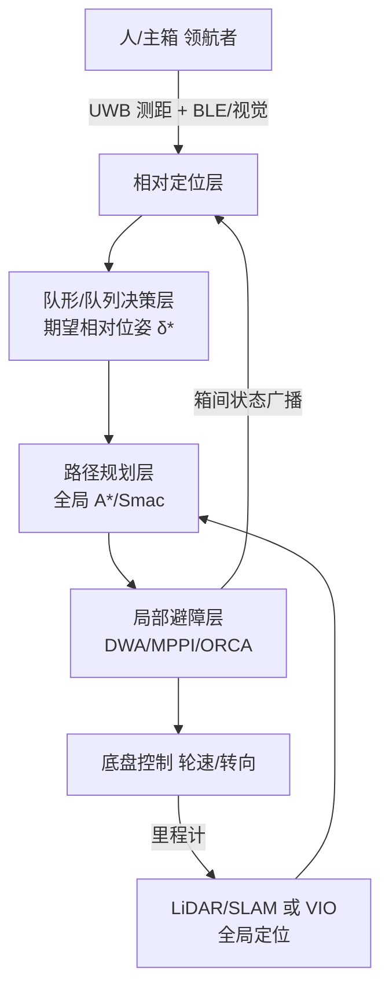
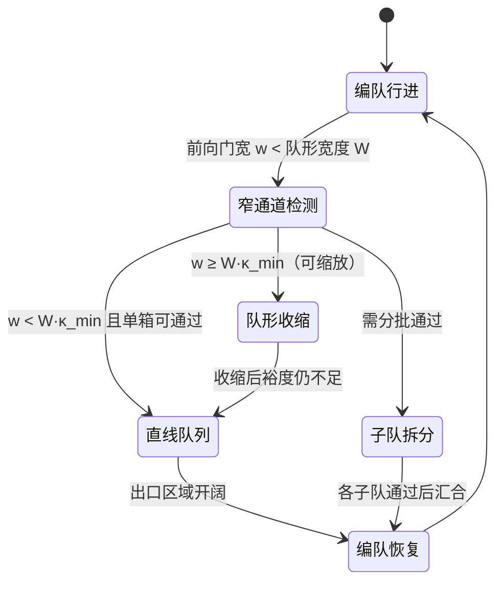

# 多行李箱自动跟随算法技术笔记

> 说明：本笔记为算法方向研究，配套《智能行李箱自动跟随-产品与专利调研》（产品/专利方向）。
> 引用编号 `[n]` 对应文末「引用来源」，编号由检索记录登记，未登记者不引用。

## 0. 结论先行

1. **工程上最稳的骨架是"分层混合"，不是单一算法**：上层用**领航-跟随 + 图/一致性**做队形与队列（简单、可解释、可扩展），下层用**采样/优化型局部规划（DWA / MPPI / MPC）+ 互避规则（ORCA 类）**做避障与箱间防撞，最底层用**相对定位（UWB 为主）+ 全局定位（LiDAR SLAM 或 VIO）**闭环。[3][4][1][30][37][38]
2. **多箱的难点不在"跟得上"，而在"队形可变 + 箱间不撞 + 丢定位不散"**。文献给出的有效手段是**队形缩放 / 直线（tailgating）切换 / 子队拆分**，而不是保持刚性队形硬穿窄通道。[40][41][42][43]
3. **定位必须承认 NLOS 是主误差源**：UWB 在遮挡下产生正偏差，严重时误差可超过 1 m；纯 UWB 单箱测距在理想 LOS 下也只有约 10 cm 级。[19][21][17]
4. **通信不可靠要当成常态设计**：要么做无通信的互避与感知（ORCA、无通信 DRL），要么在做执行期状态估计（时延补偿/信念滤波）。[37][48][46]
5. **仿真推荐 ROS 2 + Nav2 + Gazebo（多机）**；需要逼真视觉数据训模型时再上 AirSim，二者定位不同不是替代关系。[49][51][52][54]

## 1. 研究范围与方法

**范围**：多行李箱（2 箱及以上）自动跟随场景中的 5 个算法子问题——编队/队列控制、相对与全局定位、避障与绕障、多体协同（防撞/保持/通信）、软件与仿真平台。

**方法**：以学术综述、原始论文与官方技术文档为主，先取摘要级事实（算法定义、适用条件、作者报告的指标），再交叉比对同类方法。**厂商博客仅用于"取舍框架"，不作为性能数据来源**（已单独标注）。

**已知局限（请一并读）**：
- 各论文指标来自不同平台、不同场地、不同评测口径，**表内数字不可直接横向比较**，只能作为量级参考。
- 行李箱场景（非结构化、强人流、玻璃/瓷砖地面、非完整约束、载重变化）在文献中几乎没有专门研究，多数结论需从 AGV/无人机/服务机器人迁移，**迁移有效性属于推断**。
- 商用产品的真实精度基本不公开，本笔记不对任何品牌做性能判断（属产品调研卡范围）。

## 2. 需求分解与参考架构

分层理由：定位误差与规划时标差了两个数量级（定位 10–50 Hz，规划 1–10 Hz，控制 50–200 Hz），混在一层会导致参数互相拖累；文献中的"虚拟结构""一致性""MPPI"等方法本质都是在这套分层里各自占据一层。[3][4][38][49]

## 3. 编队与队列控制

### 3.1 领航-跟随（Leader-Follower）

- **原理**：指定一个领航者（人、或人携带的主箱）按外部指令/轨迹运动，跟随者维持相对领航者的期望距离与角度（`l-ψ` 或 `l-l` 控制）。[4][5]
- **适用**：1 人 + 1–3 箱的消费级场景；领航者是人，路径规划只需对人负责。
- **优点**：实现最简单、行为最可预测、跟随者只需局部信息；可做分布式观测器，让只有部分箱知道领航者状态。[5][9]
- **缺点（关键）**：**领航者失效则整组失效**；领航者拿不到跟随者状态做反馈，急转弯可能永久破坏队形；通信带宽随分布变宽而吃紧。[3][5]

### 3.2 虚拟结构（Virtual Structure）

- **原理**：把整个编队视作一个刚体，先在虚拟结构坐标系里生成每个箱的参考轨迹，再由各自跟踪控制器执行。[3][6]
- **适用**：队形固定、需要高精度保持（如并排通过闸机、整齐进电梯）。
- **优点**：控制律可对每个机器人复用、控制器设计简单、队形精度高；可与势场结合做避障修正。[3][6]
- **缺点**：**对时变队形不友好**；遭遇非完整约束或被障碍打断路径时可能无法成形；刚性强，窄通道易卡死。[3][9]

### 3.3 行为法（Behavior-based）

- **原理**：为每个箱预置若干行为（避障、保持队形、到目标），控制量是各行为按权重合成的结果，去中心化。[5][8]
- **适用**：环境简单、箱数多、想避免全局通信。
- **优点**：无中心节点、通信少、天然支持避障与队形的混合。[5]
- **缺点**：**群体行为难以显式定义、难以数学分析，收敛性无法保证**；权重调参靠经验。[8][9]

### 3.4 图论 / 一致性（Consensus）

- **原理**：把箱看作图节点，边代表可通信/可观测；设计更新律让"信息状态"（队形中心、速度、期望偏置）在邻居间收敛到一致值。[1][2]
- **适用**：箱数 ≥3、拓扑会变（有人挡在中间导致链路断开）、需要"队形整体移动"而非"跟着某一点"。
- **优点**：**在时变拓扑与噪声链路上仍能达成一致**；Ren 等指出领航-跟随、虚拟结构、行为法许多情形可视为一致性的特例，因此一致性是更一般的框架。[1][4]
- **缺点**：依赖通信质量与图连通性；设计（拉普拉斯矩阵、收敛速度）门槛高；纯一致性不解决避障。
- **实战变体**：用**复拉普拉斯**做相似队形 + **队形尺度可变**，可显著提高窄长廊通过性——这正是行李箱排队进机舱/过闸机需要的性质。[7]

### 3.5 编队方法对比

| 方法 | 需要的通信 | 队形精度 | 队形可变性 | 单点失效风险 | 实现难度 | 适合行李箱场景的定位 |
|---|---|---|---|---|---|---|
| 领航-跟随 | 低（可仅测距测向） | 中 | 中（依赖领航者） | **高**（领航者） | 低 | ✅ 首选骨架 [3][5] |
| 虚拟结构 | 中 | **高** | **低** | 中 | 中 | 固定队形/进电梯 [3][6] |
| 行为法 | 很低 | 低 | 高 | 低 | 低（调参难） | 兜底层（避障行为）[8][9] |
| 图论/一致性 | **高** | 中高 | 高 | 低 | 高 | 3 箱以上、拓扑会变 [1][7] |

### 3.6 单箱跟随（作为多箱的基元）

多箱本质是"单箱跟随"的并联，因此单箱层必须先稳：人跟随文献把能力拆为**检测→跟踪→重识别→轨迹预测→规划→控制**六个环节，并指出 PID/DWA 因简单仍被大量采用，但在人群中缺乏社会性/适应性。[11][12] 人跟随的分类学综述进一步把"跟随策略"与"人机交互"分开，说明**跟随质量很大程度取决于目标重识别与遮挡恢复**，不是控制律本身。[10]

## 4. 定位：相对定位与全局定位

行李箱场景的核心矛盾是：**相对定位（箱与人、箱与箱）决定队形精度，全局定位（在楼内/机场内的绝对位置）决定是否能做全局规划与找回**。二者传感器与误差特性完全不同，必须分开设计。

### 4.1 UWB（超宽带）

- **原理**：TOF/TWR 或 TDOA 测距，厘米级理想精度；多节点可解算相对位置；部分方案用 AoA 提供方位，但 AoA 对时钟同步要求严格。[14][18]
- **可复现实测**：
  - 4 节点 UWB 网络（DWM1001，标称约 10 cm 测距误差）用非线性最小二乘做**纯相对定位**，RMSE **3.2 cm**、10 Hz。[17]
  - DW1000 标称 LOS 下 **±10 cm / 最远 200 m**；UWB+视觉融合的飞行机器人相对定位 95% 置信区间约 **±0.19 m（东）/±0.29 m（北）**。[18]
  - 多天线 UWB（MURP，每机多标签、不传里程计）实测**平均绝对位置误差 0.24 m、航向 9.5°**，学到的测距偏差修正再降 19% 位置误差。[15]
  - 立体 UWB 阵列方案报告**100 Hz、厘米级**，并用信号复用提升网络容量。[16]
  - UWB+LiDAR+里程计（同构机器人，8 字节/条消息）在 3 机系统下达到**平均相对平移误差约 0.12 m、旋转误差约 2.2°，数据量仅 0.48 KB/s @20 Hz**。[13]
- **致命弱点**：NLOS。遮挡导致 TOF 首径误判，产生**正偏差**（测距偏大），严重时误差可 **>1 m**；NLOS 是 UWB 室内定位误差的主要来源。[19][21] 缓解路线分两类：①识别 NLOS（残差/统计特征/机器学习/几何）②抑制偏差（加权、滤波、LOS 重建、约束优化）。[19] 用 CIR 特征的工程实现报告 LOS 与 NLOS 测距误差分别降 **25.19% / 69.85%**，定位精度提升 54.46%。[20]
- **对行李箱的含义**：箱体金属框架、人体遮挡、人流密集都会造成 NLOS，**必须做 NLOS 识别 + 多锚冗余 + 与运动模型融合**，不能只用单对测距闭环。

### 4.2 视觉 / 视觉惯性（VO / VIO）

- **原理**：单目/双目 + IMU 紧耦合滑窗优化，输出 6-DoF 位姿；VINS-Mono 是代表性开源实现（IMU 预积分、在线外参标定、回环、4-DoF 位姿图）。[24][25]
- **实测量级**：室内方形回环（72 m）场景下，视觉 SLAM 的 **RPE 可达 0.008–0.030 m 级**，优于 LiDAR 里程计的噪声表现（但 APE 受回环质量影响大）。[26]
- **适用**：箱体正面装相机看人（人脸/人体/外观重识别）+ 侧向看障碍；成本低、信息丰富。
- **缺点**：纹理弱（白墙、玻璃）、强光/逆光、快速旋转、纯旋转运动易丢；标定与算力开销；隐私合规需单独处理（本笔记不展开）。

### 4.3 蓝牙 AoA / AoD

- **原理**：BLE 5.1 引入 AoA/AoD，接收端多天线阵列由相位差算角度；`θ=arccos(ψλ/2πd)`，天线间距需 `< λ/2` 否则出现角度混叠。[22][23]
- **实测量级**：商用 BLE 5.1 设备的**室内平均角度误差 1.83°、室外 0.48°**；**室外定位误差 22 cm**，室内比室外差约 39.7%（即室内约 36 cm 量级）。[22]
- **关键限制**：角度检测只在**受限扇区**内有效；即便两天线也能到亚米级，但**做到厘米级很难**；还存在协议层篡改风险（标准未覆盖）。[23]
- **对行李箱的含义**：BLE 适合作**低功耗"在不在附近"与粗方位**（找箱、唤醒、分区），**不适合做队形级精度**；可作为 UWB 的成本/功耗补充。

### 4.4 惯导（IMU / 里程计 / PDR）

- 用途不是绝对定位，而是**短时高频补间 + 丢信号时的桥接**：所有主流方案（UWB+LiDAR+里程计、VIO、LiDAR-惯性）都把 IMU/里程计当作预积分或运动约束项。[13][25][26]
- 风险：轮式里程计在瓷砖/地毯打滑，行李箱非完整约束 + 载重变化 → 尺度与航向漂移，**必须靠外部观测（UWB/LiDAR/视觉）定期校正**。

### 4.5 激光雷达 SLAM

- **原理**：2D/3D LiDAR 扫描匹配 + 后端图优化（Cartographer / LOAM 系 / LIO-SAM 紧耦合 IMU）。[26][27]
- **实测量级（室内 72 m 回环）**：LOAM RPE **0.030 m**、LIO-SAM **0.0606 m**、HDL-Graph **0.241 m**；三者 APE 均在 **1.5 m** 量级，ORB-SLAM3 的 APE 最好（1.388 m，靠回环）。[26] 另一组 KITTI/AUTONOMOS 对比中 Cartographer 平均 ATE **2.13 m**、SC-LIO-SAM **1.84 m**。[27]
- **关键弱点（对行李箱尤其致命）**：**过窄开口时三种方法的横向定位精度都会下降**——门洞、略宽通道、长走廊三组实验中均观察到同一现象。[28]
- **含义**：靠 LiDAR 做"箱与箱在门洞处不擦碰"的横向精度**不可靠**，必须补相对测距（UWB）或结构化的门宽检测。

### 4.6 多箱协同定位

三条可行路线：
1. **UWB 图 + LiDAR 图做子图匹配**：同构机器人外观相同无法靠特征区分，用 UWB 连接图与 LiDAR 连接图做共同子图匹配，LOS 机器人相对精度 **<0.3 m**，NLOS 约 **0.5 m**。[14]
2. **仅用 UWB 网络做分布式相对位姿**（只交换 8 字节里程计），实现 0.12 m/2.2°。[13]
3. **多标签 UWB 阵列单机自解算**，不依赖通信扩展，适合大规模。[15][16]

### 4.7 定位方案对比

| 方案 | 典型精度（文献量级） | 覆盖范围 | 遮挡/人流鲁棒性 | 成本 | 功耗 | 主要失效模式 | 适合角色 |
|---|---|---|---|---|---|---|---|
| UWB 测距/相对定位 | 3–12 cm（LOS）；0.3–0.5 m（融合/NLOS）[17][13][14] | 10–50 m 视距，可组网 | **中**（NLOS 正偏差）[19] | 中 | 中 | 遮挡、金属反射、多径 | **箱-人、箱-箱相对定位主力** |
| UWB + LiDAR 融合 | 0.12 m / 2.2°[13] | 同 UWB | 较高 | 高 | 高 | LiDAR 盲区、算力 | 高可靠多箱 |
| 视觉 VIO（VINS 类） | 室内 RPE 0.008–0.03 m[26] | 无界（相对） | 低（纹理/光照） | 低 | 中 | 白墙、逆光、快速旋转 | 全局里程计 + 目标重识别 |
| BLE 5.1 AoA | 室外 22 cm；室内约 0.36 m（按室外上浮 39.7% 推算）[22] | 10–30 m | 低（多径）[22][23] | **低** | **低** | 角度扇区限制、混叠 | 粗方位、找回、分区 |
| LiDAR SLAM | APE 1.5–2.1 m 级[26][27] | 建图区域 | 中 | 高 | 高 | **门洞横向精度下降**[28] | 全局定位/建图 |
| IMU/里程计 | 短时高精度，长时漂移 | — | 高 | 极低 | 极低 | 打滑、零偏 | 补间、桥接 |

## 5. 避障与绕障

### 5.1 全局规划：A* 及其工程变体

- **原理**：`f(n)=g(n)+h(n)`，`h` 可采纳（不高估）时算法可采纳且最优，且在同等启发信息下扩展节点数最少。[29]
- **适用**：已知地图（机场/酒店平面图）内的长距离绕障。
- **优点**：完备 + 最优（给定启发式）、实现成熟、代价可解释。
- **缺点**：栅格化后路径贴障、非完整约束下不可执行；对动态障碍无响应 → 需与局部层配合。
- **工程形态**：Nav2 里对应 `NavFn`（A*/Dijkstra 扩展，假设 2D 全向质点）与 `SmacPlannerHybrid`（SE(2) Hybrid-A*，带 Dubin/Reeds-Shepp 运动模型，运动学可行）。[50]

### 5.2 局部反应式：DWA

- **原理**：直接在速度空间搜索；三重裁剪——圆弧轨迹（由 `(v,ω)` 唯一确定）→ 可行速度（能在撞障前停住）→ 动态窗口（当前加速度可达的速度集）；在窗口内最大化目标函数 `G = α·heading + β·dist + γ·vel`。[30]
- **实测**：控制周期 0.25 s，在人群中以 **95 cm/s** 安全运行，过门时自动减速到约 20 cm/s。[30]
- **优点**：显式处理动力学与加速度限制，特别适合高速/载重变化平台；计算轻。
- **缺点**：纯局部，会被"陷阱"（U 形障碍、长墙）困住；目标函数权重需按平台调；对快速横穿的移动障碍反应依赖感知刷新率。

### 5.3 采样规划：RRT / RRT*

- **原理**：随机采样生长搜索树；RRT 概率完备但**几乎必然不最优**（收敛到最优解的概率为 0），RRT*/PRM* 在相同复杂度量级下**渐近最优**。[31]
- **适用**：高维/复杂几何、需要"可行解优先、再优化"的场合；狭窄通道 + 非完整约束。
- **优点**：概率完备、对高维有效、可 anytime 优化。
- **缺点**：解的随机性导致行为不可复现（对用户体验不利）；实时重规划算力开销大；狭窄通道采样效率低。
- **对行李箱**：更适合**离线/低频**生成"过闸机、绕柱子"的候选路径，而不是 10 Hz 局部控制。

### 5.4 势场类：VFH / VFH+ / VFH* / VFH+D 与 APF

- **VFH 系列原理**：栅格→极坐标直方图（polar obstacle density）→ 选"候选谷"（低密度扇区）→ 转成转向指令。VFH+ 的关键改进：**按机器人宽度膨胀障碍**（省掉低通滤波调参）、**用圆弧近似轨迹**（考虑转弯半径）、阈值迟滞、代价函数。[32] VFH* 再用 **A\* 做多步前瞻验证**，解决纯局部算法的"陷阱"问题——说明 VFH+ 是 VFH* 在 `n_g=1` 时的特例。[33]
- **实测**：VFH+ 在 GuideCane 上以 **1 m/s** 无可见振荡安全行进（上限受声呐采样率限制，不是算法限制）。[32]
- **关键缺陷**：**VFH+ 不能处理移动障碍，会被困住**；VFH+D 通过给 active window 加衰减解决，并在 ROS 全向机器人上验证了速度与成功率提升。[34]
- **APF（人工势场）**：引力 + 斥力，极简、算力极低；但**振荡、参数敏感、窄通道差、局部极小**是公认缺陷。[35] 另外经典 APF 把机器人当质点，忽略非完整约束，并存在"目标附近有障碍时不可达"（GNRON）问题。[36]
- **含义**：APF/VFH 家族可以作为**低算力兜底避障**（MCU 级），但**不能作为窄通道通行策略**——而窄通道恰恰是行李箱场景的高频场景。

### 5.5 优化/预测类：MPC 与 MPPI

- **MPC**：滚动时域优化，可显式写入速度/加速度/间距约束，天然适合"箱间最小间距"约束。
- **MPPI（Model Predictive Path Integral）**：采样型 MPC，把轨迹优化表述为概率匹配，用 GPU 并行评估上千条轨迹并按代价加权平均；能吃非二次、不可微代价（例如"离人太近"的软惩罚），在激进驾驶与多车场景验证过。[38] 后续衍生 Tube-MPPI / Robust-MPPI 等以提升鲁棒性。[39]
- **适用**：人群密集、需要同时满足"跟紧人"和"不撞人/不撞箱"的多目标。
- **缺点**：算力/GPU 需求；权重与噪声协方差调参；对模型误差敏感（可用 learned dynamics 缓解，但需数据）。

### 5.6 学习类：深度强化学习（DRL）

- **进展**：无通信的分散式策略已经能做到只靠机载感知完成密集避障，例如 PanoDP 用 360° 全景深度 + 可微物理训练信号，**同一策略从 1 个智能体泛化到 512+ 个**，无需重训也无需通信。[48]
- **优点**：能学到难以建模的社会性行为（让人、礼让、跟随间距的"舒适感"）；推理时算力固定。
- **缺点**：奖励设计敏感、跨场景泛化不稳、可解释性差、**安全保证弱**（通常需 ORCA/CBF 类安全层兜底）。[48]
- **结论**：适合作为**行为层/社会性层**，不适合作为唯一的安全保障。

### 5.7 互避：ORCA / 速度障碍

- **原理**：每个 agent 承担一半避让责任，把"无碰撞"转成速度空间的一组线性约束，用低维线性规划求最优速度；**不需要通信**，只靠相互观测。[37]
- **实测**：可在**几毫秒**内为上万个 agent 计算无碰撞速度，且证明运动平滑。[37]
- **优点**：去中心、无通信、可扩展、实时性好——非常适合"多个行李箱 + 行人"混行。
- **缺点**：密集场景下可能过于保守或脆弱（感知不完美时）；对非完整底盘需专门扩展；不处理静态障碍的全局最优。

### 5.8 避障算法对比

| 算法 | 类型 | 动态障碍 | 全局最优性 | 计算量 | 非完整约束 | 窄通道表现 | 行李箱场景定位 |
|---|---|---|---|---|---|---|---|
| A* / Hybrid-A* | 全局搜索 | 否 | **是**（可采纳 h）[29] | 中 | Hybrid-A* 支持 [50] | 好（可留裕度） | 全局路径层 ✅ |
| DWA / DWB | 局部反应 | 弱 | 否 | **低** | 显式建模 [30] | 中（易被陷阱困） | 局部执行层 ✅ |
| RRT / RRT* | 采样 | 否 | RRT 否 / RRT* 渐近 [31] | 高 | 支持 | 中（采样效率低） | 低频候选路径 |
| VFH+ / VFH* | 反应+前瞻 | VFH+ 差 [34] | 否 | 低 | 圆弧近似 [32] | 中 | 低算力兜底 |
| APF | 反应 | 弱 | 否 | **极低** | 忽略（质点假设）[36] | **差（局部极小）**[35] | 不建议单独用 |
| MPC / MPPI | 优化预测 | **强** | 局部最优（滚动） | **高**（GPU）[38] | 可写入约束 | **好（可写间距约束）** | 高价值场景 ✅ |
| DRL | 学习 | 强（训练分布内） | 无保证 | 推理低 | 可学 | 依赖训练 | 社会性/人群层 |
| ORCA | 互避（无通信） | **强** | — | **极低**[37] | 需扩展 | 好（拥挤时） | 箱间防撞层 ✅ |

## 6. 多箱协同：防撞、队列保持、通信延迟、狭窄通道

### 6.1 箱间防撞的三道防线（工程建议，分层冗余）

1. **几何层**：队形约束 + 最小间距（在 MPC/MPPI 代价或 DWA 的 `dist` 项中体现）。[30][38]
2. **互避层**：ORCA 类速度空间约束，保证"两箱同时朝对方走"时各退让一半。[37]
3. **物理层**：超声/红外/防撞条的硬急停（不依赖任何网络）——文献不覆盖，但这是消费品安全底线。[未验证：属工程实践]

### 6.2 队列保持与"排队通过"

- 一致性框架可让队形"整体平移"而不需要每箱都知道全局目标。[1]
- 复拉普拉斯 + **队形尺度可变**可直接提升细长走廊通过性。[7]
- 队列化（tailgating）的具体做法：检测窄空间 → 队形按尺度 κ 收缩（`δ(k)=κδ*`），收不下去就切入**直线队形**，通过后恢复原队形；行为由 APF 实现，稳定性用 Lyapunov 证明。[41] 无人机群的类似方案用**点集配准**在通过后"最优地"恢复原队形，且过程中不减速。[44]

### 6.3 狭窄通道 / 门洞：文献里真正有效的手段

| 手段 | 代表工作 | 机制 | 代价 |
|---|---|---|---|
| 队形缩放 + 直线队形 | 事件触发重构 [41] | 检测窄空间→收缩→tailgating→恢复 | 队形精度临时下降 |
| **自适应选形（最大可通行宽度）** | DEFORM [40] | 先算无障碍最大可通行宽度，递归优化选当前最优队形，临时 leader + 一致性 MPC 控制器 + 势场避撞；Gazebo 与实机验证 | 需要可靠的门宽/障碍分布估计 |
| 三角→线性切换 + MPC 跟随 | 自适应队形切换 [43] | 滑窗检测路径宽度 → 状态机切换 | 切换瞬态需 MPC 平滑 |
| **子队拆分（subteaming）** | STAF [42] | 图割把整队拆成可分别通过的子队，图神经网络协调，通过后合并；队形用弹簧-阻尼模型自适应 | 需要学习框架与训练 |
| 队形整体缩放 | 复拉普拉斯 [7] | 相似变换缩放队形 | 只能缩放，不能改形 |

**结论**：窄通道不要"硬保持队形"。**门宽检测 → 队形收缩 → 不行就拆队/直线化 → 通过后恢复**，是文献共同收敛到的策略。[40][41][42][43]

### 6.4 通信延迟与丢包

- **问题本质**：延迟让"去中心化马尔可夫假设"失效，策略收到的是历史状态，产生虚假非平稳性。[46]
- **三类解法**：
  1. **训练期建模**：把延迟写进博弈模型（Delay-Aware Markov Game），CTDE 训练、执行去中心，允许各 agent 不同延迟步数。[45]
  2. **执行期状态估计（推荐）**：在策略前插一个信念滤波层（GRU 转移模型 + 递归 Kalman），把过期消息换成当前状态估计；**无需重训原策略**，可插拔。[46]
  3. **联邦式分散学习**：联邦 RL + POMDP，异步聚合 + 陈旧度校正，报告在 **50% 链路丢包**下奖励退化仅 11%（对比方法 22.4%/30.0%）。[47]
- **兜底**：**完全不做箱间通信**的方案也成立——ORCA 靠互相观测，[37] 无通信 DRL 靠全景深度。[48] 对消费级产品，这条路线在成本与可靠性上往往更划算。
- **量化通信预算参考**：只用 UWB 传 8 字节/条的里程计即可支撑 0.12 m 级相对定位，3 机系统总计 **0.48 KB/s @20 Hz**。[13] 说明**协同所需带宽极低**，真正的瓶颈是**时延与丢包**，不是带宽。

## 7. 操作系统 / 仿真平台

| 平台 | 定位 | 优势 | 局限 | 建议用途 |
|---|---|---|---|---|
| **ROS 2 + Nav2** | 中间件 + 导航栈 | 行为树编排 planner/controller/recovery，插件化；现成 DWB(DWA)、TEB(MPC-like)、RPP、MPPI、Smac(Hybrid-A*)；被 300+ 公司使用 [49][50] | 学习曲线；默认参数对非完整重载平台需重调 | **主线开发底座** ✅ |
| Gazebo (gz-sim) | 物理仿真 | 与 ROS 2 通过 `ros_gz` 桥接；多机场景搭建简单（PX4 多机文档明确"比其他仿真器容易"）；同一份代码可上实机 [51][52][55] | 视觉逼真度低、CPU 物理为主 | **多箱算法验证主力** ✅ |
| AirSim | 视觉仿真（Unreal） | 逼真渲染、深度/热成像/LiDAR 数据，适合训感知模型；有 ROS wrapper [53] | 动力学为简化近似、多机 spawn 效率一般、集成开销大 [54] | 只做**感知/DRL 数据生成** |
| MATLAB/Simulink | 控制设计 | MPC/一致性控制律快速验证、代码生成 | 多机场景与传感器建模弱 | 控制律原型 |

> 注：Gazebo 与 AirSim 的对比数据（物理引擎、渲染、多机效率）来自厂商技术博客，**仅作为取舍框架**，不是权威评测。[54]

## 8. 综合推荐：三档技术组合

### 档位 A：低成本单箱/双箱（消费级首发）

| 层 | 选型 | 依据 |
|---|---|---|
| 队形 | 领航-跟随（人为主领航者） | 实现最简、可预测 [3][5] |
| 相对定位 | UWB 双/三锚 TWR + 视觉人体跟踪 | 10 cm 级测距 + 目标重识别 [17][18][11] |
| 全局定位 | 视觉 VIO（可选） | 低成本、室内可用 [25][26] |
| 局部避障 | DWA/DWB | 显式处理加速度/载重 [30][50] |
| 全局规划 | NavFn / A* | 成熟 [29][50] |

### 档位 B：主流多箱（2–4 箱，机场/酒店）

| 层 | 选型 | 依据 |
|---|---|---|
| 队形 | 领航-跟随 + 一致性队形层（可缩放） | 兼顾简单与整体平移 [1][7] |
| 相对定位 | UWB 多锚 + NLOS 识别/抑制 + 里程计融合 | NLOS 是主误差源 [19][20][13] |
| 全局定位 | 2D LiDAR SLAM（建图区域）+ 门宽检测 | 需注意门洞横向精度下降 [28][26] |
| 窄通道 | DEFORM 式"最大可通行宽度→选形" + tailgating | [40][41][43] |
| 局部避障 | MPPI 或 DWB（算力允许则 MPPI） | 可写箱间最小间距约束 [38][50] |
| 箱间防撞 | ORCA 类互避 + 硬急停 | 无通信、毫秒级 [37] |
| 通信 | UWB 数据通道（极低带宽即可）+ 执行期时延补偿 | 0.48 KB/s 足够；瓶颈是时延 [13][46] |

### 档位 C：高可靠（公共场景、箱数 ≥4 或强人流）

| 层 | 选型 | 依据 |
|---|---|---|
| 相对定位 | UWB 多标签阵列自解算 或 UWB+LiDAR 融合 | 0.12–0.24 m 级、100 Hz 级 [13][15][16] |
| 队形 | 图/一致性 + 子队拆分（STAF 类） | 通过能力不足时拆队 [42] |
| 安全层 | MPC/MPPI + CBF 式安全约束（或 ORCA 兜底） | 约束可控、可解释 [38][37] |
| 感知 | 360° 深度 + 学习型社会性策略（可选） | 人群中的礼让行为 [48] |
| 通信 | 延迟感知 + 信念滤波；断链降级为无通信互避 | [45][46][37][48] |

### 实施路线（建议顺序，属工程判断 [未验证]）

1. 单箱闭环：UWB 跟随 + DWA + 人体跟踪，把"跟丢/急停/超调"三个指标压下来。
2. 双箱：加 ORCA 互避 + 队形最小间距约束，验证"人穿门、两箱先后过"。
3. 多箱：加一致性队形层与队形缩放，做窄通道测试（门宽 0.8/0.9/1.0 m 三档）。
4. 鲁棒性：注入 UWB NLOS（人为遮挡）、通信延迟（100/300 ms）与丢包（10%/30%）做故障注入。
5. 才考虑 MPPI/DRL 升级与 LiDAR 全局定位（成本与算力换性能）。

## 9. 风险、反对意见与未解决问题

**必须承认的反对意见**
1. **"多箱编队"可能不是用户真实需求**：消费场景里用户常常只想"多一个箱子跟着"，而不是保持几何队形；刚性队形会放大窄通道失败率。[41][40] 建议把"队形"降级为"队列（一列）"作为默认形态。
2. **UWB 在金属箱体 + 人群中的表现可能显著差于论文环境**：文献的 3–12 cm 大多是 LOS 静态或受控动态，NLOS 下 0.5 m 甚至 >1 m。[17][14][21] 若产品宣称"厘米级跟随"，需要有遮挡场景的实测支撑。
3. **学习型方案的可解释性与安全责任**：DRL 无形式化安全保证，公共场景事故责任难以界定。[48]
4. **BLE AoA 的"厘米级"宣传与实测不符**：厂商口径为几厘米，独立实测室内约 0.36 m、且只在受限扇区有效。[22][23]

**未解决问题（无可靠来源，需实测）**
- 行李箱载重变化（10–25 kg）对 DWA/MPPI 参数的影响：文献无对应数据。
- 机场/高铁站人流密度下的社会性间距偏好：人跟随领域有研究框架，但**缺少行李箱形态的具体数据**。[10][11]
- 瓷砖/大理石地面的轮式里程计打滑率：无来源。
- 多箱同时过闸机/旋转门的机械可行性：属结构设计问题，不在算法范围。

## 10. 引用来源

1. Ren, W., Beard, R. W., Atkins, E. M. *Information consensus in multivehicle cooperative control*. IEEE Control Systems Magazine, 2007. https://doi.org/10.1109/mcs.2007.338264
2. Ren, W., Beard, R. W., McLain, T. W. *Coordination Variables and Consensus Building in Multiple Vehicle Systems*. https://intra.ece.ucr.edu/~ren/papers/preprints/bookchapters/RenBeardMcLain03.pdf
3. *Consensus based attractive vector approach for formation control of nonholonomic mobile robots*. IEEE AIM 2015. https://doi.org/10.1109/aim.2015.7222666
4. *Advancement Challenges in UAV Swarm Formation Control: A Comprehensive Review*. Drones 8(7):320. https://mdpi.com/2504-446x/8/7/320
5. *A Survey of Multi-mobile Robot Formation Control*. IJCA 181(48). https://ijcaonline.org/archives/volume181/number48/issa-2019-ijca-918651.pdf
6. *A Novel Virtual-Structure Formation Control Design for Mobile Robots with Obstacle Avoidance*. Applied Sciences 10(17):5807. https://doi.org/10.3390/app10175807
7. *Distributed Formation Control of Multi-Robot Systems with Path Navigation via Complex Laplacian*. Entropy 25(11):1536. https://doi.org/10.3390/e25111536
8. *Formation Control and Tracking of Mobile Robots using Distributed Estimators and A Biologically Inspired Approach*. https://link.springer.com/article/10.1007/s42835-022-01213-0
9. *Distributed Estimation and Control for Leader-Following Formations of Nonholonomic Mobile Robots*. IEEE. https://ieeexplore.ieee.org/document/8319931
10. *Person-following by autonomous robots: A categorical overview*. IJRR. https://doi.org/10.1177/0278364919881683
11. *Human Following and Guidance by Autonomous Mobile Robots: A Comprehensive Review*. IEEE Access 2025. https://doi.org/10.1109/access.2025.3548134
12. *Recent advances in AI-based mobile robots for human companionship: survey*. Artif Intell Rev. https://link.springer.com/article/10.1007/s10462-026-11603-9
13. *Distributed Relative Localization for Homogeneous Multi-Robot Systems through UWB Ranging and Limited Communications*. arXiv:2610.11308. https://arxiv.org/abs/2610.11308
14. *Distributed Relative Localization Based on Ultra-WideBand and LiDAR for Multi-robot with Limited Communication*. arXiv:2610.11141. https://arxiv.org/abs/2610.11141
15. *MURP: Multi-Agent Ultra-Wideband Relative Pose Estimation with Constrained Communications in 3D Environments*. arXiv:2312.17731. https://arxiv.org/abs/2312.17731
16. *Robust and Scalable Multi-Robot Localization Using Stereo UWB Arrays*. Tsinghua NICS. https://nicsefc.ee.tsinghua.edu.cn/nics_file/pdf/dfb37dd2-8114-4126-b691-8d426a16364c.pdf
17. *Development of a Cooperative Localization System using a UWB Network and BLE Technology*. arXiv:2212.06519. https://arxiv.org/html/2212.06519v1
18. *Relative localization with computer vision and UWB range for flying robot formation control*. IEEE. https://ieeexplore.ieee.org/document/7838839
19. *Survey on NLOS Identification and Error Mitigation for UWB Indoor Positioning*. Electronics 12(7):1678. https://mdpi.com/2079-9292/12/7/1678
20. *Ultra-Wideband Ranging Error Mitigation with Novel Channel Impulse Response Feature Parameters and Two-Step Non-Line-of-Sight Identification*. Sensors 24(5):1703. https://doi.org/10.3390/s24051703
21. *Machine Learning Integration in Ultra-Wideband-Based Indoor Positioning Systems: A Comprehensive Review*. Electronics 15(1):181. https://mdpi.com/2079-9292/15/1/181
22. *An Experimental Study on Direction Finding of Bluetooth 5.1: Indoor vs Outdoor*. arXiv:2103.04121. https://arxiv.org/html/2103.04121v1
23. *Dead on Arrival: An Empirical Study of The Bluetooth 5.1 Positioning System*. https://homepages.inf.ed.ac.uk/ppatras/pub/wintech19.pdf
24. *VINS-Mono: A Robust and Versatile Monocular Visual-Inertial State Estimator*（代码库）. https://github.com/HKUST-Aerial-Robotics/VINS-Mono
25. Qin, T., Li, P., Shen, S. *VINS-Mono*. arXiv:1708.03852. https://arxiv.org/html/1708.03852v1
26. *Evaluation and comparison of eight popular Lidar and Visual SLAM algorithms*. arXiv:2208.02063. https://arxiv.org/html/2208.02063v1
27. *Impact of 3D LiDAR Resolution in Graph-based SLAM Approaches: A Comparative Study*. arXiv:2410.17171. https://arxiv.org/pdf/2410.17171
28. *Lidar Positioning for Indoor Precision Navigation*. CVPRW 2022. https://openaccess.thecvf.com/content/CVPR2022W/PBVS/papers/Holmberg_Lidar_Positioning_for_Indoor_Precision_Navigation_CVPRW_2022_paper.pdf
29. Hart, P. E., Nilsson, N. J., Raphael, B. *A Formal Basis for the Heuristic Determination of Minimum Cost Paths*. IEEE TSSC, 1968. https://doi.org/10.1109/tssc.1968.300136
30. Fox, D., Burgard, W., Thrun, S. *The Dynamic Window Approach to Collision Avoidance*. IEEE RAM 4(1), 1997. https://publications.ri.cmu.edu/storage/publications/pub_files/pub1/fox_dieter_1997_1/fox_dieter_1997_1.pdf
31. Karaman, S., Frazzoli, E. *Sampling-based Algorithms for Optimal Motion Planning*. arXiv:1105.1186. https://arxiv.org/pdf/1105.1186
32. Ulrich, I., Borenstein, J. *VFH+: Reliable Obstacle Avoidance for Fast Mobile Robots*. ICRA 1998. https://www.cs.cmu.edu/~iwan/papers/vfh+.pdf
33. Ulrich, I., Borenstein, J. *VFH\*: Local Obstacle Avoidance with Look-Ahead Verification*. ICRA 2000. https://www.cs.cmu.edu/~iwan/papers/vfhstar.pdf
34. *VFH+D: An Improvement on the VFH+ Algorithm for Dynamic Obstacle Avoidance and Local Planning*. IFAC 2020. https://ifatwww.et.uni-magdeburg.de/ifac2020/media/pdfs/4330.pdf
35. *Artificial potential fields revisited: advances, limitations, and hybrid solutions in modern robotics*. https://doi.org/10.1088/2631-8695/ae73e7
36. *Motion Planning for Autonomous Ground Vehicles Using Artificial Potential Fields: A Review*. arXiv:2310.14339. https://arxiv.org/pdf/2310.14339
37. van den Berg, J., Guy, S. J., Snape, J., Lin, M. C., Manocha, D. *Optimal Reciprocal Collision Avoidance (ORCA)*. https://gamma.cs.unc.edu/ORCA
38. Williams, G., Aldrich, A., Theodorou, E. A. *Model Predictive Path Integral Control: From Theory to Parallel Computation*. JGCD 40(2), 2017. https://arc.aiaa.org/doi/10.2514/1.g001921
39. *Model Predictive Path Integral (MPPI) control*（ACDS Lab 综述页，含 Tube-/Robust-MPPI）. https://sites.gatech.edu/acds/mppi
40. *DEFORM: Adaptive Formation Reconfiguration of Multi-Robot Systems in Confined Environments*. IEEE RA-L 2025. https://doi.org/10.1109/lra.2025.3552998
41. *Event-based Reconfiguration Control for Time-varying Formation of Robot Swarms in Narrow Spaces*. arXiv:2505.16087. https://arxiv.org/abs/2505.16087
42. *Subteaming and Adaptive Formation Control for Coordinated Multi-Robot Navigation (STAF)*. arXiv:2509.16412. https://arxiv.org/html/2509.16412
43. *Adaptive Formation Switching and MPC-Based Follower Control for Multi-Robot Navigation in Narrow Passages*. ICIA 2025. https://doi.org/10.1109/icia64617.2025.11277468
44. *Dynamic Formation Reshaping Based on Point Set Registration in a Swarm of Drones*. arXiv:2010.15506. https://ar5iv.labs.arxiv.org/html/2010.15506
45. Chen, B., Xu, M., Liu, Z., Li, L., Zhao, D. *Delay-Aware Multi-Agent Reinforcement Learning*. arXiv:2005.05441. https://arxiv.org/pdf/2005.05441v2.pdf
46. *Decoupled Delay Compensation: Enhancing Pre-trained MARL Policies via Learned Dynamics Filtering*. arXiv:2605.26286. https://arxiv.org/abs/2605.26286
47. *Dynamic federated multi-agent planning under partial observability and network instability for real-time edge applications*. https://link.springer.com/article/10.1186/s43067-026-00407-0
48. *PanoDP: Learning Collision-Free Navigation with Panoramic Depth and Differentiable Physics*. arXiv:2603.07644. https://arxiv.org/html/2603.07644
49. *Nav2 官方文档总览*. https://docs.nav2.org/rolling
50. *Nav2 Navigation Plugins（planner/controller/costmap 插件清单）*. https://docs.nav2.org/plugins
51. *ROS 2 integration overview — Gazebo*. https://gazebosim.org/docs/latest/ros2_overview/
52. *Multi-Vehicle Simulation with Gazebo — PX4 Guide*. https://docs.px4.io/main/en/sim_gazebo_gz/multi_vehicle_simulation
53. *AirSim ROS wrapper (airsim_ros_pkgs)*. https://github.com/microsoft/AirSim/blob/main/docs/airsim_ros_pkgs.md
54. *Gazebo vs AirSim: Drone Simulation Compared*（厂商技术博客，仅作取舍框架）. https://inferensys.com/differences/robotics-simulation-and-synthetic-environment-platforms/drone-and-uav-simulation-environments/gazebo-vs-airsim-drone-simulation
55. *Simulation — Programming Multiple Robots with ROS 2*. https://osrf.github.io/ros2multirobotbook/simulation.html

## 相关笔记

- [[智能行李箱自动跟随]]（项目 hub）
- [[智能行李箱自动跟随-产品与专利调研]]
- [[Hermes Kanban笔记]]
