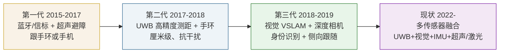
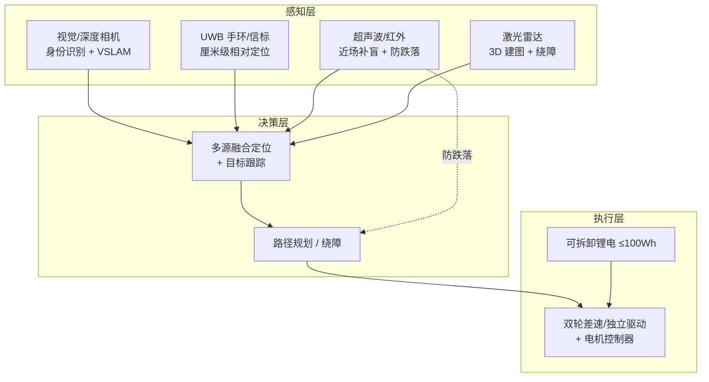
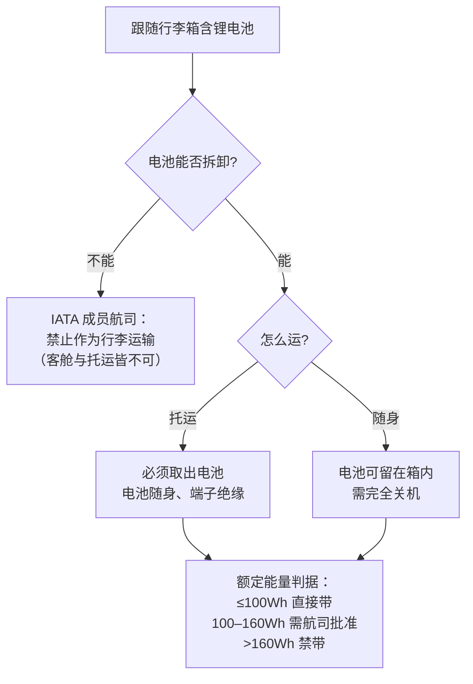

# 智能行李箱自动跟随 — 产品与专利调研

> 调研人：Sage（Researcher）｜完成日期：2026-11-19
> 引用方式：正文用 `[n]` 标注，编号对应文末《来源台账》。每条关键结论都可在台账里找到 URL 与来源类型。

---

## 一、结论先行（TL;DR）

1. **自动跟随行李箱在技术上已经"做得到"，但在商业上是一条失败过的赛道。** 三个曾经的头部玩家基本都撤了：ForwardX 明确表示"行李箱已不是重点"、转向 B2B 仓储 AMR[9]；酷哇（COWAROBOT）转向无人环卫/城市机器人[16]；90 分 Puppy1 已检索不到官方在售页面。仍在售的主要是爱尔威（Airwheel）SR5 一类"UWB 手环跟随 + 可骑行"的小众品类[20][23]。
2. **跟随方案已收敛为"手环 UWB + 视觉/深度相机 + 近场超声/红外"的三层结构**，激光雷达只出现在高端／原型机[14][31]。纯视觉（VSLAM）方案的代表作 Ovis 在众筹交付阶段翻车，是这条路线的关键反面教材[7][8]。
3. **真正的行业门槛不是算法，是航空合规。** 跟随行李箱必须内置电机与电池，而 IATA 自 2018-01-15 起规定：**锂电池不可拆卸的行李箱，禁止作为行李运输**[53][56]。美国 FAA 更严格：智能行李只能随身携带，托运仅允许 ≤0.3g 锂金属或 ≤2.7Wh 锂离子电池[51]。这一条直接决定了产品形态必须是"≤100Wh + 可拆卸电池 + 20 寸" [58][62]。
4. **专利上中国申请量密集但以实用新型／应用改良为主，发明集中在 UWB 定位与视觉测距两个方向**；美国侧只有一件典型的系统级申请（US20180360177A1，已放弃），且底层跟随思路的早期中国发明专利（如 CN106444763B）已因未缴年费失效[37][44]。这意味着**跟随功能的"基础专利墙"比想象中薄，但 2025 年后 UWB 阵列与 YOLO+深度测距的新申请正在变密**[47][48]。
5. **合规红线有三条，且都是硬红线**：① 电池 >100Wh 不能随身带上飞机[58]；② 电动行李箱不属于机动车也不属于非机动车，**公共道路骑行属违法**[62][65][66]；③ 部分机场明令禁止在航站楼内使用个人电动载具（美国四大机场、日本 2024 年起、新加坡樟宜全面禁止）[27][28]。

---

## 二、研究范围与方法

**范围**：具备"自主跟随"能力的行李箱（含以跟随为主要卖点的产品、相关专利、评测报道、供应链方案、航空与道路法规）。**不含**：仅具备 GPS 定位/称重/充电宝功能的普通"智能行李箱"（但作为合规对照出现）。

**方法**：
- 中英文双语检索，覆盖厂商官网、众筹页、科技媒体上手评测、Google Patents/Patsnap 专利页、民航局与航司政策原文、消协比较试验、供应链厂商方案页。
- 来源分四类记账：**产品/厂商页**、**专利**、**评测/报道**、**法规/标准**。
- 对互相矛盾的数据**并列呈现并标注口径差异**，不做平滑处理。

**⚠️ 可信度分级（重要）**：
- 本报告**不采信**两类"行业研究报告"：`chyxx.com`(智研咨询) 与 `renrendoc.com`(人人文库) 的智能行李箱专利/市场分析文档[67][68]。理由见 §7.3——其内部数据自相矛盾（同一年的全球市场规模给出 9.8 / 28.6 / 38.6 亿美元三个不同数字），且出现无法核实的厂商与技术组合。**本报告中的市场规模数字一律不作为结论使用。**
- 搜狐等平台的"实测"长文有明显软文特征（无条件赞美、无缺点、无量化测试条件），仅作"产品存在"的证据，规格数据一律交叉核验[30]。

---

## 三、产品全景：三代技术演进

| 代际 | 代表产品 | 跟随介质 | 关键局限 |
|---|---|---|---|
| 一 | Cowarobot R1（2016） | 专用手环 + 声呐/深度传感 | 只跟手环不跟人，手环丢失即失效[10][11] |
| 二 | 90 分 Puppy1（2018）、Airwheel SR5、常州摩本类方案 | UWB + RF 信标遥控器 | 需佩戴/携带信标；遮挡与多径导致定位漂移[17][20][42] |
| 三 | ForwardX Ovis（2019） | 纯视觉（人脸/人体 + VSLAM） | 拥挤场景建议切手动；众筹交付失败[2][5][7] |

**一个被反复验证的结论**：各家官方 FAQ 都建议"极拥挤场景切手动模式"[5]，这等于承认自动跟随在真实机场高峰环境下的鲁棒性不足。法媒实测 Rover R1 时记录到"跟随模式频繁掉线，需重新激活"[14]。

---

## 四、产品对比表

> 空格表示公开资料中未披露。速度/续航数字若各家报道不一致，已在备注标明口径。

| 产品 | 厂商/年份 | 跟随方式 | 传感器配置 | 最高速度 | 续航 | 电池 | 重量/容量 | 价格 | 现状 |
|---|---|---|---|---|---|---|---|---|---|
| **Ovis** | ForwardX 灵动科技（北京）/ 2019 | 视觉侧向跟随（Side Follow），可自动退到身后绕障 | 前 170° 广角相机 + 手柄后相机、Qualcomm Snapdragon 视觉芯片、ROS、超声波、GPS | 3 m/s ≈10.8 km/h；多家报道 6–7 mph（≈9.7–11.3 km/h），口径不一[1][2][3][4] | 约 20 km（另说 4 小时）[3][1] | 96Wh 可拆卸，兼作充电宝[3] | ≈4.5 kg / 45 L[3] | 众筹 $399 起，零售 $799[1][2] | **退出**：公司称行李箱已非重点[9] |
| **COWAROBOT R1** | 酷哇（上海）/ 2016 | 跟随专用手环（CO-MOVE 系统），侧向保持 | CO-EYE 深度传感 + 声呐组 + 防跌落（cliff）传感 | 4.5 mph ≈7.2 km/h（官方限速）[10][12] | 12.5 英里 ≈20 km[10][12] | 96.5Wh 可拆卸[10] | 10.5 lb ≈4.8 kg / 33 L / 20 寸 | $429 早鸟、$699 零售[16] | 众筹交付，后续型号 Rover |
| **COWAROBOT Rover S** | 酷哇 / 2020 前后 | 人体识别（AI）+ 自动跟随，无需遥控 | 多传感器（中文评测称 15 个，含激光雷达、远红外、摄像头）[13] | 约 7 km/h[14] | 20 km[15] | 6400mAh 可拆卸，可当充电宝[15] | — | 约 €1200（法国实测报道）[14] | 公司主业已转向环卫机器人[16] |
| **90 分 Puppy1** | 润米科技（小米生态链）/ 2018 | UWB 定位 + RF 信标遥控器，5 m 内一键召唤，前后双向 | Segway 定制跟随芯片、UWB 无线电定位、内置定位雷达 | 6 km/h[17][18] | 10 km（±3，4 km/h 匀速）[17][18] | 100Wh 可拆卸[17][18] | 20 寸，约 6 kg（概念版）[19] | ¥4999 官方价 / ¥4299 首发[17] | 未检索到官方在售页面（**推断已停产**，非官方声明） |
| **Airwheel SR5** | 爱尔威（常州）/ 在售 | UWB 高精度定位 + 手环；模式一键切换 | UWB + 超声波避障 + 指纹解锁 | 官方页未披露 | 官方页未披露 | 62.6Wh 可拆卸，符合登机[20] | 20 寸 / 30 L[22] | 京东约 ¥2388[23] | **仍在售**[20][21] |
| **Travelmate** | Travelmate Robotics（旧金山）/ 2016–2017 | 手机 App 为中枢，AI 跟随；可直立或平躺行进 | 多传感器阵列 + 板载处理器；支持语音/手势指令[26] | 6.75 mph ≈10.9 km/h[26]；中文报道记 11 km/h[24] | 4 小时自动 / 100 小时手动[24][26] | — | — | 众筹 | 未见量产报道 |
| **Modobag**（对照：可骑行，非跟随） | 芝加哥 Modobag / 2016 | 无跟随，人骑乘 | 电机 + 油门/刹车 + 伸缩把手 | 8 mph ≈12.9 km/h[27] | 约 13 km[27] | 锂电池（可拆性存疑）[29] | 空重 19 lb ≈8.6 kg[27] | $1500 零售 / $995 众筹[27] | 美国 10 大机场中 4 家明令禁止[27] |

**表外要点**：
- **"跟随距离"是各家一致的调参目标**：US20180360177A1 的权利要求把跟随距离明确写为 **0.5–1.5 m**[44]；Rover 系列实测维持在 1–2 m[14]；ARTVZ 宣称 1.5 m（软文，仅供参考）[30]。
- **报警阈值**：Ovis 手环在 2 m（6.5 ft）外提醒[2]；Rover 为 3 m[14][15]；SR5 为 3 m[22]。
- **一关键细节**：Ovis FAQ 说明"前两轮为万向轮，跟随模式下后两轮变为驱动轮"[5]——即**跟随模式下不具备全向底盘**，这是它绕障时选择"退到身后"而非侧向平移的机械原因。

---

## 五、商业化教训（这一节比参数表更重要）

### 5.1 Ovis：一次教科书级的众筹交付失败

- 2018 年 Indiegogo 募资，Forbes 记为约 140 万美元[6]；CES 2019 发布量产版，定价 $799[2]。
- 交付一路延期：2020-01-15 更新船期（抵洛杉矶 2020-02-02），2020-02-14 通知**每箱需额外支付约 $135 关税**，且要求电汇/PayPal[7]。
- 到货用户反馈"要么完全不能用，要么用几天就失效"[7]；也有用户付了 $228 关税后**什么都没收到，邮件/Facebook/Indiegogo 全部不回复**[8]。
- 站长已向 FTC 投诉，并总结出一种模式：**先小批量发货、再声称剩余无法交付，最后让用户放弃**[7]。

> 教训：硬件众筹的"跟随"演示视频 ≠ 可量产的一致性。**评估任何跟随行李箱厂商时，先查有没有真实第三方上手评测和量产交付记录，而不是看宣传参数。**

### 5.2 三家公司的战略转向

| 公司 | 原始切入 | 现在 | 说明来源 |
|---|---|---|---|
| ForwardX 灵动科技 | Ovis 消费级跟随箱 | 视觉 AMR（仓储/制造），C+ 轮累计超 6.5 亿元 | COO 明言"luggage is not currently a focus"[9] |
| 酷哇 COWAROBOT | Rover 跟随箱 | 无人环卫扫地车、配送车、具身智能 | 2018 年与中联环境发布无人扫地车[15][16] |
| 润米 90 分 | Puppy1 跟随箱 | 指纹锁/金属箱等常规智能箱包 | Puppy1 已不在产品线[17][19] |

**共同点**：跟随行李箱都是这些公司的"现金流/品牌曝光"产品，真正的商业化落点在 B 端。新浪当年的判断很直接：**"它们之所以没有火起来，最大的问题在于一款旅行箱功能众多却不能登机"**[17]。

---

## 六、技术路线对比（与专利分布对照）

| 路线 | 定位精度 | 成本 | 典型失效场景 | 代表产品 | 代表专利 |
|---|---|---|---|---|---|
| UWB + 手环 | 10–15 cm[42] | 低 | 遮挡、多径、多目标混淆；信标忘带 | 90 分 Puppy1、Airwheel SR5 | CN109348426A[42]、CN108013563A[39]、CN120935756A[48] |
| 视觉 VSLAM | 相对定位好，绝对精度依赖标定 | 中 | 逆光、人流遮挡、相似衣着；需算力 | ForwardX Ovis | WO2017219751A1[45]、CN106444763B[37]、CN120411480A[47] |
| 超声波/红外 | 米级，仅测距 | 极低 | 无法识别身份，只能"跟最近的物体" | 早期方案、低成本避障 | CN109188412A[40]、CN209862573U[41] |
| 激光雷达 | 厘米级建图 | 高（模组体积/价格） | 成本、功耗、结构开孔 | 高端原型、Rover 中文评测提及[13] | 多为系统集成，非行李箱专用 |
| 混合融合（当前主流） | 综合最优 | 中高 | 融合算法与算力调度 | 供应链成熟方案 | 设备融合类申请[31][48] |

**供应链侧已形成"跟随整车方案"这个独立品类**：博赛智行（PSICV）直接售卖"跟随从机 + 跟随主机 + 整车控制器 + 电机驱动 + 传感器"套件，明确写"融合 UWB + IMU + 激光雷达 + 深度视觉"[31]；激光雷达侧有北醒（TF 系列单点/线阵，主打防跌落与近场补盲）[32]、思岚（雷达 + SLAMWARE 导航模块 + 超声波/防跌落/碰撞传感融合）[33]、禾赛与广和通联合的多模态方案（JT 系列迷你 3D 雷达）[34]。

> 判断：**做跟随行李箱不需要自研全部传感器**，套件化方案成熟；真正的差异化在"身份确认 + 拥挤场景鲁棒性 + 机械结构/电池合规"。

---

## 七、关键专利与技术路线摘要

### 7.1 专利清单（按技术路线分组）

| # | 公开号 | 名称 | 申请人 | 关键日期 | 技术要点 |
|---|---|---|---|---|---|
| P1 | CN105005307B | 智能跟随行李箱的控制方法 | 武汉元驰智能 | 申请 2015-08-07／授权 2017-11-14 | 用"正前方距离"判运动状态、"左右最短距离"判运动方向、"拉杆倾角"控底轮转速，实现跟随身后[35] |
| P2 | CN104905520B | 一种自动行进的智能行李箱与系统 | —（页面为葡语镜像） | 申请 2015-06-05，法律状态 Active，预计 2035 到期 | 早期基础性"自动行进行李箱+系统"布局[36] |
| P3 | CN106444763B（公开号 A） | 基于视觉传感器智能自动跟随方法、系统及行李箱 | 泉州幻想智能科技 | 申请 2016-10-20／授权 2019-06-11，**已因未缴年费失效** | 视觉传感器取主人相对坐标 → PID 控左右后轮，保持设定距离；用视觉深度信息判障，可叠加超声波[37] |
| P4 | CN207949167U | 智能跟随行李箱（实用新型） | 常州爱尔威 | 申请 2018-03-12／授权 2018-10-12 | 结构方案：两动力轮置于四从动轮之间，增大前后力臂以抗起步/急停倾翻[38] |
| P5 | CN108013563A | 基于 UWB 的自动调速跟随与避障旅行箱及跟随算法 | — | 2017 年前后申请 | UWB 测距 + 速度/加速度传感器，按距离阈值分级加减速[39] |
| P6 | CN109188412A | 自动跟随行李箱定位跟随及防撞 | — | 2018 年前后 | 4 路超声波测距 + 红外避障 + 蓝牙信号唤醒启动；单片机方案，主打低成本[40] |
| P7 | CN209862573U | 可自动跟随行走并自动避障的行李箱（实用新型） | — | 2019 | CPU + 至少一组避障装置（每组≥2 个超声波）+ UWB 天线做空间定位[41] |
| P8 | CN109348426A | 基于 UWB 的跟随系统及方法 | 常州摩本智能科技 | 申请 2019-02-19／公开 2019-05-28 | 双 UWB 模块 + 标签；**每秒 10 次位置更新，位置误差 <15 cm，测距误差 <10 cm**；含全球唯一 ID 校验防误跟；按距离/速度差分级变速[42] |
| P9 | CN109674162B / CN110786609A | 自驱动行李箱及自驱动装置 | — | 分案/同族 | **双跟随模式**：侧面传感模块执行"第一跟随模式"、背面模块执行"第二跟随模式"；触控急停开关；执行轮可绕两轴旋转（可侧向走）；通信含 UWB/RFID/BT/WiFi；含滑环 + 轮位检测[43] |
| P10 | US20180360177A1 | Robotic suitcase | 美国申请（优先权 2017-06-15），**已放弃 Abandoned，PCT 已 Ceased** | 2017 | ATTS 自主目标跟踪系统六级子系统：蓝牙三边定位 + 视觉人脸 + 超声/红外测距 + 避障 + 距离/速度控制 + 声光提示；跟随距离权利要求 **0.5–1.5 m**；支持直立/平躺两种行进姿态[44] |
| P11 | WO2017219751A1（同族 CN105911999A） | 具有自主跟随避障功能的移动行李箱及其使用方法 | 中国申请人（PCT/CN2017/081567） | 公开 2017-12-28 | 四模块架构：移动平台 + 环境感知 + 数据融合定位 + 跟随避障处理；**把"地面凹凸信息"纳入路径规划**[45] |
| P12 | WO2018227987A1 | 自动行走的行李箱、智能设备及系统 | — | 2018 | 越出"跟随"：按起点/终点自主规划路线，**可脱离跟随目标自行到达目的地**，用视觉判路标[46] |
| P13 | CN120411480A | 基于深度学习的目标测距与自动行李箱跟随方法 | 电子科技大学 | 申请 2025-04-25／公开 2025-08-01 | YOLOv8 检测 + 深度相机取深度；**单目测距与深度测距交叉校验，误差小于阈值才采信深度值**；四分位法去离群点 + 中值滤波[47] |
| P14 | CN120935756A／B | 基于 UWB 的行李箱设备跟随方法及系统 | 宁波巴比智能科技 | 授权公告 2026-06-30 | 多 UWB 天线构建不同**三角定位阵列**，用 UAS 评分器周期选最优阵列；阵列加权角度融合 + 双 DIP 控制器算线/角速度；多因子异常判定 + 应急恢复策略[48] |
| P15 | WO2025251844A1 | 智能电动旅行箱及电动转向装置 | — | 优先权 2024-06-08 等 | 电动升降把手（固定杆内置电机 + 丝杠），把手电动展开/折叠[49] |
| P16 | CN202411316690（机场行李车） | 基于 UWB 技术的机场行李车动态跟随与避障系统 | — | — | 把路径规划/避障算力放**云端数据中心**，车载端只做 UWB 通信，降低单台成本[50] |

### 7.2 技术路线判读

1. **"跟随"的专利重心已从"能不能跟"转向"跟得稳"**。P13/P14 两件 2025–2026 年的申请，一个解决"距离测不准"，一个解决"姿态抖动/急停/偏航"，正是真实落地时的痛点[47][48]。
2. **双模式跟随（侧面 + 背面）是被明确布局过的结构方案**，P9 用两个传感模块 + 可绕两轴旋转的执行轮实现"侧向平移"[43]。这对"多箱编队/绕障"的后续技术方案有直接参考价值。
3. **基础专利的空隙**：P3（视觉 + PID 跟随）是本领域最直白的实现路径，但已因未缴年费失效[37]；P10（美国系统级申请）已放弃[44]；P11 的 PCT 也已 Ceased[45]。**跟随功能的核心思路并不存在强垄断**——真正的风险点在 2025 年后的新申请（P13、P14）。
4. **企业侧布局量**：36 氪项目页称灵动科技（ForwardX）已申请专利 200 项、获 11 项美国发明专利授权[69]；另一篇 2019 年报道记为 97 项申请、45 项国际专利[70]。两组数字口径不同且均非官方检索，**只能作为量级参考，不能作为结论**。
5. **机场专用形态另有一条线**：把算力上云、车端只留 UWB 的机场行李车（P16）[50]，比"每台箱子都装算力"更贴近机场运营方的成本逻辑。

### 7.3 关于"专利分析报告"的核查提示

检索中遇到两份声称给出精确专利统计的文档[67][68]，**本报告不予采信**，理由：

| 可疑点 | 具体表现 |
|---|---|
| 内部数据自相矛盾 | 同一份文档对"2024 年全球智能行李箱市场规模"先后给出 9.8 / 28.6 / 38.6 亿美元；另一份给出 48.6 亿、78 亿美元[67][68] |
| 无法核实的技术组合 | 称"Rimowa Travel+ 采用双目视觉""Ovis 识别距离 15 米、跟随成功率 91.7%""小米 90 分响应 ≤0.3 秒、2023 年销量 300 万台"，均无一手来源[67][68] |
| 引用了不存在或错配的标准 | 称 FAA 2023 年发布《PED 适航管理指南》禁止机场控制区启用自主驱动、EASA 发布《智能移动行李设备技术合规框架》、IEC 63258 将于 2026 年发布——**本次检索在 FAA/EASA/IEC 官方渠道均未找到对应文件** |

> 因此本报告对"市场规模""专利总量排名"类结论一律标注为**未核实**。若后续需要真实的专利态势数据，应直接查 CNIPA 专利检索系统或 incoPat/Derwent 付费库，而不是引用二手文档。

---

## 八、合规与安全风险提示

### 8.1 航空运输：最硬的一道门

| 规则 | 内容 | 来源 |
|---|---|---|
| IATA（2018-01-15 生效，至今延续） | 锂电池**不可拆卸**的智能行李，**禁止运输**；可拆卸者，装箱托运时必须取出电池随身携带 | [53][56] |
| FAA PackSafe（页面更新 2026-04-13） | 含锂电池的行李**必须随身**，除非电池已取出；托运仅允许锂金属 ≤0.3 g 或锂离子 ≤2.7 Wh；托运的锂电池设备必须完全关机（非睡眠） | [51] |
| IATA 2026 版旅客指南 | 智能行李被单列为设备类别，随功率（Wh）与"安装/可拆/不可拆"分档管理 | [52] |
| 航司执行 | 国泰（2018-01-01 起）、达美（2018-01-15 起）、夏威夷等同步执行；夏威夷明确把"电池+电机+GPS 使箱体自行推进并跟随主人"列为智能行李特征 | [54][55][57] |
| 中国民航局 | ≤100Wh 可随身；100–160Wh 需航司批准（备用电池限 2 个）；>160Wh 禁止；充电宝严禁托运 | [58][59][60] |
| 东航细化 | 每人便携式电子设备（含锂电池）≤15 台、备用电池 ≤20 块；充电宝不得放入行李架，须置于座椅下方 | [61] |
| 消协口径（深圳，2024-07） | 电动行李箱**属于不能托运物品**；建议选 ≤100Wh 且 ≤20 寸；**电池可拆的话，可把箱体托运、电池随身** | [62][63] |

> **设计含义**：想上飞机，产品必须是"**≤100Wh + 可快拆电池 + 20 寸**"。三位一体，缺一条就出局。这也解释了 90 分 Puppy1 为什么专门强调"100Wh 可拆卸锂电池、安检时可拆开过检"[17]。

### 8.2 使用场景：道路与机场

| 风险 | 事实 | 来源 |
|---|---|---|
| 公共道路骑行违法 | 电动行李箱既非机动车也非非机动车，不能作为代步工具上道路；只能在封闭小区道路、广场、室内场馆使用。依据《道路交通安全法实施条例》（行人不得在道路上使用滑板、旱冰鞋等滑行工具）及第 89 条罚则 | [62][63][66] |
| 机场航站楼内可能被禁 | MarketWatch 实测调查：美国 10 大最忙机场中 4 家（亚特兰大、丹佛、JFK、旧金山）明确表示此类装置违反其"个人运输装置"禁令 | [27] |
| 国别差异 | 日本 2024 年起加强管制可骑行电动行李箱；新加坡樟宜机场**全面禁止** | [28] |
| 地铁等封闭空间 | 部分地铁站允许携带（电池容量合规前提下）但**禁止站内骑行** | [66] |

### 8.3 产品安全与认证

- **认证空白**：深圳消委会明确"电动行李箱**暂未纳入《强制性产品认证目录》**，没有严格的测试和认证标准"[62]。锂电池本体属 CCC 强制认证范围，选购时应确认电池有独立 CCC 标志[62][65]。
- **速度与制动是最大安全隐患**：广东省消委会对市售 **15 款电动旅行箱**做比较试验，最高行驶速度跨度 **2.6–22.9 km/h**，最高速时制动距离 **最短 0.5 m、最长 15.2 m**；仅 4 款（Airwheel、UBNI、DTA、芒果鸟）速度落在 7–10 km/h 兼顾安全，仅 2 款制动距离 <3 m[64]。
- **"功能越多越难合规"**：新疆市场监管局的提示直接把电动骑行箱定性为"滑行工具"，禁止公共道路行驶，并指出该品类尚未纳入强制认证、质量参差不齐[65]。

### 8.4 其他非技术风险

| 风险 | 说明 | 来源 |
|---|---|---|
| 众筹交付 | Ovis 案例：延期 → 追加关税 → 部分用户收货即坏 / 全无音信 | [7][8] |
| 隐私 | 视觉方案需人脸/人体识别。跟随箱在公共空间持续拍摄，涉及他人肖像与个人信息；国内应按《个人信息保护法》做本地处理、最小采集 | [4]（识别能力）+ 合规常识（本项为推断，非直接引用） |
| 防盗反成诱饵 | 手环/信标丢失即失效；箱体在 1–2 m 内跟随，"骑行者逃跑"场景下的追回能力无实证 | [10][11][14] |
| 售后与备件 | 定制驱动轮、定制电池、定制手环，任一停产即整机失效（Ovis 用户已遇到无响应的售后） | [8] |

---

## 九、给产品/技术团队的 7 条可执行建议

1. **产品定义先定场景，再定功能。** 明确写"仅限机场/车站/酒店等封闭场地使用，禁止上道路"，并在说明书与包装上标注——这是消协和交管部门的口径要求[62][65]。
2. **电池按"可拆卸 ≤100Wh"第一性设计。** 把电池做成可单手快拆的独立模块，且拆下后箱体可正常托运；这条决定产品能不能卖到海外[51][53][62]。
3. **传感器选型走"三层"而非"单点极致"：** UWB 手环做相对定位（10–15 cm 级）、视觉做身份确认、超声/红外做近场补盲与防跌落。激光雷达只在需要 3D 绕障的高端型号上，别为它牺牲体积与功耗[31][32][42][45]。
4. **速度上限压到步行速度以下（≤6 km/h），并把制动距离做成硬指标。** 参照消协比较试验，制动距离 >3 m 在 7–10 km/h 下已属不合格区间[64]。
5. **安全机制五件套必须齐**：物理急停开关（P9 的触控急停是现成思路）[43]、离身减速/停车、信标失联即停、防跌落（cliff detect）[10]、倾翻抑制（P4 的轮系布局思路）[38]。
6. **FTO 检索双轨走：** 中国侧重点查 2025 年后 UWB 阵列（P14）与 YOLO+深度测距（P13）[47][48]；美国侧重点查系统级 ATTS 类架构（P10 已放弃，但同族与后续可能是障碍）[44]。早期视觉+PID（P3）已失效，可自由实施[37]。
7. **别把"跟随"当唯一卖点。** 三家头部公司的结局说明：跟随是演示效果最好、复购最差的功能。可考虑"电动助力 + 跟随"双形态（Airwheel/ARTVZ 路线），让产品在跟随关闭时仍有价值[20][30]。

---

## 十、资料缺口（本报告没解决的）

| 缺口 | 说明 |
|---|---|
| Ovis 官方规格书存档 | `ovis.forwardx.com/faq` 本次抓取返回 **HTTP 404**，无法核对官方参数，规格只能靠媒体转述 |
| 第三方实验室实测 | 除广东省消委会对 15 款电动旅行箱的比较试验外[64]，未见针对"跟随功能"本身的标准化测试报告（跟随成功率、掉线率、避障成功率均无公开可复现数据） |
| 真实专利统计 | 未查 CNIPA/incoPat，本报告的专利结论基于**抽样阅读**，不代表全量分布 |
| 跟随箱的销量数据 | 所有公开"市场规模"数字均无法核实（见 §7.3），故本报告不给任何市场数字 |
| Modobag/Modobag 类产品的现行机场政策 | 仅有 2016 年调查与 2024 年日本/樟宜的报道，中国机场对"跟随箱"（非骑行）是否有专门规定，未找到明文 |

---

## 来源台账

> 类型说明：**产品页**=厂商官网/众筹页；**专利**=专利数据库页面；**报道/评测**=媒体或第三方实测；**法规**=政府/行业组织原文。
> 日期标"未标注"表示页面本身未给出发布日期。

| # | 来源 | 类型 | 发布时间 | URL | 取用的关键结论 |
|---|---|---|---|---|---|
| 1 | VentureBeat《ForwardX raises $10 million…》 | 报道 | 2018（未标日） | https://venturebeat.com/ai/forwardx-raises-10-million-for-ai-powered-luggage-that-follows-you | 融资 1000 万美元；$399 起；最高 6.2 mph；4 小时续航；自动退到身后绕障 |
| 2 | GlobeNewswire《ForwardX…CES 2019》 | 产品页（新闻稿） | 2019-01-06 | https://globenewswire.com/news-release/2019/01/06/1680900/0/en/ForwardX-Robotics-Introduces-Production-Ready-Next-Gen-Autonomous-Suitcase-at-CES-2019.html | 侧向跟随；VSLAM+神经网络+多传感器融合；零售 $799；手环 6.5 ft 报警 |
| 3 | New Atlas《Motorized AI-packin' suitcase…》 | 报道 | 2018 | https://newatlas.com/ovis-suitcase/55063 | 双无刷电机、多相机、骁龙芯片；10 km/h；96Wh 可拆；20 km；45 L；4.5 kg |
| 4 | Digital Trends《The ForwardX Ovis…》 | 报道 | 2018 | https://digitaltrends.com/cool-tech/forwardx-cx-1-self-following-smart-suitcase | 170° 广角 + 人脸识别；最高 7 mph |
| 5 | Indiegogo《Ovis》项目页 | 产品页（众筹） | 2018 | https://indiegogo.com/en/projects/forwardxrobotics/ovis-1st-ai-powered-suitcase-following-by-side | 3 m/s；±1 cm 避障精度；V-SLAM；拥挤场景建议切手动；万向轮配置说明 |
| 6 | Forbes《I Tried The $800 Robot Suitcase》 | 报道/上手 | 2019-01-07 | https://forbes.com/sites/johnkoetsier/2019/01/07/i-tried-the-800-robot-suitcase-so-you-wont-have-to | 众筹约 140 万美元；用户画像为常旅客 |
| 7 | Brian M. Fischer《The $778,531 Luggage Scam》 | 报道（个人博客） | 2020-02（文中日期） | https://brianmfischer.com/naucrates-indiegogo-luggage-scam | 交付延期、每箱约 $135 关税、到货即故障、"先发一部分再放弃"模式 |
| 8 | PissedConsumer《Ovis By Forwardx》 | 用户投诉 | 未标注 | https://pissedconsumer.com/ovis-by-forwardx/RT-F.html | 付 $228 关税后未收货，多渠道无回应 |
| 9 | FreightWaves《ForwardX Robotics captures $15M in Series B》 | 报道 | 2020 | https://freightwaves.com/news/forwardx-robotics-captures-15m-in-series-b | COO：行李箱已非公司重点，转向 B2B AMR |
| 10 | Indiegogo《R1: The First and Only Robotic Suitcase》 | 产品页（众筹） | 2016-07 | https://www.indiegogo.com/en/projects/cowarobot/r1-the-first-and-only-robotic-suitcase | CO-EYE 深度传感 + 声呐 + 防跌落；4.5 mph；20 km 级；96.5Wh 可拆；15° 爬坡；机器人部件仅占 4% 体积 |
| 11 | The Verge《I thought I knew the future of luggage…》 | 报道/上手 | 2016-07-26 | https://www.theverge.com/circuitbreaker/2016/7/26/12287024/cowarobot-r1-autonomous-suitcase-future-of-luggage | CO-MOVE 系统；声呐 + CO-EYE 深度传感 + 防跌落；跟的是手环 |
| 12 | Android Authority《Crowdfunding project of the week: COWAROBOT R1》 | 报道 | 2016 | https://www.androidauthority.com/crowdfunding-project-week-cowarobot-r1-suitcase-follows-708387/ | 4.5 mph；12.5 英里；CO-EYE 含声呐与防跌落 |
| 13 | 极果《Cowarobot R1 拉杆箱》 | 报道/评测 | 未标注 | https://www.jiguo.com/article/article/57028.html | 中文实测：约 15 个传感器（激光雷达、远红外、视觉 AI、摄像头）；约 90% 跟随成功率；30° 斜坡爬不上 |
| 14 | franceinfo《On a testé la première valise robot…》 | 报道/实测 | 未标注 | https://www.franceinfo.fr/replay-radio/nouveau-monde/nouveau-monde-on-a-teste-la-premiere-valise-robot-qui-vous-suit-partout_2913345.html | 7 km/h；20 km；跟随模式频繁掉线需重置；3 m 外强震动提醒；售价约 1200 欧；必须随身不得托运 |
| 15 | 界面新闻《自己"奔跑"的行李箱，酷哇…》 | 报道 | 2020-05-29（图片路径） | https://jiemian.com/article/4448392.html | Rover S：人体识别、超 3 m 震动提醒、6400mAh 可拆续航 20 km |
| 16 | TechNode《Meet The Robotic Suitcase That Follows You Around》 | 报道 | 2016-07-28 | https://technode.com/2016/07/28/robotic-suitcase-follows-just-like-dog | $429 早鸟 / $699 零售；研发制造在上海；15° 坡度 |
| 17 | 新浪数码《90 分发布智能跟随旅行箱 Puppy1》 | 报道 | 2018-11-02 | https://tech.sina.cn/mobile/xp/2018-11-02/detail-ihnfikve8775805.d.html | UWB 军用无线电定位 + Segway 定制芯片；5 m 内跟随；6 km/h；10 km（±3）；100Wh 可拆；¥4999/¥4299；"火不起来因不能登机" |
| 18 | 果壳《90 分智能跟随旅行箱 Puppy1 双 11 正式发售》 | 报道 | 2018-11 | https://m.guokr.com/article/458083/ | 前后双向跟随；重心自适应；20 寸；指纹 + TSA；≤100Wh 可拆电池 |
| 19 | ZingGadget《CES 2018 小米生态链 90FUN Puppy 1》 | 报道 | 2018-01 | https://zinggadget.com/90fun-showcase-puppy-1-self-following-suitcase-in-ces-2018/ | CES 2018 概念版；Segway 跟随芯片；可拆卸电池应对限飞禁令 |
| 20 | Airwheel 官网 SR5 产品页 | 产品页 | 未标注 | http://airwheel.cn/product/sr5 | 超声波探头检障碍方向与距离，动态规划路径；20 寸登机箱；62.6Wh 可拆电池；TSA 锁 |
| 21 | Airwheel 官网 SR5 功能页 | 产品页 | 未标注 | http://airwheel.cn/function/sr5 | UWB 高精度定位 + 手环自动跟随；双轮驱动 30W、500 rpm；一键伸缩电机轮 |
| 22 | Airwheel 台湾 SR5 页 | 产品页 | 未标注 | https://www.airwheeltaiwan.com/page17.html | 超出 3 m 手环与 App 震动提醒；指纹解锁存 5 组；超声波避障；30 L |
| 23 | 什么值得买 SR5 报价 | 电商页 | 未标注 | https://smzdm.com/p/28279778 | 京东售价约 ¥2388（时效性报价，仅供参考） |
| 24 | 中国广播网（CNR）《这款行李箱不仅可以智能跟随 还能躲避障碍》 | 报道 | 2017-09-20 | http://m.cnr.cn/tech/20170920/t20170920_523956951.html | Travelmate：11 km/h；4 小时跟随 / 100 小时普通模式；App 操控发声寻箱 |
| 25 | CNBC《This robot suitcase follows you around on your travels》 | 报道 | 2017-04-24 | https://cnbc.com/2017/04/24/travelmate-an-autonomous-suitcase.html | Travelmate 4 小时续航；TSA 合规；GPS |
| 26 | Condé Nast Traveler《Travelmate Robotics Suitcase…》 | 报道 | 2017 | https://cntraveler.com/story/this-robot-suitcase-follows-you-around-and-answers-voice-commands | 6.75 mph；直立/侧躺两种行进；语音与手势指令 |
| 27 | MarketWatch《Zooming past you at an airport soon: Rideable suitcases》 | 报道/调查 | 2016-08-11 | https://marketwatch.com/story/zooming-past-you-at-an-airport-soon-rideable-suitcases-2016-08-11 | Modobag 8 mph、$1500、19 lb；美国 10 大机场中 4 家（ATL/DEN/JFK/SFO）明令禁止 |
| 28 | Al Jazeera《Why is Japan cracking down on rideable motorised suitcases?》 | 报道 | 2024-08-03 | https://aljazeera.com/news/2024/8/3/why-is-japan-cracking-down-on-rideable-motorised-suitcases | 日本加强管制；新加坡樟宜全面禁止；美国多数机场有条件允许；托运须取出电池 |
| 29 | The Points Guy《Which Smart Bags Make the Cut…》 | 报道 | 2017-12 | https://thepointsguy.com/news/smart-bags-with-without-removable-battery | 各航司禁令围绕"不可拆电池"；Modobag 电池可拆性存疑 |
| 30 | 搜狐《ARTVZ 爱途仕智能电动行李箱实测》 | 报道（**软文特征明显**） | 未标注 | https://www.sohu.com/a/1084362002_122645244 | 宣称 1.5 m 跟随距离、跟随续航 5 km / 骑行 7 km；仅作"产品存在"证据 |
| 31 | 博赛智行 PSICV《智能跟随整体方案》 | 产品页（供应链） | 未标注 | https://www.psicv.com/Solutions | 跟随整车套件（从机/主机/整车控制器/驱动/传感器）；融合 UWB+IMU+激光雷达+深度视觉；遥控 30 m |
| 32 | 北醒 Benewake 机器人方案页 | 产品页（供应链） | 未标注 | https://www.benewake.com/robot/index.html | TF 系列单点/线阵激光雷达用于防跌落、近场补盲、AGV 避障；100–1000 Hz |
| 33 | 思岚 Slamtec《机器人避障解决方案》 | 产品页（供应链） | 未标注 | https://www.slamtec.com/cn/news/detail/164 | 雷达 + SLAMWARE 导航模块；支持超声、防跌落、碰撞、深度相机多传感器融合 |
| 34 | 禾赛科技《与广和通联合发布机器人激光雷达方案》 | 产品页（供应链） | 2025-11-03 | https://www.hesaitech.com/cn/news/1377 | JT 系列迷你 3D 雷达 360°×189°；集成激光 SLAM、V-SLAM、多传感器融合，厘米级定位 |
| 35 | Google Patents CN105005307B | 专利 | 申请 2015-08-07／授权 2017-11-14 | https://patents.google.com/patent/CN105005307B/zh | 距离判状态、左右距离判方向、拉杆倾角控轮速的跟随控制方法 |
| 36 | Google Patents CN104905520B | 专利 | 申请 2015-06-05（状态 Active） | https://patents.google.com/patent/CN104905520B/pt | "自动行进的智能行李箱与系统"早期基础布局 |
| 37 | Google Patents CN106444763A/B | 专利 | 申请 2016-10-20／授权 2019-06-11 | https://patents.google.com/patent/CN106444763A/zh | 视觉传感器 + PID 保持设定距离；**已因未缴年费失效（Expired - Fee Related）** |
| 38 | 品牌网 CN207949167U | 专利 | 申请 2018-03-12／授权 2018-10-12 | https://www.chinapp.com/patent/466314.html | 爱尔威实用新型：两动力轮置于四从动轮之间，增大抗倾翻力臂 |
| 39 | Patsnap CN108013563A | 专利 | 2017 前后 | https://eureka.patsnap.com/patent-CN108013563A | 基于 UWB 的自动调速跟随与避障旅行箱及跟随算法 |
| 40 | Google Patents CN109188412A | 专利 | 2018 | https://patents.google.com/patent/CN109188412A/en | 4 路超声测距 + 红外避障 + 蓝牙唤醒；单片机低成本方案 |
| 41 | Google Patents CN209862573U | 专利 | 2019 | https://patents.google.com/patent/CN209862573U/en | CPU + 超声波组 + UWB 天线做定位与避障 |
| 42 | Google Patents CN109348426A | 专利 | 申请 2019-02-19／公开 2019-05-28 | https://patents.google.com/patent/CN109348426A/zh | 双 UWB 模块方案：10 Hz 更新、位置误差 <15 cm、测距误差 <10 cm、ID 校验、分级变速 |
| 43 | Google Patents CN109674162B / CN110786609A | 专利 | 同族分案 | https://patents.google.com/patent/CN109674162B/en | 侧面/背面双跟随模式；触控急停；UWB/RFID/BT/WiFi；滑环 + 轮位检测 |
| 44 | Google Patents US20180360177A1 | 专利 | 优先权 2017-06-15，**已放弃** | https://patents.google.com/patent/US20180360177A1/en | ATTS 六级子系统；权利要求 0.5–1.5 m 跟随距离；直立/平躺两种姿态 |
| 45 | Google Patents WO2017219751A1 | 专利 | 公开 2017-12-28 | https://patents.google.com/patent/WO2017219751A1/en | 移动平台+环境感知+数据融合定位+跟随避障处理；纳入地面凹凸信息 |
| 46 | Google Patents WO2018227987A1 | 专利 | 2018 | https://patents.google.com/patent/WO2018227987A1/en | 自主路线规划，可脱离跟随目标独立到达目的地 |
| 47 | Google Patents CN120411480A | 专利 | 申请 2025-04-25／公开 2025-08-01 | https://patents.google.com/patent/CN120411480A/en | 电子科技大学：YOLOv8 + 深度相机交叉校验测距，四分之一位距去噪 + 中值滤波 |
| 48 | Patsnap CN120935756A/B | 专利 | 授权公告 2026-06-30 | https://eureka.patsnap.com/patent/CN120935756A | 宁波巴比：多 UWB 天线三角阵列 + UAS 评分选阵 + 角度融合 + 双 DIP 控制 + 异常恢复 |
| 49 | Google Patents WO2025251844A1 | 专利 | 优先权 2024-06-08 等 | https://patents.google.com/patent/WO2025251844A1/zh | 电动升降把手（固定杆内置电机 + 丝杠）与电动转向装置 |
| 50 | 技术网 CN202411316690 机场行李车 | 专利 | 未标注 | https://www.xjishu.com/zhuanli/54/202411316690.html | 基于 UWB 的机场行李车跟随避障，算力放云端以降本 |
| 51 | FAA PackSafe《Baggage Equipped with Lithium Batteries》 | 法规 | 页面更新 2026-04-13 | https://www.faa.gov/hazmat/packsafe/baggage-with-lithium-batteries | 智能行李须随身；托运仅允许 ≤0.3 g 锂金属或 ≤2.7 Wh 锂离子；托运须完全关机 |
| 52 | IATA《Passengers travelling with lithium batteries》2026 版 | 法规（行业指南） | 2026-03-31 | https://www.iata.org/contentassets/6fea26dd84d24b26a7a1fd5788561d6e/passengers_travelling_with_lithium_batteries.pdf | 依 ICAO TI 2025–2026 与 IATA DGR 67 版；智能行李按 Wh 与可拆性分档 |
| 53 | CNBC《Smart luggage…facing new travel restrictions》 | 报道 | 2018-01-12 | https://www.cnbc.com/2018/01/12/smart-luggage-with-lithium-batteries-are-facing-new-travel-restrictions.html | IATA：2018-01-15 起不可拆电池的智能行李禁止运输 |
| 54 | 国泰航空《new 'smart bag' policy》 | 法规（航司政策） | 2017-12（2018-01-01 生效） | https://news.cathaypacific.com/cathay-pacific-and-cathay-dragon-to-introduce-new-smart-bag-policy-146794 | 电池不可拆则不接受为客舱或托运行李；智能行李不视为 PED，按充电宝/备用电池处理 |
| 55 | Delta《Puts Limits on Select 'Smart Bags'》 | 法规（航司政策） | 2017-12-04（2018-01-15 生效） | https://pro.delta.com/content/corporate/us/en/news/news-archive/2017/december-2017/delta-puts-limits-on-select--smart-bags--out-of-safety-concerns.html | 电池不可拆者一律不接受；并指出厂商宣称"FAA/TSA 认证"具误导性 |
| 56 | Flight Safety Foundation《All IATA Airlines to Restrict Smart Luggage…》 | 报道 | 2017-12-12 | https://flightsafety.org/iata-airlines-restrict-carriage-smart-luggage-beginning-jan-15 | IATA 危险品委员会决定：不可拆电池禁止运输；成员承运人占全球约 83% 运量 |
| 57 | 夏威夷航空《'Smart Bags' Restrictions》 | 法规（航司政策） | 2017-12-20 | https://news.alaskaair.com/releases/hawaiian-airlines-to-implement-smart-bags-restrictions/ | 明列智能行李特征，含"电池+电机+GPS 使箱体自行推进并跟随主人" |
| 58 | 中国民航局《关于民航旅客行李中携带锂电池规定的公告》 | 法规 | 2011-07-28 | http://www.caac.gov.cn/XXGK/XXGK/ZFGW/201601/t20160122_27588.html | ≤100Wh 随身；100–160Wh 需航司批准；>160Wh 严禁携带；备用电池仅限手提 |
| 59 | 中国民航局《航旅指南》 | 法规 | 2015-12 页面 | https://www.caac.gov.cn/CXCK/HLZN/201512/t20151214_15866.html | 充电宝严禁托运；Wh 换算方法与各设备典型能量区间 |
| 60 | 中国民航局《关于重申民航旅客携带"充电宝"乘机规定的公告》 | 法规 | 2015-08-14 | https://www.caac.gov.cn/XXGK/XXGK/TZTG/201511/t20151105_11036.html | 严禁托运、>160Wh 禁带、标识不清禁带、飞行中禁用 |
| 61 | 中国东方航空《锂电池运输要求》 | 法规（航司政策） | 未标注 | https://global.ceair.com/global/static/Announcement/BaggageService/restrictedluggageandspecialitems/erlithiumBattery/ | 每人电子设备 ≤15 台、备用电池 ≤20 块；充电宝须置于座椅下方，不得放行李架 |
| 62 | 广州市消委会转载《电动行李箱能上飞机吗？》 | 法规（消协指引） | 2024-07 | https://www.guangzhou315.com/html/web/jingshitishi/27901.html | 电动行李箱属不能托运物品；建议 ≤100Wh 且 ≤20 寸；电池可拆则可托运箱体；未纳入 CCC 目录；不得上路骑行 |
| 63 | 南都/奥一《事关电动行李箱，深圳市消委会发布消费指引》 | 报道 | 2024-07-13 | https://m.mp.oeeee.com/a/BAAFRD000020240713974624.html | 同上，并引《道路交通安全法实施条例》《道路交通安全法》第 89 条罚则 |
| 64 | 广东省消委会（中山市市场监管局转载）《15 款电动旅行箱比较试验》 | 法规（消协比较试验） | 未标注 | https://www.zs.gov.cn/zszjj/gkmlpt/content/2/2644/post_2644031.html | 15 款样品最高速度 2.6–22.9 km/h；最高速制动距离 0.5–15.2 m；仅 4 款 7–10 km/h 且仅 2 款制动 <3 m |
| 65 | 新疆市场监管局《电动骑行箱消费提示》 | 法规 | 2025-12 | https://scjgj.xinjiang.gov.cn/xjaic/qjxx/202512/10fcb02c008b432a8888c6beb4b694fc.shtml | 最高约 15 km/h、载重 100 kg；属滑行工具，禁止公共道路行驶；未纳入强制认证目录 |
| 66 | 澎湃新闻《电动行李箱成"网红代步神器"？交警提示》 | 报道 | 未标注 | https://www.thepaper.cn/newsDetail_forward_25474725 | 首都机场口径 100Wh 以下可随身；地铁可带不可骑；交管明确不能上马路 |
| 67 | 智研咨询《2025 年中国电动智能行李箱行业…》 | 行业报告（**不予采信**） | 2025 | https://chyxx.com/industry/1233747.html | 有多处无法核实数据（如"小米 2023 年智能行李箱销量 300 万台"）；仅用于说明二手报告质量风险 |
| 68 | 人人文库《2025-2030 智能跟随行李箱专利布局…》 | 行业报告（**不予采信**） | 2025 | https://www.renrendoc.com/paper/530192727.html | 内部数据自相矛盾、引用无法核实的标准与厂商参数；列为反面例证 |
| 69 | 36 氪 灵动科技项目页 | 企业资料 | 未标注 | https://pitchhub.36kr.com/project/1713076393502978 | 称已申请专利 200 项、11 项美国发明专利授权（非官方检索，仅作量级参考） |
| 70 | AI 云资讯《从行李箱、物流车到机器人 灵动科技的 AI 创想和实践》 | 报道 | 未标注 | https://www.icloudnews.net/a/20552.html | 2019 年口径：已申请专利 97 项、含 45 项国际专利、2 项美国授权；说明 Ovis 的侧向跟随定位 |

---

## 复核提示（给下一位读者）

- 本文所有 `[n]` 均可在上表查到 URL。若某条结论你无法在对应 URL 中找到，那是我的转述失效，请以原文为准并回写更正。
- 上表中的"报道/评测"类来源**不能**当作事实证据：它们是"某人这样报道/体验过"的证据。产品参数请优先看厂商页（1、2、5、10、20、21、22 类），法规请优先看 51–66 类原文。
- 本报告刻意**不提供**市场规模数字与专利总量排名，因为这些数字在可及的公开来源里全部不可核实。
