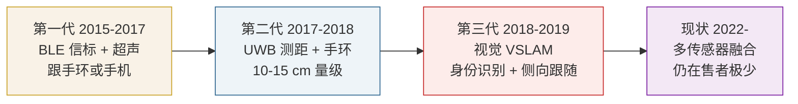
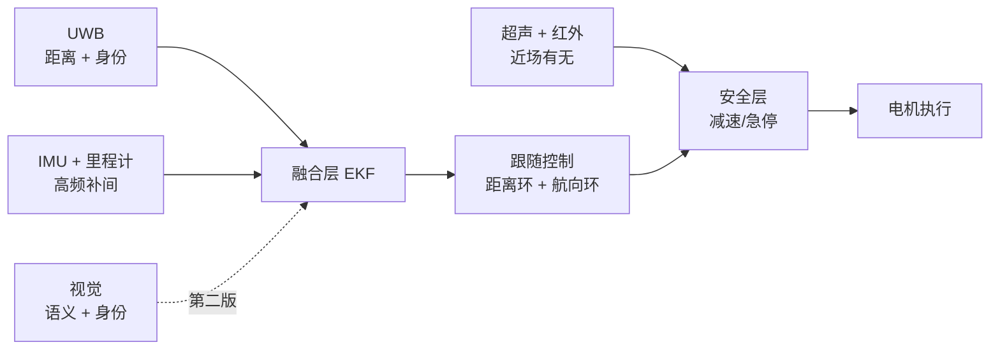
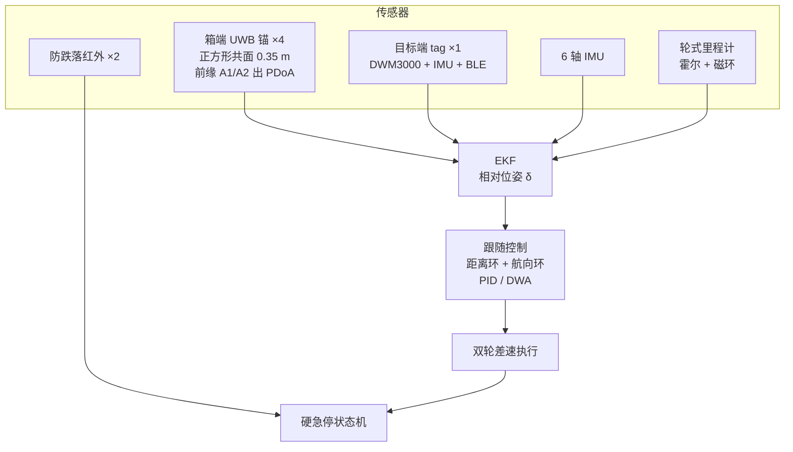
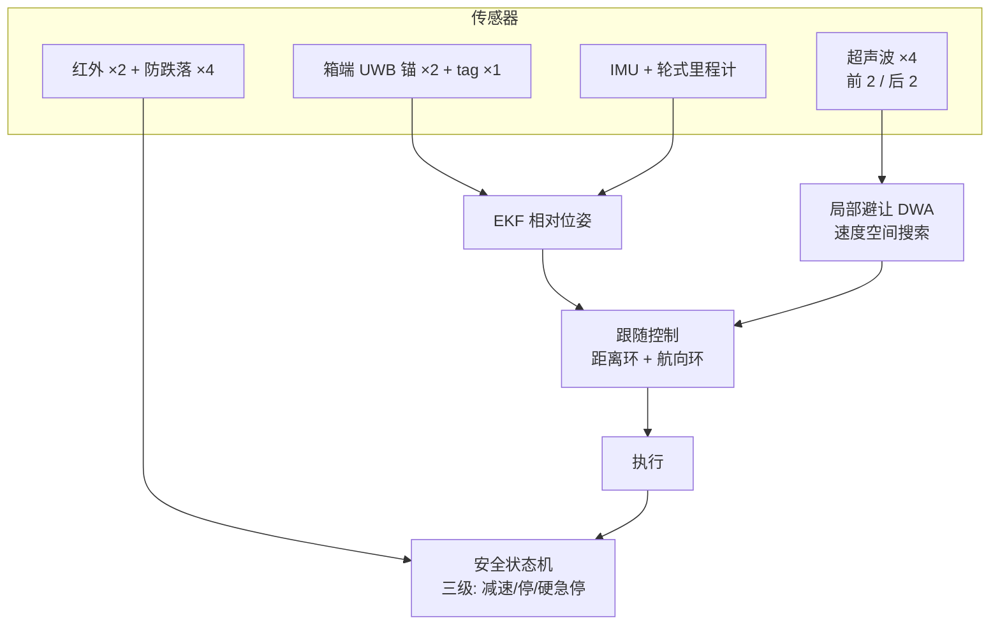
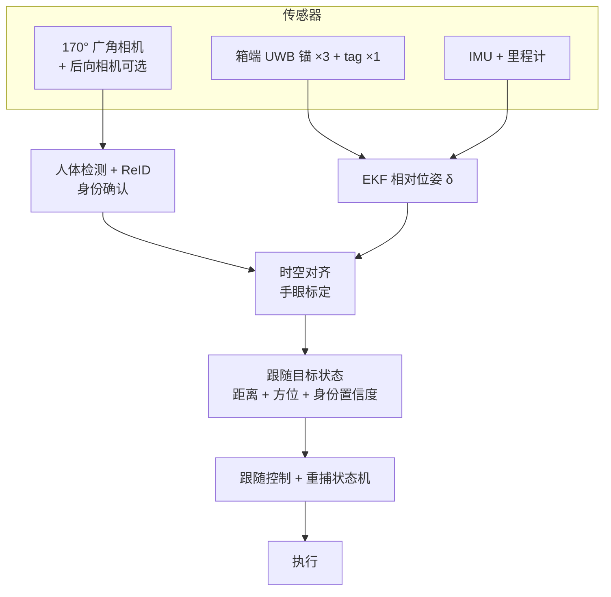
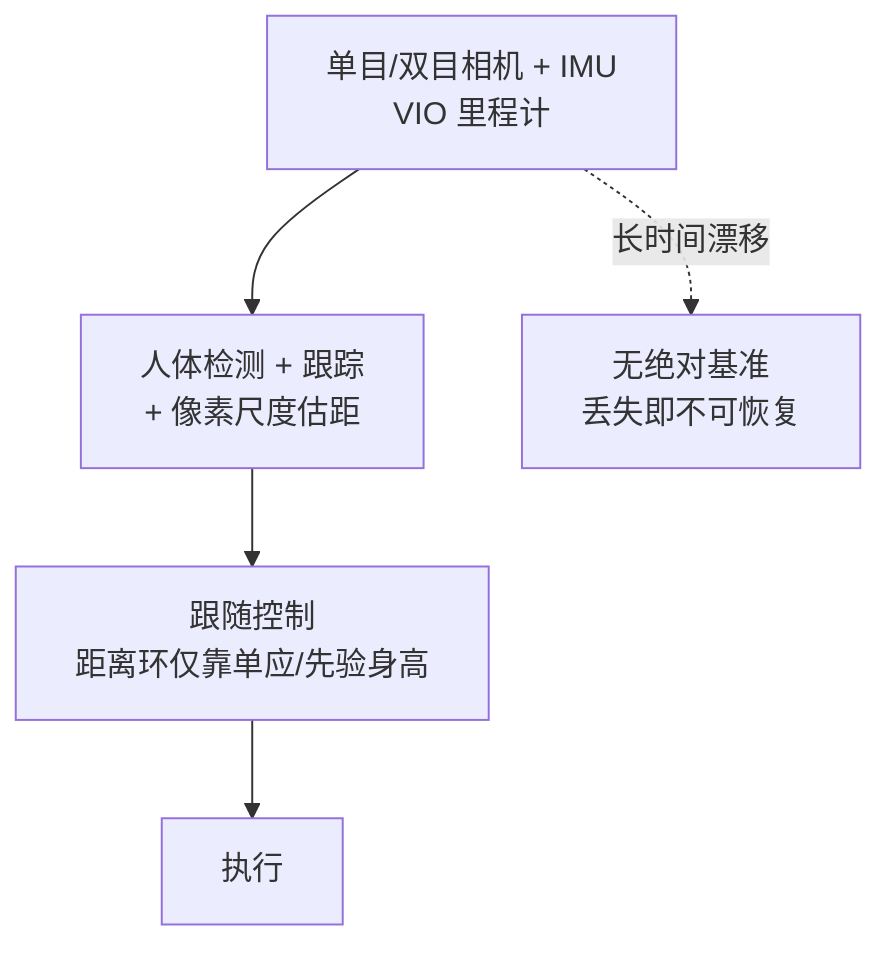
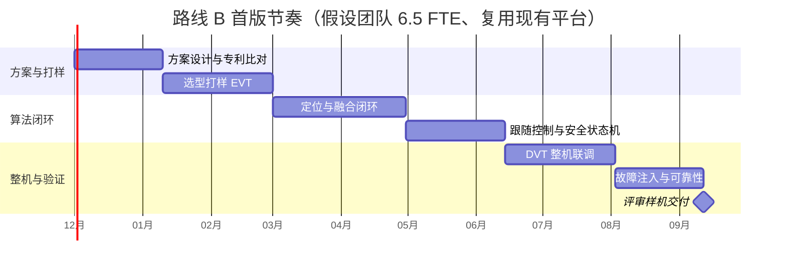
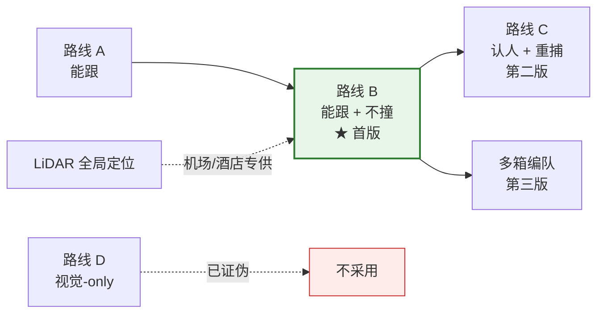

# 智能行李箱跟随技术路线报告
## 多传感器组合 · 实现周期 · 首版裁剪

> 编制：Orchestrator（任务编排者）｜完成日期：2026-11-19｜状态：**可直接进产品/研发评审**
> 用途：回答三个决策问题——**① 第一版用哪套传感器组合？② 要多久、多少人？③ 第一版砍掉什么？**

---

## 0. 怎么读这份报告

### 0.1 结论成熟度标记（全文沿用）

| 标记 | 含义 | 评审时的采信强度 |
|---|---|---|
| 〔事实〕 | 有法规原文、官方页面、专利原文或一手实测可查 | 可直接引用 |
| 〔文献量级〕 | 论文/报告自报指标，平台与场地不同，**不可横向比较** | 只作量级参考，不背书 |
| 〔工程判断〕 | 本报告基于上述证据做出的工程推断，无直接文献支撑 | 需评审拍板或补测 |
| 〔未验证〕 | 公开资料查不到，或来源不可采信，明确登记为缺口 | 立项后必须自测填补 |

### 0.2 证据基线（不重复调研的边界）

本报告是收敛性报告，**证据来自已完成的前序任务，不重新抓取竞品页**：

| 序号 | 输入 | 载体文件（库内路径） | 规模 |
|---|---|---|---|
| ① | 竞品现状 / 产品参数 / 专利 / 合规 | `Notes/智能行李箱自动跟随-产品与专利调研.md`（库根那份逐字节相同的重复副本已于 2026-11-20 移入 `.trash/`，本报告不引用副本） | 357 行 / **70 条**来源（编号 `P-n`） |
| ② | 定位·编队·避障算法与传感器能力 | `Notes/多行李箱自动跟随算法技术笔记.md` | 397 行 / **55 条**来源（编号 `A-n`） |
| ③ | 多箱系统架构与三档组合（前序汇总） | `Resources/智能行李箱多箱自动跟随技术报告.md` | 805 行 / 125 条可回查来源 |
| ④ | **竞品一手页面抓取（7 款在售/历史产品）** | `Notes/竞品自动跟随行李箱规格表_2026-11-19.md`（CSV 原件：`attachments/竞品自动跟随行李箱规格表_2026-11-19.csv`） | 7 产品 / 19 条一手页来源（编号 `C-n`，即该表 S-n） |
| ⑤ | **UWB 单箱跟随主线基准方案（含 BOM、控制参数、验证计划）** | `Notes/UWB单箱自动跟随-主技术路线.md` | 677 行 / 16 条一手来源（编号 `U-Sn`，即该文 S-n） |
| ⑥ | 器件价格量级（本次新增，仅 4 条） | 见 §9.2 `B-n` | 电商页/二手博客，**仅作量级** |

**引用约定**：`[P-n]` 回查文件①台账第 n 条；`[A-n]` 回查文件②第 n 条；`[C-n]` 回查文件④第 n 条；`[U-Sn]` 回查文件⑤台账第 n 条；`[B-n]` 见 §9.2。所有编号在源文件里都有标题与可点击 URL。

### 0.3 与并行深入卡的关系

本次任务链上另有 4 张并行卡在做更细的一手工作。截至本报告定稿，**其中 3 张的产出已落库并被本报告采纳**：

| 并行卡 | 产出 | 状态 | 落入本报告位置 |
|---|---|---|---|
| 竞品页面抓取 `t_57e6360a` | `Notes/竞品自动跟随行李箱规格表_2026-11-19.md`（7 款，19 条一手页） | ✅ 已采纳 | §2.1（产品状态与参数）、§2.2 |
| UWB 主线方案 `t_ba39a786` | `Notes/UWB单箱自动跟随-主技术路线.md`（677 行，含 BOM/控制参数/验证计划） | ✅ 已采纳 | §4 路线 A/B 的传感器清单、BOM、精度预期、§6.3 门禁阈值 |
| 专利与公开技术依据 `t_e5bb471f` | `Notes/智能行李箱自动跟随-产品与专利调研.md` | ✅ 结论一致，已引用 | §2.3、§2.4 |
| 传感器对比矩阵 `t_b318ff0c` | `Notes/自动跟随传感器对比-IMU-红外-超声波-视觉.md`（12 传感器 × 14 量化维度 D1–D14） | ✅ 已采纳 | §3.1（补充矩阵，原表口径不变） |

> 交叉核对结论：并行产出与本报告**无事实冲突**；只有一处**判断收紧**——UWB 主线基准采用「箱端 4 锚 + PDoA」，其专利风险高于本报告原先设想的「2 锚纯测距」，已在 §2.3 与 §7.2 修正。

---

## 1. 一页决策版

### 1.1 推荐结论（先说答案）

> **第一版走路线 B：UWB + IMU + 超声/红外（= 路线 A 的最小可行集 + 近场安全件）。**
> 约 **22.5 人月 / 5 个月**（6.5 人团队、复用现有 20 寸电动箱体平台与 ROS 2 + Nav2 仿真）。
> **不做视觉身份识别、不做多箱编队、不做 LiDAR 全局定位、不做自主绕障、不做骑行。**
> 视觉（路线 C）作为第二版的身份与重捕增强，**唯一条件是第一版的"掉线率/误停率"已被量化压下去**。

### 1.2 四条路线一览（细节见 §4–§5）

| | 路线 A UWB+IMU | 路线 B UWB+超声/红外 | 路线 C UWB+视觉 | 路线 D 视觉-only |
|---|---|---|---|---|
| 一句话定位 | 最小可行，稳定跟随 | **首版推荐**，跟随+近场安全 | 身份识别与丢失重捕 | 低成本，风险高 |
| 增量 BOM 量级（单箱跟随功能） | **¥250±50（自研板）/ ¥450–1,100（现成模块）** | **¥320±60 / ¥550–1,300** | ¥500–900 / ¥1,200–2,700 | ¥200–900 / ¥150–500 |
| 算法复杂度（1–5） | 2 | 3 | 4.5 | 5 |
| 跟的是"谁" | tag（不认人） | tag（不认人） | **人**（可重捕） | 人（易跟丢/跟错） |
| 关键失效 | 遮挡 NLOS、忘带 tag | 软质/玻璃误检、频繁误停 | 逆光白墙、算力功耗、隐私 | 逆光遮挡、缺尺度、多人混淆 |
| 周期（人月 / 日历） | 18 / ≈17 周 | 22.5 / ≈21 周 | 36 / ≈34 周 | 30 / ≈29 周起，返工风险高 |
| 建议 | 可作为 B 的减配版 | **✅ 第一版** | 第二版增强 | ❌ 不作主线 |

### 1.3 第一版必须砍掉的功能（清单 + 理由 + 何时加回）

| # | 砍掉的功能 | 为什么砍 | 什么时候加回 |
|---|---|---|---|
| 1 | 视觉身份识别 / 人脸 | 需 SoC 级算力与散热 [P-3]；公共空间持续拍摄涉《个人信息保护法》〔合规推断，识别能力见 P-4〕；2025 年新申请 CN120411480A（YOLOv8+深度测距）风险集中于此 [P-47] | 第二版（路线 C），先做"人体检测"不做"人脸" |
| 2 | 多箱编队 / 保持队形 | 刚性队形在窄通道必然崩解，正确解法是门宽检测→收缩→拆队 [A-40][A-41][A-42]；且消费场景真实需求多为"多一个箱子跟着"而非几何队形 [A-40] | 第二版，且必须以"队列（一列）"为默认形态 |
| 3 | 侧向平移 / 并排过闸机 | 需全向或可绕两轴旋转的执行轮，属底盘结构大改 [P-43]；多数编队算法假设全向底盘，非完整底盘需专门扩展 [A-36][A-37] | 结构预研通过后 |
| 4 | LiDAR 全局 SLAM | 门洞/窄通道处三种 LiDAR 方法横向精度同时下降 [A-28]，恰是箱间不擦碰最需要的场景；且成本/体积/功耗最高 [P-32][P-33] | 机场/酒店专供型号 |
| 5 | 自主绕障 / 全局路径规划 | 第一版做"减速—停—人工绕"即可满足跟随；全局规划依赖地图与建图流程，是运营成本而非硬件成本 | 第二版（Nav2 Hybrid-A* + 门宽约束） |
| 6 | 骑行 / 代步 | 多国已封：公共道路违法 [P-62][P-63]，美国 4 大机场、樟宜机场禁入 [P-27][P-28] | **不加**（形态永久放弃） |
| 7 | 云端算力 / 联云规划 | 机场弱网与隐私双重风险；云端方案是运营方降本逻辑 [P-50]，不是消费级首版逻辑 | 机场运营方 B 端形态 |
| 8 | DRL / 学习型策略 | 无形式化安全保证，事故责任难界定 [A-48] | 有安全层兜底 + 数据闭环之后 |
| 9 | 自动上下电梯 / 上下坡 | 斜坡、台阶、扶梯是单箱即失效的场景；先做"防跌落检测 + 停车" | 第二版 |
| 10 | App 遥控、语音/手势召唤 | 非跟随主线功能，Ovis 一代即为对照（语音/手势并未挽回商业失败）[P-24][P-25] | 按需 |

---

## 2. 竞品现状与专利风险小结（引用前序结论）

### 2.1 竞品现状：三条路线的真实结局

| 产品 | 跟随介质 | 传感器 | 现状 | 关键结论 | 来源 |
|---|---|---|---|---|---|
| ForwardX Ovis | **纯视觉**（人体/人脸 + VSLAM） | 170° 广角 + 后相机、骁龙视觉芯片、超声、GPS | **退出**（公司称行李箱非重点） | 视觉-only 的唯一规模化实证 = 商业失败；官方 FAQ 建议"极拥挤场景切手动" | [P-1][P-3][P-5][P-9] |
| COWAROBOT R1 / Rover S | 手环（侧向保持）/ 人体识别 | R1：深度 + 声呐 + 防跌落；Rover：约 15 个传感器含 LiDAR | 主业转无人环卫 | 传感器堆料不等于产品成功 | [P-10][P-11][P-13][P-15][P-16] |
| 90 分 Puppy1 | UWB + RF 信标 | Segway 跟随芯片 + UWB + 定位雷达 | 未检索到在售页（推断停产） | 强调"100 Wh 可拆过检"，合规优先于功能 | [P-17][P-18][P-19] |
| Airwheel SR5 | UWB + 手环 | UWB + 超声避障 + 指纹解锁 | **仍在售**（约 ¥2388） | 唯一长期在售的跟随箱 = **UWB 路线** | [P-20][P-21][P-23] |
| Travelmate | App 中枢 + AI 跟随 | 多传感器阵列 + 板载处理器（官方众筹方称**不用相机视觉**） | **已停业**（PitchBook 记 Out of Business，2024-04-29；官网与 Indiegogo 页均已下架） | 连官网都消失 = 最彻底的失败形态 | [P-24][P-25][P-26] [C-14][C-15][C-16] |
| ARTVZ 爱途仕（2026 在售） | 多频射频信号追踪 + 一键切骑行 | 未披露（正文只讲前轮 360° 循迹） | 在售（电商款） | ⚠ 仅单篇软文来源，**只作"信标路线仍有新玩家"的存在性证据**，参数不采信 | [C-17] |

**七款产品的路线统计（一手抓取口径）**〔事实，见 [C-1]–[C-17]〕

- **4 款走"信标/手环 + 近场测距"路线**（SR5、Puppy1、R1、ARTVZ）——成本低、算力低、暗光逆光都稳，代价是忘带手环即失效、遮挡多径漂移。
- **1 款纯视觉**（Ovis）、**1 款 AI 人体识别**（Rover S）、**1 款声称不用视觉的自有阵列**（Travelmate，已停业）。
- **避障几乎全靠超声波/声呐/深度传感近场补盲，激光雷达只在酷哇 2017 量产款被宣称用过。** 这一条直接支撑本报告把"超声/红外近场安全"放进首版（路线 B）。

**三个必须带进评审的事实**

1. **在售且长期存活的跟随方案是 UWB，不是视觉**（SR5 vs Ovis）[P-20][P-9]。
2. **失败的根因不是算法，是不能登机**：IATA 自 2018-01-15 起禁运"锂电池不可拆卸"的智能行李 [P-53][P-56]；FAA 规定必须随身、托运仅允许 ≤0.3 g 锂金属或 ≤2.7 Wh 锂离子 [P-51]。——产品形态被硬锁为「**≤100 Wh + 可单手快拆 + 20 寸**」[P-58][P-62]。
3. **"跟随"是演示效果最好、复购最差的功能**：三家头部公司全部转向 B 端 [P-9][P-16][P-17]，决策时必须把"演示可行性"与"量产一致性"分开评估。

### 2.2 商用参数的事实标准（可直接写进 PRD 目标值）

| 指标 | 事实标准 | 依据 |
|---|---|---|
| 跟随距离 | 0.5–1.5 m（稳态 1–2 m） | 专利权利要求明文 [P-44]；实测维持 1–2 m [P-14] |
| 越界告警 | 2–3 m 振动/声音 | [P-2][P-14][P-22] |
| 最高速度 | ≤6 km/h（建议上限） | 消协：7–10 km/h 才兼顾安全 [P-64] |
| 续航 | 10–20 km 或 4 h 级 | [P-3][P-10][P-17][P-24] |
| 电池 | ≤100 Wh 且可单手快拆 | [P-51][P-58][P-62] |
| 制动 | 7–10 km/h 下 <3 m | 15 款样机仅 2 款达标 [P-64] |
| 通过性 | 单箱 ≤0.6 m；多箱需队形收缩 | [A-40][A-41] + 〔工程判断〕 |

### 2.3 专利风险小结（按本报告四条路线归属）

| 风险等级 | 风险点 | 对应公开号 | 落到哪条路线 | 规避动作 |
|---|---|---|---|---|
| 🔴 高 | **UWB 多天线三角定位阵列 + UAS 评分选阵 + 角度融合 + 双 DIP 控制 + 应急恢复**（2026-06-30 授权公告） | CN120935756A/B [P-48] | A/B/C（UWB 必经） | 主线基准的「4 锚 + PDoA + 加权融合」与其权利要求**高度接近**（UWB 主线文档自评 R8 中等风险）→ 必做 FTO；可差异化的点：**不做 UAS 评分选阵**，改固定几何 + 全局加权最小二乘，并留评审记录 |
| 🟡 中 | 箱上 **4 个 UWB 标签正方形共面 + 用户 1 主标签**，差分判向 + 级联 PID 控双差速轮 | CN202110300883 [U-S8] | A/B 的 4 锚构型 | 这是"教科书式"实现，字面规避空间小；对策是**设计替代**（如 3 锚 L 形 + 距离差比）或与权利人谈授权 |
| 🟡 中 | 双 UWB 模块 + 标签、10 Hz 位置更新、唯一 ID 校验、按距离/速度差分级变速 | CN109348426A [U-S5] | A/B 的 2 锚减配构型 | **减配到 2 锚并不等于规避**；靠"不采用其分级变速规则 + 不同滤波结构"降低落入度，仍须 FTO |
| 🟡 中 | YOLOv8 + 深度相机交叉校验测距 + 四分位去离群（2025-08 公开） | CN120411480A [P-47] | C/D | 第二版做视觉时改用「人体检测框 + 地面平面单应」测距，避开"深度相机交叉校验"特征 |
| 🟡 中 | 双跟随模式（侧面/背面）+ 触控急停 + 可绕两轴旋转执行轮 | CN109674162B / CN110786609A [P-43] | A 的急停设计可用（正面对比），侧向平移被排除 | 急停做物理按键，不做"触控"特征描述；侧向平移整体砍掉 |
| 🟢 低 | 视觉取相对坐标 → PID 控后轮（最直白实现） | CN106444763A/B [P-37] | C/D | **已因未缴年费失效**，不构成障碍 |
| 🟢 低 | Robotic suitcase 系统级（跟随距离 0.5–1.5 m 权利要求） | US20180360177A1 [P-44] | 全部 | **已放弃 Abandoned**；但 0.5–1.5 m 已成为公共参数 |
| 🟢 低 | 自主跟随避障移动行李箱（PCT） | WO2017219751A1 [P-45] | B/C | 法律状态 Ceased |
| ⚪ 待查 | 早期基础性布局 | CN104905520B（Active，预计 2035 到期）[P-36] | 全部 | 需 CNIPA/incoPat 全量 FTO |

> ⚠️ **明确声明**：以上是**基于公开页面的法律状态判读，不是 FTO 结论**。正式立项必须做 CNIPA / incoPat 全量检索。基础专利墙比预期薄（P3 失效、P10 放弃、P11 ceased），风险集中在 **2025 年后的新申请**。

### 2.4 合规约束（决定形态，不决定算法）

| 约束 | 内容 | 对首版的直接要求 |
|---|---|---|
| 航空 | 不可拆卸电池的智能行李禁运 [P-53][P-56]；托运仅 ≤2.7 Wh 锂离子 [P-51] | 电池 **≤100 Wh + 单手快拆**，20 寸箱体 |
| 场地 | 公共道路骑行违法 [P-62][P-63]；美国 4 大机场、樟宜禁入 [P-27][P-28] | 说明书与包装明示"仅限机场/车站/酒店等封闭场地" |
| 认证 | 电动行李箱**暂未纳入 CCC 强制目录**，无强制测试标准 [P-62][P-65]；电池本体需独立 CCC | 自建企业标准 + 第三方测试，作为对客户的合规背书 |
| 安全 | 15 款样机最高速 2.6–22.9 km/h、制动 0.5–15.2 m [P-64] | 首版即须做制动距离台架测试 + 硬急停 |

---

## 3. 传感器能力边界矩阵（路线设计的事实底座）

### 3.1 能力矩阵

| 维度 | UWB（TWR/PDOA） | IMU + 轮式里程计 | 红外（主动/被动） | 超声波阵列 | 视觉（单目/RGBD/VIO） | 视觉 tag（AprilTag/ArUco） | 2D/3D LiDAR |
|---|---|---|---|---|---|---|---|
| 提供的信息 | 相对**距离**（+角度，PDOA 单边界） | 加速度/角速度、位移增量 | **有无**物体（主动测距米级） | **距离**（米级，窄波束） | 语义 + 身份 + 深度（RGBD） | **6DoF 位姿**（需可视） | 距离扫描 / 建图 |
| 典型精度 | LOS ±10 cm；4 锚 NLS RMSE 3.2 cm @10 Hz [A-17][A-18] | 短时高精度，长时漂移 [A-25] | 米级，定性 | 米级，±3 cm 级测距 | VIO RPE 0.008–0.03 m（室内 72 m 回环）[A-26] | 厘米级但需 tag 在视野内 | APE 1.5–2.1 m；门洞横向精度下降 [A-26][A-28] |
| 有效范围 | 10–50 m 视距，可组网 [A-18] | — | 0.3–5 m | 0.2–4 m | 1–10 m 有效识别 | 0.3–5 m | 10–50 m |
| 刷新率 | 10–100 Hz [A-16][A-42] | 100–1000 Hz | 低（10 Hz 级） | 10–50 Hz | 15–30 Hz（视觉） | 15–30 Hz | 10–100 Hz |
| 人群遮挡鲁棒性 | **中**（NLOS 正偏差 >1 m）[A-19][A-21] | 高（不依赖视距） | 低（人即遮挡物） | 中（软质/斜面误检） | **低**（遮挡即丢） | 极低（遮挡即丢） | 中 |
| 光照敏感性 | 无 | 无 | 被动红外怕热源/阳光 | 无 | **高**（逆光/白墙/夜间）[A-24][A-25] | 中 | 低 |
| 身份区分能力 | **有 ID 校验**（tag 唯一）[P-42] | 无 | **无** | **无** | **有**（人体/人脸/ReID） | 有（tag ID） | 无 |
| 成本量级（单套） | 中：核心模块 ¥100–500 [B-1] | 极低：¥10–50 | 极低：¥3–10/路 [B-4] | 极低：¥8–25/路 | 中：模组 ¥30–200 [B-2] + SoC ¥150–600 | 极低（软件） | 高：¥600–2,000+ 〔工程判断〕 |
| 算力需求 | 极低（MCU 可跑） | 极低 | 极低 | 极低 | **高**（SoC/GPU）[P-3][A-38] | 中 | 中高 |
| 能否单独闭环跟随 | **能（LOS）** / 不能（NLOS） | **不能**（漂移累积，无绝对基准） | **不能**（无身份、无距离连续性） | **不能**（无身份、无法判方向） | 有条件能（短距、好光照） | 能（但需 tag 可见，等于退化回信标） | 能建图定位，但**不能识别人** |

> 补充矩阵：12 类传感器 × 14 个量化维度（D1–D14，含 D14「能否单独闭环跟随」判据与逐格来源脚注）见 [[自动跟随传感器对比-IMU-红外-超声波-视觉]]；与上表口径一致、粒度更细，两表若有出入以本节 §3.1 为对照基线。

### 3.2 传感器逐条结论

- **UWB**：唯一能在消费级成本下同时给出"绝对距离 + 目标身份 + 米级到厘米级精度"的传感器，因此是跟随的**定位主力**；硬边界是 NLOS 正偏差（遮挡时测距偏大，严重时 >1 m），必须做 NLOS 识别与多锚冗余，不能单对测距闭环 [A-19][A-20][A-21]。
- **IMU / 轮式里程计**：只做**补间与桥接**——在 UWB 两帧之间、短时丢包时维持状态估计；长时必然漂移，瓷砖/大理石打滑率无公开数据〔未验证〕[A-13][A-25]。
- **红外（主动/被动）**：只能回答"有没有东西"，米级、无身份、被动红外怕热源与阳光直射；**不能作为跟随输入**，只能做近场安全与防跌落 [P-40][P-10]。
- **超声波阵列**：便宜、可测距、窄波束，适合近场补盲与防跌落；对软质物（衣物/窗帘）、斜面、玻璃反射会漏检或误检，且**无方向信息、无身份**——只能"避"，不能"跟" [P-40][P-41]。
- **视觉（单目/RGBD/VIO）**：唯一能回答"**是不是我的主人**"的传感器，也是唯一能做丢失重捕的；代价是逆光/白墙/纯旋转/夜间失效、需 SoC 级算力与散热、公共空间持续拍摄的隐私合规问题 [P-3][P-4][A-24][A-25][A-26]。
- **视觉 tag（AprilTag 类）**：精度高但要求 tag 持续可见，本质上是"用摄像头做信标"，退化后与 UWB 信标同级，且遮挡即丢——**不构成独立路线**。
- **LiDAR**：能建图、能测门宽，但 (a) 成本/体积/功耗最高，(b) **过窄开口时横向定位精度下降**（门洞、略宽通道、长走廊三组实验均观察到）[A-28]，恰是箱间不擦碰最依赖的工况，(c) 不能识别人。定位：**高端/机场型号的全局定位件，不是首版件**。

### 3.3 由此推出的组合逻辑

**组合原则〔工程判断〕**：**定位要"距离+身份"，安全要"有无+距离"，语义要"视觉"**。三者时标差两个数量级（定位 10–50 Hz / 规划 1–10 Hz / 控制 50–200 Hz），必须分层放在不同层，否则参数互相拖累 [A-3][A-49]。

---

## 4. 四条组合路线

### 路线 A：UWB + IMU（最小可行，主打稳定跟随）

| 项 | 内容 |
|---|---|
| **传感器清单** | 箱端 **UWB 锚 ×4**（正方形共面，边长 0.30–0.40 m，前缘 A1/A2 双天线出 PDoA；**减配版可退化为 2 锚纯测距** [U-S9]）、目标端 tag ×1（DWM3000 模块 + 6 轴 IMU + BLE + 300 mAh）、箱体 6 轴 IMU ×1、轮式里程计（霍尔 AB 相 ×2）、防跌落红外 ×2、主控 STM32G474、物理急停按键 ×1 [U-S1][U-S2][U-S16] |
| **BOM 量级（单箱增量）** | 自研板：**¥250±50**（UWB 4 锚 + tag ≈¥165、IMU ¥24、超声/红外/编码器/按键 ¥60）[U-§2.3]；现成模块方案：**¥450–1,100** [B-1][B-3]。整机 BOM（含电机/电池/结构）≈**¥800/台**，跟随功能不是成本瓶颈 [U-§2.3] |
| **算法复杂度** | **2 / 5**。三级串级：距离环 20 Hz / 航向环 50 Hz / 轮速环 200 Hz + 20 Hz EKF，架构与专利 CN202110300883、CN109348426A 及已发表工程实现一致 [U-S5][U-S8][U-S9] |
| **功能效果预期** | LOS 静态定位 0.08–0.15 m（1σ）；动态跟随横向 RMS 0.10–0.20 m；最小转弯半径 0.40 m @0.5 m/s、0.95 m @1.4 m/s；续航 15–20 km（3.7–5 h @1 m/s）；**速度硬限 1.4 m/s ≈5 km/h** [U-S1][U-S4][U-S10][U-S11] |
| **失效场景** | ① 人体遮挡/金属箱体反射 → NLOS 正偏差 0.3–1.0 m [A-19][A-21][U-S14]；② tag 忘带/丢失/没电 → 完全失效 [P-10][P-11]；③ **PDoA 有效视场约 ±60°，超界退化纯距离** [U-S1]；④ 多人同行两 tag 靠近 → 无法区分；⑤ 上下坡、台阶、扶梯 → 无感知能力 |
| **适用产品档位** | 入门款 / 双箱首发，¥2,000–3,500（对标 SR5 ¥2,388 [P-20]） |
| **首版缺失的关键能力** | 不认人、不避障、遇障即停 |

### 路线 B：UWB + 超声/红外（**首版推荐**：跟随 + 近场安全）

| 项 | 内容 |
|---|---|
| **传感器清单** | 路线 A 全部 + 超声波 ×3（前/左/右，与主线基准预留位置一致 [U-§2.2]）+ 下视防跌落对管 ×2 组 + 双急停（自锁按键 + 独立触控）+ 蜂鸣/振动手环反馈 |
| **BOM 量级（单箱增量）** | 自研板：**¥320±60**；现成模块方案：**¥550–1,300**〔工程判断；超声 ¥8–25/路、红外 ¥3–10/路 [B-4]〕 |
| **算法复杂度** | **3 / 5**。A + 局部反应式避障（DWA，控制周期 0.25 s 级 [A-30]）+ 安全状态机（越界 2–3 m 告警 [P-14][P-22]、可用锚 <2 限速、超声近距直接断电机）。**不做全局规划** |
| **功能效果预期** | 遇静态障碍减速绕行（DWA 在人群中 95 cm/s 安全运行、过门自动降到约 20 cm/s [A-30]）；人突停能停住（**验证阈值：制动 ≤0.8 m @1.1 与 1.4 m/s，干/湿地面** [U-§9 T7]）；遮挡 3 s 内停车、恢复后 <2 s 重新跟上（T4）；撞人/撞墙概率显著下降 |
| **失效场景** | ① 软质物（衣物下摆、窗帘）与玻璃/镜面超声漏检或误检 → 误停或漏停〔未验证，需自测〕；② 人群密集时频繁急停 → 体验崩溃（这是 Ovis 官方建议切手动的同类问题 [P-5]）；③ 只能避不能绕出复杂环境（U 形障碍会困住 [A-30]）；④ 仍不认人；⑤ 载重 10–25 kg 变化对制动距离的影响无文献数据〔未验证〕[A-30][A-38] |
| **适用产品档位** | **主流消费级首发**，¥2,500–4,000 |
| **为什么它是首版** | 见 §7.2：安全件不可省（消协实测仅 2/15 款制动达标 [P-64]），而视觉/编队/建图都可延迟 |

### 路线 C：UWB + 视觉（身份识别 + 丢失重捕）

| 项 | 内容 |
|---|---|
| **传感器清单** | 路线 B 全部 + 170° 广角相机 ×1（可选后向相机）+ SoC 级主控（视觉推理）+ 可选深度/RGBD 模块 |
| **BOM 量级（单箱增量）** | 自研板：**¥500–900**；现成模块方案：**¥1,200–2,700**〔工程判断；相机模组 ¥30–200 [B-2]，SoC 增量 ¥150–600 属估算〕 |
| **算法复杂度** | **4.5 / 5**。UWB EKF + 视觉人体检测/重识别 + 相机—UWB 时空对齐与标定 + 身份置信度融合 + 重捕状态机（丢 tag 后 3–5 s 内视觉接管）。需 SoC 算力、功耗与散热设计 [P-3] |
| **功能效果预期** | 跟"人"而不是"tag"：tag 忘带/掉落时仍可短时跟随；可做侧向/背影跟随（Ovis 的产品形态 [P-5]）；可在人群中对主人重识别；为避障提供语义（人 vs 行李车 vs 柱子） |
| **失效场景** | ① 逆光、白墙、纯色地板、夜间 → 视觉失效 [A-24][A-25][A-26]；② 多目标混淆（一家人穿同款）→ 跟错人，比跟丢更糟；③ 算力/功耗挤压续航；④ 隐私合规（持续拍摄公共空间他人）〔识别能力 P-4 + 合规推断〕；⑤ 2025 年新专利 CN120411480A 落点 [P-47] |
| **适用产品档位** | 高端消费 / 机场·酒店专供，¥4,000–6,000+ |
| **前置条件** | 必须在路线 B 的"掉线率/误停率"量化达标之后再做，否则只是放大未解决的单箱问题 |

### 路线 D：视觉-only（低成本，**标注风险，不作主线**）

| 项 | 内容 |
|---|---|
| **传感器清单** | 单目/双目相机 ×1 + IMU；无 UWB、无 tag |
| **BOM 量级（单箱增量）** | 小批：**¥200–900**；千台目标：**¥150–500**〔工程判断 [B-2]〕 — **四条路线里最低** |
| **算法复杂度** | **5 / 5**（看似少硬件，实则最难：单目缺尺度，靠人体高度/地面平面假设；VIO 长时漂移；遮挡后重捕难；跟随距离估计误差随距离增长） |
| **功能效果预期** | 仅"短距（<2 m）、光照良好、人少、无遮挡"场景可用。**ForwardX Ovis 就是这条路线的规模化实证：众筹交付失败 + 公司退出 + 官方建议拥挤时切手动** [P-5][P-7][P-9] |
| **失效场景** | 逆光/白墙/夜间、遮挡、快速转身、多人同款衣着、地面纹理弱（机场大理石恰好弱）、上坡（地面平面假设失效）；且**无 tag → 无任何跨模态兜底** |
| **适用产品档位** | 不建议作为产品主线；仅适合"低成本玩具/展会演示"，或作为路线 C 降级后的兜底通道（视觉是 C 的一部分，而非独立形态） |
| **风险结论** | 〔事实 + 工程判断〕**该路线已在市场上被证伪一次**，重走需要解释"为什么这次不同"，本报告不提供该论证 |

---

## 5. 路线横向对比

### 5.1 决策矩阵（1=差，5=好）

| 维度 | 权重 | A | B | C | D |
|---|---|---|---|---|---|
| 跟随稳定性（LOS） | 20% | 4 | 4 | 4 | 2 |
| 人群/遮挡鲁棒性 | 20% | 2 | 3 | 3 | 1 |
| 安全（不撞人/不停不撞） | 20% | 2 | **5** | 5 | 2 |
| 身份可靠性（跟对人） | 10% | 3 | 3 | **5** | 2 |
| 成本竞争力 | 10% | **5** | 4 | 2 | **5** |
| 周期可控性 | 10% | **5** | 4 | 2 | 1 |
| 专利/合规风险（分高=风险低） | 10% | 3 | 3 | 2 | 2 |
| **加权总分** | 100% | **3.20** | **3.80** | **3.50** | **2.40** |

> 加权口径：`Σ(权重 × 分)`，权重合计 100%；逐项算术见各行分数（A：0.8+0.4+0.4+0.3+0.5+0.5+0.3=3.20；B：0.8+0.6+1.0+0.3+0.4+0.4+0.3=3.80；C：0.8+0.6+1.0+0.5+0.2+0.2+0.2=3.50；D：0.4+0.2+0.4+0.2+0.5+0.5+0.2=2.40）。

> 权重是〔工程判断〕，评审可改；改权重后排序结论只在 B 与 C 之间变化——而这正是本报告要拍板的地方（§7.2）。

### 5.2 三句话总结

- **A 是 B 的减配版**，价差约 ¥50–100 BOM，却省掉了"不撞人"这一项——不值得省。
- **B 是唯一同时满足"能跟 + 不伤人 + 5 个月内可评审"的路线**。
- **C 是正确方向但错的时间**：它解决的问题（身份/重捕）在首版可以用"tag 唯一 ID + 越界告警"部分替代 [P-42][P-14]。

---

## 6. 实现周期表

### 6.1 估算假设（**先看这里，再看数字**）

| 假设项 | 取值 | 说明 |
|---|---|---|
| 团队规模 | **6.5 FTE**：算法 3（定位融合 1、控制 1、感知 1）+ 嵌入式 2 + 结构/硬件 1 + 测试 1（共享 0.5） | 若只有 3 人，见 §6.4 敏感性 |
| 平台复用 | **复用**现有 20 寸电动箱体（电机驱动、电池仓、结构、模具） | 不含全新底盘开发；全新底盘 +40~60% |
| 软件底座 | ROS 2 + Nav2（现成 DWB/DWA、MPPI、Smac Hybrid-A*）+ Gazebo 多机仿真 [A-49][A-50][A-51] | 不自研中间件与规划器 |
| 供应链 | 采用套件化方案（跟随从机/主机 + 整车控制器 [P-31]），UWB 用现成模组 | 不自研射频 |
| 样机轮次 | **3 轮**：EVT（功能验证）/ DVT（设计验证）/ PVT（小批试产） | 每轮含一次返工 buffer |
| 人月定义 | **有效投入人月**，已含 20% 联调返工 buffer | 不含项目管理与合规申报工时 |
| 日历换算 | 有效并行度按 **4.5 FTE**（测试与结构部分串行）折算，1 月 ≈ 4.3 周 | 日历周为 P50 估计 |

### 6.2 五阶段人月表（单位：人月）

| 阶段 | 主要交付物 | A | B | C | D |
|---|---|---|---|---|---|
| ① 方案设计 | 系统架构、接口定义、DFMEA 初版、专利比对 | 1.5 | 2.0 | 2.5 | 2.0 |
| ② 选型打样 | BOM 定版、EVT 板与结构件、传感器标定工装 | 3.0 | 3.5 | 5.0 | 3.0 |
| ③ 算法闭环 | 定位/融合/控制闭环，仿真→实机，指标标定（跟丢率/急停率/超调） | 6.0 | 8.0 | 16.0 | 14.0 |
| ④ 整机联调 | DVT 整机、人穿门/人群/窄通道场景联调 | 4.0 | 5.0 | 7.0 | 6.0 |
| ⑤ 可靠性验证 | 故障注入（NLOS/延迟/丢包）、老化、制动台架、场景回归 | 3.5 | 4.0 | 5.5 | 5.0 |
| **合计人月** | | **18.0** | **22.5** | **36.0** | **30.0** |
| **日历周期（P50）** | | **≈17 周** | **≈21 周** | **≈34 周** | **≈29 周起** |
| 日历风险区间（P90） | | 20 周 | 25 周 | 44 周 | **不可收敛风险高** |

### 6.3 阶段门禁（Gate）——每个阶段"过"的判据

| 阶段 | 通过判据（可测） |
|---|---|
| ① 方案设计 | 架构图 + 接口表评审通过；专利字面比对表完成；BOM 目标价达成共识 |
| ② 选型打样 | 传感器静态标定复现性 ≤ 目标精度 1.5 倍；EVT 板功耗与散热达预算 |
| ③ 算法闭环 | 按 UWB 主线验证计划取值：**T1** 静态 LOS 1σ ≤0.15 m；**T2** 动态横向 RMS ≤0.20 m、纵向 ≤0.15 m（0.8/1.1/1.4 m/s 三档）；**T4** 遮挡注入 3 s 内停车、恢复后 <2 s 重新跟上；10 次人穿门 ≥9 次成功〔最后一项为工程判断，其余为 [U-§9] 阈值〕 |
| ④ 整机联调 | 机场/车站实景 ≥8 小时连续运行无人工干预；掉线率与误停率有量化报告 |
| ⑤ 可靠性验证 | 按 [U-§9] 全项通过：**T5** 场景边界（电梯 / 台阶 3·8·15 cm / 8%·15% 坡 / 湿瓷砖全部正确触发状态机）；**T7** 制动 ≤0.8 m @1.1 与 1.4 m/s 干湿地面；**T8** 4 锚共存丢帧率 <2%；**T9** 安全链 3 s 内断驱动；另加通信故障注入 100/300 ms 延迟、10%/30% 丢包 [A-46][A-47] |

### 6.4 敏感性分析（评审必问的三个"如果"）

| 变量 | 变化 | 对路线 B（22.5 人月 / 21 周）的影响 |
|---|---|---|
| 团队规模 | 降到 **3 FTE** | 人月不变，日历周期 **≈21 周 → 34–38 周**（并行度崩塌，测试无法与开发重叠） |
| 团队规模 | 升到 **10 FTE** | 日历 **21 周 → 18 周**，边际收益快速衰减（联调与测试是串行瓶颈） |
| 平台复用 | **不复用**现有箱体（全新底盘/模具） | 人月 **+40~60%**（≈32–36 人月），日历 +8~12 周 |
| 砍掉阶段⑤可靠性验证 | — | 人月 −4（−18%），但**无法支撑合规与售后**，且消协实测显示制动不达标是品类通病 [P-64]，不建议 |
| 加视觉（升到路线 C） | — | 人月 **+13.5**、日历 **+13 周**；且需额外 SoC 选型与散热一轮 |
| 首版就做多箱（2–4 箱） | — | 人月再 **+10~14**，因为必须加一致性队形层 + ORCA 互避 + 窄通道选形 [A-1][A-7][A-37][A-40] |

### 6.5 与并行任务产能的关系（资源提示）

首版 22.5 人月若压在 **5 个月**内，意味着算法与嵌入式必须在 ①阶段就并行开工（接口先冻结），结构与测试在第 ③ 阶段切入。若同时还要做路线 C 的视觉预研（SoC 选型 + ReID 数据集），建议单独配 1 FTE 前置 2 个月，不占首版预算。

---

## 7. 推荐路线与理由

### 7.1 推荐：**路线 B**（UWB + IMU + 超声/红外），22.5 人月 / ≈21 周

### 7.2 六条理由（每条可追溯）

1. **市场实证指向 UWB 而非视觉**：唯一长期在售的跟随箱 SR5 是 UWB 方案 [P-20][P-23]；纯视觉的 Ovis 众筹交付失败、公司退出 [P-7][P-9]。〔事实〕
2. **安全件不可省，且这是品类通病**：15 款电动旅行箱最高速制动距离 0.5–15.2 m、仅 2 款 <3 m [P-64]。首版若无近场感知与硬急停，等于把品类已知缺陷复制一遍。〔事实 + 工程判断〕
3. **"不认人"在首版可以接受，且能省掉三重代价**：UWB tag 自带 ID 校验 [P-42]，配合 2–3 m 越界告警 [P-14][P-22] 已覆盖主要风险；换来的节省是 SoC 算力/散热 [P-3]、隐私合规 [P-4]、以及 2025 年新专利 CN120411480A 的落点 [P-47]。〔事实 + 工程判断〕
4. **专利风险可控，但不能靠"减配"绕过**：UWB 构型的三件在先专利已把三条路都占了——4 锚正方形共面 CN202110300883 [U-S8]、双模块 + ID 校验 + 分级变速 CN109348426A [U-S5]、多天线阵列 + UAS 选阵 CN120935756A/B [P-48]。因此在 B 上的正确动作不是"换个锚点数量"，而是：**① 立项前做 FTO；② 在权利要求层面做差异化（不做 UAS 评分选阵、不做其分级变速规则）；③ 预备设计替代（3 锚 L 形）**。基础专利（CN106444763B 失效、US20180360177A1 放弃、WO2017219751A1 ceased）不构成障碍 [P-37][P-44][P-45]。〔事实 + 判读〕
5. **周期匹配首版窗口**：B = 22.5 人月 / ≈21 周；C = 36 人月 / ≈34 周。若首版目标"6 个月内可评审样机"，只有 A/B 在窗口内，而 A 缺安全件。〔工程判断，假设见 §6.1〕
6. **架构可平滑升级到 C 与多箱**：B 的融合层与安全层可直接承接视觉（C）与 ORCA 互避/一致性队形（多箱）[A-37][A-1][A-7]，不需重构；这一点在图 §4-B 与 §9.1 三档组合中一致。〔工程判断〕

### 7.3 第一版交付定义（供评审逐项确认）

**必须做到**：单箱跟随 0.5–1.5 m、≤6 km/h、续航 ≥10 km、越界 2–3 m 告警、近场遇障减速停、物理硬急停、制动 <3 m @6 km/h、电池 ≤100 Wh 可单手快拆、20 寸箱体。
**明确不做**：视觉身份、多箱编队、侧向平移、LiDAR 建图、自主绕障、骑行、云端、DRL、自动上下坡/电梯。

### 7.4 第二版的三条升级路线（按投入产出排序）

| 优先级 | 升级 | 增量成本 | 收益 | 触发条件 |
|---|---|---|---|---|
| 1 | ORCA 式箱间互避 + 最小间距约束（**双箱**） | 约 +4 人月 | 从"1 个箱子"扩到"2 个箱子"，覆盖一家两口场景 | 双箱硬件模具就绪 |
| 2 | 视觉人体检测（**不做人脸**）+ 重捕 | +13.5 人月 | 掉 tag 仍能跟，体验跃升 | 首版掉线率已量化达标 |
| 3 | 一致性队形层 + 门宽检测选形（2–4 箱） | +8~10 人月 | 真正的"多箱"卖点 | 窄通道实测通过率达标 [A-40][A-41] |

---

## 8. 风险登记册

| # | 风险 | 等级 | 触发条件 | 缓解动作 | 依据 |
|---|---|---|---|---|---|
| R1 | UWB NLOS 导致真实场景精度远差于论文 | 🔴 高 | 金属箱体 + 人流遮挡 | 多锚冗余 + NLOS 识别 + 运动模型融合；**对外不宣称"厘米级"**，宣称"1 m 内稳定跟随" | [A-19][A-20][A-21] |
| R2 | 人群密集时频繁误停导致体验崩溃 | 🔴 高 | 超声/红外误触发 | 三级减速策略 + 误报抑制（连续 N 帧才判障）+ 用户可切"宽松模式" | [P-5][A-30]〔工程判断〕 |
| R3 | 制动距离不达标（品类通病） | 🔴 高 | 高速 + 重载 | 6 km/h 速度上限 + 台架测试进 Gate | [P-64] |
| R4 | 专利落入 CN120935756A/B | 🟡 中 | UWB 多阵列/角度融合设计 | 首版用 2 锚 TWR；立项前 FTO | [P-48] |
| R5 | 电池不可拆/超 100 Wh 导致不能登机 | 🟡 中 | 形态定义失误 | 三位一体约束写进 PRD：≤100 Wh + 可快拆 + 20 寸 | [P-51][P-58][P-62] |
| R6 | 载重变化（10–25 kg）使控制参数失效 | 🟡 中 | 用户装箱重量差异 | 建载重—制动距离—加速度上限标定表；首版留参数档位 | 〔未验证〕[A-30][A-38] |
| R7 | 地砖/大理石打滑使里程计失效 | 🟡 中 | 光滑地面 + 急停 | IMU 主导桥接 + 打滑检测（轮速与 IMU 速度残差） | 〔未验证〕[A-25] |
| R8 | 品类信任已受损（众筹失败史） | 🟡 中 | 对外沟通 | 交付节奏承诺保守；先小批量实测数据再宣传 | [P-7][P-8] |
| R9 | 认证空白导致无法自证安全 | 🟡 中 | 上市前 | 自建企业标准 + 第三方测试报告 | [P-62][P-65] |
| R10 | 售后备件依赖定制件 | 🟢 低 | 量产爬坡 | 优先选套件化供应商 [P-31] | [P-8] |

### 8.1 必须实测填补的缺口（立项后前 8 周内）

1. 真实人流下 UWB 掉线率与跳变幅度（含金属箱体自遮挡）。
2. 10–25 kg 载重对制动距离与 DWA 参数的定量影响。
3. 瓷砖/大理石轮式里程计打滑率。
4. 超声对软质物/玻璃/斜面的误漏检率。
5. 0.8 / 0.9 / 1.0 m 三档门宽的通过成功率（单箱 / 双箱）。
6. 无任何第三方标准化的"跟随成功率"测试方法——需自建测试规范。[P-64]

---

## 9. 附：证据追溯表与来源

### 9.1 结论 → 证据追溯（评审抽查用）

| 结论 | 报告位置 | 证据编号 | 类型 |
|---|---|---|---|
| 在售跟随箱主流是 UWB | §2.1 | [P-20][P-23][P-9] | 事实 |
| 视觉-only 已商业证伪 | §2.1、路线 D | [P-5][P-7][P-9] | 事实 |
| 不能登机是失败根因 | §2.4 | [P-51][P-53][P-56][P-58] | 事实（法规原文） |
| 跟随距离 0.5–1.5 m | §2.2 | [P-44] | 事实（权利要求） |
| 制动不达标是通病 | §7.2、R3 | [P-64] | 事实（消协试验） |
| UWB LOS 10 cm 级 | §3.1、路线 A | [A-17][A-18] | 文献量级 |
| LOS 静态 0.08–0.15 m、横向 RMS 0.10–0.20 m | 路线 A、§6.3 Gate③ | [U-S1][U-S4] | 数据手册 + 实测论文 |
| 速度硬限 1.4 m/s（≈5 km/h）与制动 0.8 m 目标 | 路线 A/B、Gate⑤ | [U-S10][U-S11] | 官方试验 + 工程推导 |
| UWB 4 锚 + tag ≈¥165、整机 BOM ≈¥800 | 路线 A、§1.2 | [U-§2.3] | **工程假设**（单价待询价） |
| Travelmate 已停业（2024-04-29） | §2.1 | [C-14][C-15][C-16] | 商业数据库（PitchBook） |
| NLOS 正偏差 >1 m | §3.2、R1 | [A-19][A-21] | 文献量级 |
| 超声/红外无身份、只报有无 | §3.2 | [P-40][P-41] | 事实（专利技术方案） |
| 视觉怕逆光/白墙/需算力 | §3.2、路线 C | [A-24][A-25][P-3] | 文献量级 + 事实 |
| LiDAR 门洞横向精度下降 | §3.2、§1.3#4 | [A-28] | 文献量级 |
| DWA 过门自动降速、95 cm/s 人群安全 | 路线 B | [A-30] | 文献量级 |
| ORCA 无通信毫秒级互避 | §7.4 | [A-37] | 文献量级 |
| 窄通道靠"收缩/拆队"不靠刚性队形 | §1.3#2 | [A-40][A-41][A-42] | 文献量级 |
| 通信瓶颈是时延不是带宽（0.48 KB/s） | §6.3 Gate⑤ | [A-13][A-46] | 文献量级 |
| 首版推荐 B | §7 | 以上全部 + §5.1 权重 | **工程判断** |
| 人月与日历周期 | §6 | §6.1 假设 | **工程判断** |
| BOM 量级 | §4 各路线 | [U-§2.3][B-1]–[B-4] | **工程判断**（单价待询价） |

### 9.2 并行卡来源与本次新增来源

**C 组（竞品一手页，完整 19 条见 `Notes/竞品自动跟随行李箱规格表_2026-11-19.md` §4）**

| # | 来源 | 用途 | 链接 |
|---|---|---|---|
| C-1～C-4 | Airwheel 官网 SR5 产品页 / 功能页 / 台湾页 / 电商报价 | 在售状态、3 m 报警、30 L、¥2388 | http://airwheel.cn/product/sr5 |
| C-5～C-8 | Indiegogo Ovis / New Atlas / GlobeNewswire / FreightWaves | 3 m/s、96 Wh、侧向跟随、"luggage is not currently a focus" | https://www.indiegogo.com/en/projects/forwardxrobotics/ovis-1st-ai-powered-suitcase-following-by-side |
| C-9～C-10 | Indiegogo R1 / 界面新闻 Rover S | CO-EYE + 声呐 + 防跌落；Rover S 3 m 提醒 | https://www.indiegogo.com/en/projects/cowarobot/r1-the-first-and-only-robotic-suitcase |
| C-11～C-12 | 新浪数码 Puppy1 / 36 氪 CES2018 | UWB + RF 信标、6 km/h、100 Wh 可拆 | https://tech.sina.cn/mobile/xp/2018-11-02/detail-ihnfikve8775805.d.html |
| C-13～C-16 | Condé Nast Traveler / PitchBook / Kingscrowd / r/shittykickstarters | Travelmate 6.75 mph、**Out of Business 2024-04-29**、项目页被移除 | https://pitchbook.com/profiles/company/168677-47 |
| C-17 | 搜狐 ARTVZ 测评（软文特征） | 仅在售存在性，参数不采信 | https://www.sohu.com/a/1084362002_122645244 |

**U 组（UWB 主线基准，完整 16 条见 `Notes/UWB单箱自动跟随-主技术路线.md` §11）**

| # | 来源 | 用途 | 链接 |
|---|---|---|---|
| U-S1 | Qorvo DW3000 Datasheet Rev.B | LOS ±6 cm（标定后）、PDoA ±10°→AoA ±5° | https://www.mouser.com/pdfDocs/DW3000DataSheet5.pdf |
| U-S4 | imec《Single Anchor Localization…DW3000》实测 | 4 锚 TWR 平均误差 7.6–8 cm、95% 分位 19 cm、AoA 3.5–6.6° | https://imec-publications.be/server/api/core/bitstreams/47c01cfd-67e7-4684-9145-d0e5336639f3/content |
| U-S5 | CN109348426A 基于 UWB 的跟随系统（常州摩本） | 双模块 + 唯一 ID + 10 Hz + 分级变速 | https://patents.google.com/patent/CN109348426A/zh |
| U-S8 | CN202110300883 智能行李箱及其自动跟随方法 | 4 锚正方形共面 + 差分判向 + 级联 PID | https://www.xjishu.com/zhuanli/04/202110300883.html |
| U-S10 | 《多功能智能跟随行李箱控制系统设计》 | 25 kg 匀速摩擦约 8.6 N（续航推算基础） | https://blog.csdn.net/qq_41999731/article/details/122868648 |
| U-S11 | 广东省消委会 15 款电动旅行箱比较试验 | 速度 2.6–22.9 km/h、制动 0.5–15.2 m、仅 2 款 <3 m | https://www.zs.gov.cn/zszjj/gkmlpt/content/2/2644/post_2644031.html |
| U-S16 | Qorvo DWM3000 模块数据手册 | tag 端集成天线/时钟，10 cm 级定位 | https://download.mikroe.com/documents/datasheets/DWM3000_datasheet.pdf |

**B 组（器件价格量级，仅 4 条）**

| # | 来源 | 用途 | 链接 |
|---|---|---|---|
| B-1 | CSDN《UWB 定位基站成本大揭秘》（二手博客，含 BOM 拆解口径） | DW1000 类核心模块 100–200 元 / DW3000 类 300–500 元 | https://blog.csdn.net/weixin_29031057/article/details/158866614 |
| B-2 | OpenMV 官方 OV5640 FPC 相机模组 $20；淘宝同款 ¥31.86–55.80 | 视觉模组价量级 | https://openmv.io/products/ov5640-fpc-camera-module |
| B-3 | 淘宝 UWB 模块类目（跟随车模组套件 ¥240 量级） | 跟随套件价量级 | https://taobao.com/list/product/uwb%E6%A8%A1%E5%9D%97.htm |
| B-4 | 1688 HC-SR501 人体红外模块 ¥2.91/件 | 红外/超声价量级 | https://detail.1688.com/offer/533749199326.html |

> ⚠️ B 组来源为电商页与二手技术博客，**只用于"量级"判断，不可作为采购价依据**。正式 BOM 需向 [P-31] 博赛智行套件、[P-32] 北醒、[P-33] 思岚等供应商询价。

### 9.3 台账索引（各文件完整台账）

- **P-1 ～ P-70**：见 `Notes/智能行李箱自动跟随-产品与专利调研.md` §来源台账（该文条目数与库根那份重复副本一致；副本已于 2026-11-20 移入 `.trash/`，本报告不引用）。
- **A-1 ～ A-55**：见 `Notes/多行李箱自动跟随算法技术笔记.md` §10 引用来源。
- **C-1 ～ C-19**：见 `Notes/竞品自动跟随行李箱规格表_2026-11-19.md` §4 来源清单（本次摘引 C-1～C-17）。
- **U-S1 ～ U-S16**：见 `Notes/UWB单箱自动跟随-主技术路线.md` §11 来源台账（本次摘引 7 条，另 `[U-§x]` 表示引用该文正文小节）。
- **B-1 ～ B-4**：见本文 §9.2（价格量级用）。

### 9.4 图表清单

| 编号 | 类型 | 内容 | 所在 |
|---|---|---|---|
| 图-1 | Mermaid | 三代技术演进 | §2.1 |
| 图-2 | Mermaid | 传感器组合逻辑 | §3.3 |
| 图-3 | Mermaid | 路线 A 架构 | 路线 A |
| 图-4 | Mermaid | 路线 B 架构 | 路线 B |
| 图-5 | Mermaid | 路线 C 架构 | 路线 C |
| 图-6 | Mermaid | 路线 D 架构 | 路线 D |
| 图-7 | Mermaid Gantt | 路线 B 首版节奏 | §6.3 |
| 图-8 | Mermaid | 路线演进关系 | §7.1 |
| 表-1 | 表 | 四条路线一览 | §1.2 |
| 表-2 | 表 | 砍掉功能清单 | §1.3 |
| 表-3 | 表 | 竞品现状 | §2.1 |
| 表-4 | 表 | 专利风险 | §2.3 |
| 表-5 | 表 | 传感器能力矩阵（10 维度 × 7 传感器） | §3.1 |
| 表-6~9 | 表 | 四条路线规格 | §4 |
| 表-10 | 表 | 决策矩阵 | §5.1 |
| 表-11 | 表 | 五阶段人月 | §6.2 |
| 表-12 | 表 | 敏感性 | §6.4 |
| 表-13 | 表 | 风险登记册 | §8 |
| 表-14 | 表 | 证据追溯 | §9.1 |

> 表号为正文主表索引；并行卡回填后新增的对照内容（§0.3 并行卡状态表、§2.1 七款路线统计、§4 各路线规格表、§9.2 C/U 组来源）不另占表号。

---

## 10. 评审待拍板的 5 个问题

1. **首版是否接受"不认人"**（只跟 tag）？——若不接受，首版即升路线 C，周期 +13 周。
2. **首版产品档位定价**是否锚定 ¥2,500–4,000？——决定 BOM 上限与是否保留防跌落 4 路。
3. **是否复用现有 20 寸平台**？——不复用则 +40~60% 人月。
4. **团队按 6.5 FTE 配置**是否成立？——3 FTE 时日历周期翻倍。
5. **专利 FTO 何时启动**？——建议与方案设计并行，不要等到 DVT。
