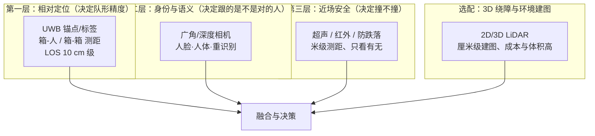
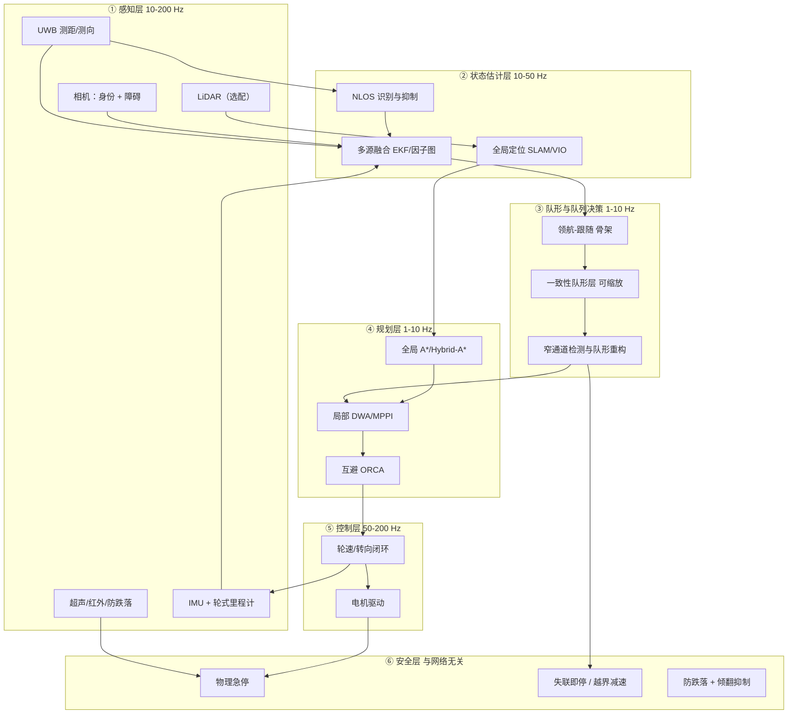
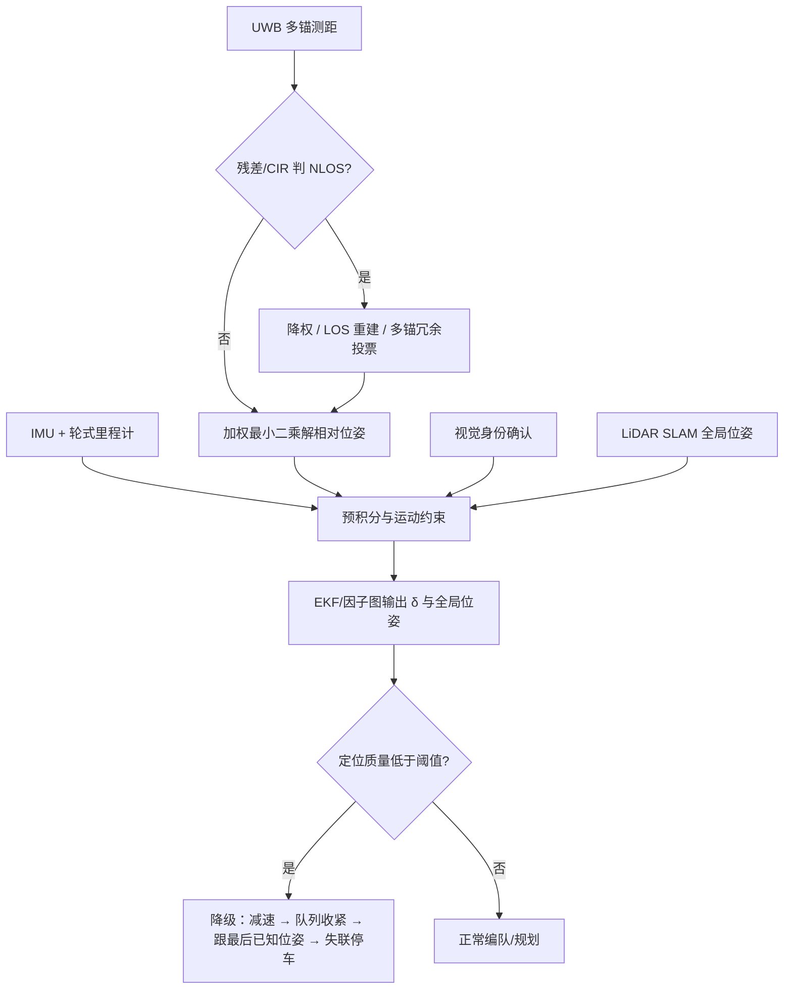
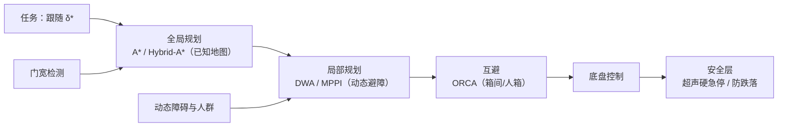
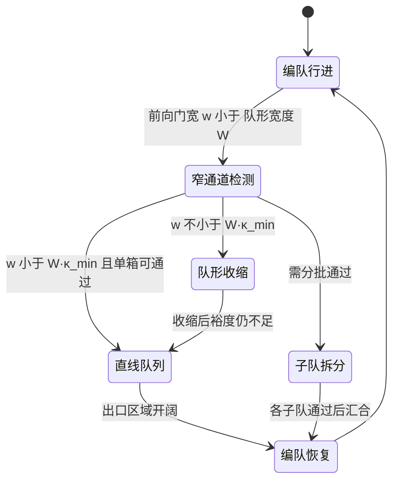
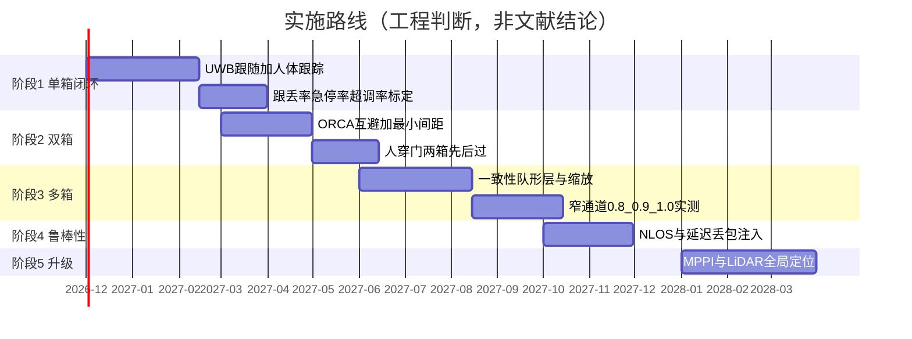
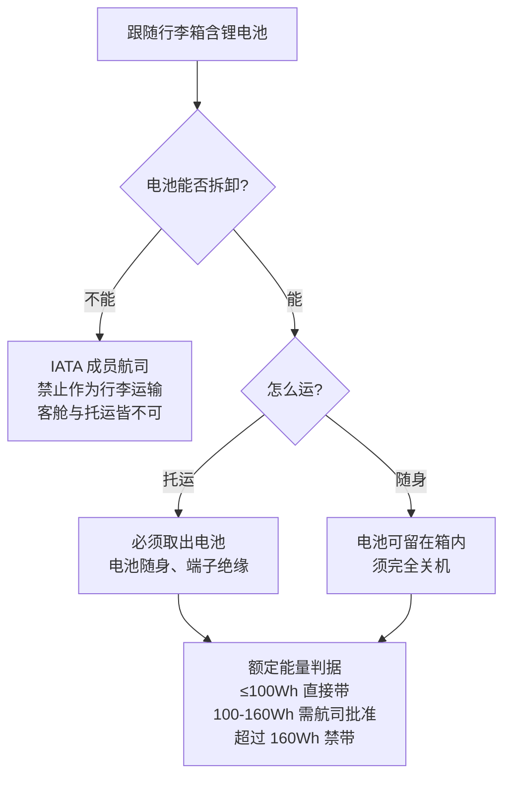

# 智能行李箱多箱自动跟随技术报告

> 撰写：Sage（Researcher）｜完成日期：2026-11-19
> 本报告汇总两份上游研究：《智能行李箱自动跟随-产品与专利调研》（产品/专利/合规，70 条来源）与《多行李箱自动跟随算法技术笔记》（算法，55 条来源）。
> **引用约定**：`[P-n]` 指产品/专利/合规调研台账第 n 条；`[A-n]` 指算法技术笔记来源第 n 条。两个台账的完整标题与 URL 见 §12，编号一一对应，无编号来源一律未引用。

**结论成熟度标记**（全文沿用）：

| 标记 | 含义 |
|---|---|
| 〔事实〕 | 有法规原文、官方页面或专利原文可查 |
| 〔文献量级〕 | 来自论文作者自报指标，平台/场地/口径不同，**不可横向比较**，只作量级参考 |
| 〔工程推断〕 | 本报告基于上述证据的工程判断，无直接文献支撑 |
| 〔未验证〕 | 公开资料查不到，或来源不可采信，明确标注为缺口 |

---

## 摘要

**一句话结论**：单箱自动跟随在工程上已经收敛、在商业上已经失败；多箱跟随的技术门槛不在"跟得上"，而在**队形可变、箱间防撞、丢定位不散**三件事，而整条产品线的真正生死线是**航空合规**。

**八条核心结论**

1. **单箱方案已收敛为三层结构**：UWB 做箱-人相对测距（LOS 下 10 cm 级）、视觉做身份确认与目标重识别、超声/红外做近场补盲与防跌落；激光雷达只出现在高端或原型机。〔文献量级〕[P-31][A-17][A-19]
2. **商用参数已形成事实标准**：跟随距离 0.5–1.5 m（US20180360177A1 权利要求明文）[P-44]，越界告警 2–3 m [P-2][P-14][P-22]，最高速度 6–11 km/h [P-5][P-10][P-17]，续航 10–20 km [P-3][P-15][P-17]，电池 62.6–100 Wh 且可拆 [P-20][P-3][P-17]。
3. **商业上是一条失败过的赛道**：ForwardX 明言"行李箱已不是重点"转向 B2B AMR [P-9]；酷哇转向无人环卫 [P-16]；90 分 Puppy1 已检索不到在售页面 [P-17][P-19]。在售的主要剩 Airwheel SR5 这类"UWB 手环 + 可骑行"小众品类 [P-20][P-23]。
4. **失败原因是"不能登机"，不是算法不行**：IATA 自 2018-01-15 起禁止运输锂电池不可拆卸的智能行李 [P-53][P-56]；FAA 规定智能行李须随身、托运仅允许 ≤0.3 g 锂金属或 ≤2.7 Wh 锂离子 [P-51]。产品形态被硬锁为「**≤100 Wh + 可快拆 + 20 寸**」[P-58][P-62]。
5. **多箱的难点被文献明确指向队形可变性**：窄通道的正确解法是"门宽检测 → 队形收缩 → 直线化/拆队 → 通过后恢复"，而不是保持刚性队形硬挤。〔文献量级〕[A-40][A-41][A-42][A-43]
6. **定位必须承认 NLOS 是主误差源**：UWB 遮挡产生**正偏差**，严重时 >1 m；纯单对测距闭环必然在金属箱体 + 人流环境中失效。〔文献量级〕[A-19][A-21]
7. **协同通信的瓶颈是时延与丢包，不是带宽**：3 机系统仅需 0.48 KB/s @20 Hz 即可维持 0.12 m 级相对定位；而完全无通信的方案（ORCA、无通信 DRL）在消费级成本下往往更划算。〔文献量级〕[A-13][A-37][A-48]
8. **推荐三档技术组合**：A 档（1–2 箱消费级）领航-跟随 + UWB + DWA；B 档（2–4 箱机场/酒店）加一致性队形层 + NLOS 抑制 + MPPI + ORCA；C 档（≥4 箱或强人流）加子队拆分 + CBF 式安全约束 + 延迟感知通信。详见 §9。〔工程推断〕

**本报告不做什么**

- 不引用任何市场规模、专利总量排名数字。上游调研已判定公开市场数据不可核实（同一文档对同一年份给出 9.8/28.6/38.6 亿美元三个值）[P-67][P-68]。
- 不对任何品牌做性能背书。产品参数一律标注"厂商宣称"或"媒体转述"。

---

## 1. 背景与需求

### 1.1 场景与用户

自动跟随行李箱的目标场景是**机场、高铁站、酒店、会展、园区**这类半结构化室内环境：地面平整（瓷砖/大理石）、人流密集且动态、存在门洞/闸机/电梯/扶梯等窄通道，行进距离在数百米到 2 km 量级。〔工程推断〕

用户价值主张有三条：① 双手解放（可同时拿咖啡/证件/手机）；② 多箱携带（一家三口 3–4 个箱子，只有 2 只手）；③ 短时骑行（机场长通道代步）。这三条价值主张的商业命运完全不同——**第三条已被多国法规封死**（见 §10.2），第一条的复购最弱。

> 上游调研给出的判断值得原样保留：三家头部公司的结局说明"跟随是演示效果最好、复购最差的功能"[P-17][P-9]。

### 1.2 需求分解（功能 → 可测指标）

| 需求 | 可测指标 | 目标值 | 依据 |
|---|---|---|---|
| 跟随不断线 | 跟随距离 | 0.5–1.5 m（稳态 1–2 m） | 专利权利要求明文 0.5–1.5 m [P-44]；Rover 实测维持 1–2 m [P-14] |
| 越界可感知 | 告警距离 | 2–3 m 振动/声音提醒 | Ovis 手环 2 m [P-2]；Rover 3 m [P-14][P-15]；SR5 3 m [P-22] |
| 跟得上步行 | 最高速度 | ≤6 km/h（建议上限） | 步行速度以下；消协比较试验 7–10 km/h 才兼顾安全 [P-64] |
| 单次可用 | 续航 | 10–20 km 或 4 h 级 | Ovis 20 km [P-3]；R1 20 km [P-10]；Puppy1 10 km(±3) [P-17]；Travelmate 4 h [P-24] |
| 能上飞机 | 电池 | ≤100 Wh 且可单手快拆 | IATA [P-53][P-56]、FAA [P-51]、CAAC [P-58]、消协 [P-62] |
| 能过窄道 | 门宽通过性 | 单箱 ≤0.6 m；多箱需队形收缩 | 门宽 0.8/0.9/1.0 m 三档测试建议属〔工程推断〕[A-40][A-41] |
| 多箱并行 | 并发箱数 | 2–4 箱（首发） | 一致性与拆队方案在 3 箱以上才体现价值 [A-1][A-42] |
| 不伤人 | 制动距离 | <3 m（7–10 km/h 下） | 15 款比较试验：仅 2 款制动 <3 m [P-64] |
| 能兜底 | 失效安全 | 失联即减速停车 + 物理急停 | 触控急停为现成专利思路 [P-43]；其余属〔未验证〕工程实践 |

### 1.3 为什么"多箱"是另一个问题

单箱跟随是一个**跟踪问题**：目标唯一、误差可闭环、失败可人工接管。多箱跟随是**多智能体协同 + 分布式状态估计**问题，多出四个单箱不存在的失败模式：〔工程推断，依据 [A-4][A-5]〕

1. **箱间碰撞**——跟随者彼此不知道对方位置；
2. **队形在窄通道必然崩解**——刚性结构通过性差 [A-3][A-9]；
3. **单点信息失效**——领航者丢定位则整组失效 [A-3][A-5]；
4. **通信不保证**——时延/丢包破坏去中心化的马尔可夫假设 [A-46]。

---

## 2. 现有产品与专利现状

### 2.1 三代技术演进

| 代际 | 代表产品 | 跟随介质 | 关键局限 | 来源 |
|---|---|---|---|---|
| 一 | COWAROBOT R1（2016） | 专用手环 + 声呐/深度传感 | 只跟手环不跟人，手环丢失即失效 | [P-10][P-11] |
| 二 | 90 分 Puppy1（2018）、Airwheel SR5 | UWB + RF 信标 | 需佩戴信标；遮挡与多径导致漂移 | [P-17][P-20][P-42] |
| 三 | ForwardX Ovis（2019） | 纯视觉（人脸/人体 + VSLAM） | 拥挤场景建议切手动；众筹交付失败 | [P-2][P-5][P-7] |

> **一个被各家官方承认的短板**：Ovis 官方 FAQ 建议"极拥挤场景切手动模式"[P-5]——等于承认自动跟随在机场高峰环境下鲁棒性不足。法媒实测 Rover 时记录到"跟随模式频繁掉线，需重新激活"[P-14]。

### 2.2 主要产品对比

> 空格 = 公开资料未披露。各家速度/续航报道口径不一致处已在单元格注明，**不可横向当作性能排名**。

| 产品 | 厂商/年份 | 跟随方式 | 传感器 | 最高速度 | 续航 | 电池 | 现状 | 来源 |
|---|---|---|---|---|---|---|---|---|
| **Ovis** | ForwardX 灵动科技 / 2019 | 视觉侧向跟随，可退到身后绕障 | 170° 广角相机 + 后相机、骁龙视觉芯片、ROS、超声、GPS | 3 m/s（≈10.8 km/h）；媒体另有 6–7 mph 口径 | ≈20 km（另说 4 h） | 96 Wh 可拆，可当充电宝 | **退出**：公司称行李箱已非重点 | [P-1][P-3][P-9] |
| **COWAROBOT R1** | 酷哇 / 2016 | 专用手环（CO-MOVE）侧向保持 | CO-EYE 深度 + 声呐组 + 防跌落 | 4.5 mph ≈7.2 km/h | 12.5 英里 ≈20 km | 96.5 Wh 可拆 | 众筹交付，后续为 Rover 系 | [P-10][P-11][P-16] |
| **COWAROBOT Rover S** | 酷哇 / 2020 前后 | 人体识别（AI）跟随，无需遥控 | 中文评测称约 15 个传感器（含 LiDAR、远红外、摄像头） | ≈7 km/h | 20 km | 6400 mAh 可拆，可当充电宝 | 主业已转无人环卫 | [P-13][P-14][P-15] |
| **90 分 Puppy1** | 润米（小米生态链）/ 2018 | UWB + RF 信标，5 m 内一键召唤，前后双向 | Segway 定制跟随芯片、UWB、内置定位雷达 | 6 km/h | 10 km（±3，4 km/h 匀速） | 100 Wh 可拆 | 未检索到官方在售页（**推断停产**，非官方声明） | [P-17][P-18][P-19] |
| **Airwheel SR5** | 爱尔威（常州）/ 在售 | UWB 高精度定位 + 手环，模式一键切换 | UWB + 超声避障 + 指纹解锁 | 官方未披露 | 官方未披露 | 62.6 Wh 可拆 | **仍在售**（约 ¥2388，时效报价） | [P-20][P-21][P-23] |
| **Travelmate** | Travelmate Robotics / 2016–2017 | 手机 App 为中枢，AI 跟随 | 多传感器阵列 + 板载处理器，支持语音/手势 | 6.75 mph ≈10.9 km/h | 4 h 跟随 / 100 h 手动 | — | 未见量产报道 | [P-24][P-25][P-26] |
| **Modobag**（对照：可骑行） | 芝加哥 Modobag / 2016 | 无跟随，人骑乘 | 电机 + 油门/刹车 | 8 mph ≈12.9 km/h | ≈13 km | 可拆性存疑 | 美国 10 大机场中 4 家明令禁止 | [P-27][P-29] |

**表外三个关键细节**

- **"跟随距离"是所有方案的公共调参目标**，且从专利层面就是 0.5–1.5 m [P-44]。
- **Ovis 在跟随模式下只有后两轮是驱动轮、前两轮改为万向轮**[P-5]——即**不具备全向底盘**，这解释了它绕障时选择"退到身后"而非侧向平移的机械原因。多箱编队若要做侧向让行，必须在底盘层面解决（见 §3.2）。
- **宣称精度不可信**：Ovis 众筹页写"±1 cm 避障精度"[P-5]，而实测量级见 §6；极果中文实测 R1 称约 90% 跟随成功率、30° 斜坡爬不上 [P-13]，属媒体实测，非标准测试。

### 2.3 商业化失败复盘（比参数更重要）

**Ovis 的众筹交付**〔事实，来自当事人记录〕：2018 年 Indiegogo 募资约 140 万美元 [P-6]；交付一路延期，2020-02-14 通知每箱追加约 $135 关税且要求电汇 [P-7]；到货用户反馈"要么完全不能用，要么用几天就失效"[P-7]；也有用户付 $228 关税后什么都没收到、全渠道无回应 [P-8]。站长总结出一种模式：**先小批量发货、再声称剩余无法交付、最后让用户放弃**[P-7]。

| 公司 | 原始切入 | 现在 | 依据 |
|---|---|---|---|
| ForwardX 灵动科技 | Ovis 消费级跟随箱 | 视觉 AMR（仓储/制造），C+ 轮累计超 6.5 亿元 | COO 明言 "luggage is not currently a focus" [P-9] |
| 酷哇 COWAROBOT | Rover 跟随箱 | 无人环卫扫地车、配送车 | 2018 年与中联环境发布无人扫地车 [P-15][P-16] |
| 润米 90 分 | Puppy1 跟随箱 | 指纹锁/金属箱等常规智能箱包 | Puppy1 已不在产品线 [P-17][P-19] |

> **给技术决策的含义**：跟随功能的"演示→量产"落差极大。做多箱方案时，**先把单箱在真人流中的掉线率、误停率、过门成功率做成可复现的量化指标**，再谈编队——否则编队只是在放大一个没解决的单箱问题。〔工程推断〕

### 2.4 专利清单与技术路线判读

| # | 公开号 | 名称（简） | 申请人 | 关键日期 | 技术要点 |
|---|---|---|---|---|---|
| P1 | CN105005307B | 智能跟随行李箱控制方法 | 武汉元驰 | 2015-08-07 / 授权 2017-11-14 | 正前距判状态、左右最短距判方向、拉杆倾角控轮速 [P-35] |
| P2 | CN104905520B | 自动行进的智能行李箱与系统 | —（葡语镜像） | 2015-06-05，Active | 早期基础性布局 [P-36] |
| P3 | CN106444763A/B | 基于视觉传感器的自动跟随方法及行李箱 | 泉州幻想智能 | 2016-10-20 / 授权 2019-06-11，**已因未缴年费失效** | 视觉取相对坐标 → PID 控后轮保持设定距离 [P-37] |
| P4 | CN207949167U | 智能跟随行李箱（实用新型） | 常州爱尔威 | 2018-03-12 / 授权 2018-10-12 | 两动力轮置于四从动轮之间，增大抗倾翻力臂 [P-38] |
| P5 | CN108013563A | 基于 UWB 的自动调速跟随与避障旅行箱 | — | 2017 前后 | UWB 测距 + 速度阈值分级加减速 [P-39] |
| P6 | CN109188412A | 自动跟随行李箱定位跟随及防撞 | — | 2018 前后 | 4 路超声 + 红外避障 + 蓝牙唤醒，单片机低成本 [P-40] |
| P7 | CN209862573U | 可自动跟随并自动避障的行李箱 | — | 2019 | CPU + 超声波组 + UWB 天线定位 [P-41] |
| P8 | CN109348426A | 基于 UWB 的跟随系统及方法 | 常州摩本 | 申请 2019-02-19 | 双 UWB 模块；10 Hz 更新、位置误差 <15 cm、测距误差 <10 cm、ID 校验 [P-42] |
| P9 | CN109674162B / CN110786609A | 自驱动行李箱及自驱动装置 | — | 同族分案 | **双跟随模式**（侧面/背面）；触控急停；执行轮可绕两轴旋转（可侧向走）；UWB/RFID/BT/WiFi [P-43] |
| P10 | US20180360177A1 | Robotic suitcase | 美国申请 | 优先权 2017-06-15，**已放弃 Abandoned** | ATTS 六级子系统；跟随距离权利要求 **0.5–1.5 m**；直立/平躺两姿态 [P-44] |
| P11 | WO2017219751A1 | 具有自主跟随避障功能的移动行李箱 | 中国申请人 | 公开 2017-12-28 | 移动平台+环境感知+数据融合定位+跟随避障；纳入地面凹凸信息 [P-45] |
| P12 | WO2018227987A1 | 自动行走的行李箱、智能设备及系统 | — | 2018 | 可脱离跟随目标自主规划到达目的地 [P-46] |
| P13 | CN120411480A | 基于深度学习的目标测距与自动行李箱跟随方法 | 电子科技大学 | 申请 2025-04-25 / 公开 2025-08-01 | YOLOv8 + 深度相机**交叉校验**测距；四分位去离群 + 中值滤波 [P-47] |
| P14 | CN120935756A/B | 基于 UWB 的行李箱设备跟随方法及系统 | 宁波巴比智能 | 授权公告 2026-06-30 | 多 UWB 天线**三角定位阵列** + UAS 评分选阵 + 角度融合 + 双 DIP 控制 + 应急恢复 [P-48] |
| P15 | WO2025251844A1 | 智能电动旅行箱及电动转向装置 | — | 优先权 2024-06-08 等 | 电动升降把手（内置电机 + 丝杠）[P-49] |
| P16 | CN202411316690 | 基于 UWB 的机场行李车动态跟随与避障系统 | — | — | 避障算力放**云端**，车端只做 UWB 通信以降本 [P-50] |

**四条判读**〔事实 + 工程推断〕

1. **"跟随"的专利重心已从"能不能跟"转向"跟得稳"**：P13 解决"距离测不准"，P14 解决"姿态抖动/急停/偏航"，都是真实落地痛点 [P-47][P-48]。
2. **双模式跟随（侧面 + 背面）被明确布局过**：P9 用两个传感模块 + 可绕两轴旋转的执行轮实现侧向平移 [P-43]。**这对多箱编队的"侧向让行"是直接可用的结构思路**。
3. **基础专利墙比想象中薄**：P3（视觉 + PID，最直白的实现路径）已失效 [P-37]；P10（美国系统级）已放弃 [P-44]；P11 的 PCT 也已 Ceased [P-45]。——**这属于法律状态判读，不构成 FTO 结论**，正式立项须查 CNIPA/incoPat 全量。
4. **风险集中在 2025 年后的新申请**：UWB 阵列（P14）与 YOLO+深度测距（P13）[P-47][P-48]。另有一条"算力上云"的机场专用形态（P16）[P-50]，比"每台箱子装算力"更贴近机场运营方的成本逻辑。

---

## 3. 关键硬件

### 3.1 传感器三层结构

| 器件 | 作用 | 典型指标 | 取舍 | 来源 |
|---|---|---|---|---|
| UWB（DW1000/DWM1001 类） | 箱-人、箱-箱相对测距 | LOS ±10 cm / 最远 200 m；4 节点 NLS 融合 RMSE 3.2 cm @10 Hz | 必需；**NLOS 是主误差源** | [A-18][A-17] |
| 广角/深度相机 | 身份确认、目标重识别、障碍语义 | Ovis 为 170° 广角 + 骁龙视觉芯片 | 必需；逆光/白墙/隐私是代价 | [P-4][P-3] |
| 超声波 | 近场补盲、防跌落 | 4 路超声 + 红外（低成本专利方案） | 便宜、只测距不识身份 | [P-40][P-7] |
| 红外/防跌落（cliff） | 台阶、扶梯口 | R1 即有 cliff 传感 | 必需安全件 | [P-10] |
| 2D/3D LiDAR | 建图、绕障、门宽检测 | 单点/线阵 100–1000 Hz；迷你 3D 雷达 360°×189° | 高端选配，牺牲体积与功耗 | [P-32][P-34] |
| IMU + 轮式里程计 | 高频补间、丢信号桥接 | 短时高精度、长时漂移 | 必需；瓷砖地面打滑率〔未验证〕 | [A-13][A-25] |

> **供应链判断**：做跟随行李箱**不需要自研全部传感器**。博赛智行直接售卖"跟随从机 + 跟随主机 + 整车控制器 + 电机驱动 + 传感器"套件并明写融合 UWB+IMU+LiDAR+深度视觉 [P-31]；激光雷达侧北醒（TF 系列，主打防跌落/近场补盲）[P-32]、思岚（雷达 + SLAMWARE + 多传感器融合）[P-33]、禾赛与广和通（JT 系列迷你 3D 雷达）[P-34] 均有现成方案。真正的差异化在**身份确认 + 拥挤场景鲁棒性 + 机械/电池合规**，不在传感器本身。

### 3.2 底盘与执行机构

- **主流是双轮差速/独立驱动 + 万向轮组**：SR5 为双轮驱动 30 W / 500 rpm 且电机轮可一键伸缩 [P-21]；Ovis 跟随时后两轮变驱动轮、前两轮为万向轮 [P-5]。
- **非完整约束是编队控制的硬约束**：多数编队算法假设全向移动或需专门扩展（ORCA 对非完整底盘即需扩展）[A-37][A-36]。**若产品要做"侧向让行/并排过闸机"，必须在结构上支持侧移**——P9 的可绕两轴旋转执行轮 [P-43] 是现成的专利级思路。
- **抗倾翻是结构性安全件**：P4 把两动力轮置于四从动轮之间以增大前后力臂，针对起步/急停倾翻 [P-38]。

### 3.3 算力与电气

| 项 | 结论 | 来源 |
|---|---|---|
| 板载算力 | 视觉方案需 SoC 级算力（Ovis 用骁龙视觉芯片 + ROS）；MPPI 类局部规划需 GPU 级算力 | [P-3][A-38] |
| 算力卸载 | 机场形态可把规划/避障算力放云端，车端只留 UWB 通信以降本 | [P-50] |
| 电池容量 | 现售/历史产品实测区间 62.6 / 96 / 96.5 / 100 Wh，全部可拆 | [P-20][P-3][P-10][P-17] |
| 电池合规 | ≤100 Wh 可随身；100–160 Wh 需航司批准；>160 Wh 禁止 | [P-58][P-51] |
| 充放电复用 | 多数产品把电池做成可当充电宝（USB 输出） | [P-3][P-15] |
| 制动 | 15 款样机最高速制动距离 0.5–15.2 m，跨度极大 | [P-64] |

> **一个未解决的问题**：行李箱载重 10–25 kg 变化对 DWA/MPPI 参数（尤其加速度上限与制动距离）的定量影响，**文献中没有对应数据**〔未验证〕[A-30][A-38]。这是必须自建测试台解决的工程问题。

---

## 4. 系统总体架构

### 4.1 分层架构

**为什么必须分层**〔文献依据 + 工程推断〕：定位误差与规划的时标差两个数量级——定位 10–50 Hz、规划 1–10 Hz、控制 50–200 Hz；混在一层会让参数互相拖累。文献中的"虚拟结构""一致性""MPPI"等方法，本质都是在这套分层里各自占据一层 [A-3][A-4][A-38][A-49]。

**两条架构红线**

1. **安全层必须独立于通信与上层决策**：箱间互避依赖网络，网络断了还要能停。ORCA 靠互相观测不靠通信，是很好的软件兜底 [A-37]，但**物理急停/超声硬急停是消费品安全底线**（文献不覆盖，属〔未验证〕工程实践）[P-10]。
2. **相对定位与全局定位必须分开设计**：二者传感器与误差特性完全不同——相对定位决定队形精度，全局定位决定能否做全局规划与"找回"[A-28][A-26]。

### 4.2 各层时标与信息流

| 层 | 频率 | 输入 | 输出 | 关键失效 |
|---|---|---|---|---|
| 感知 | 10–200 Hz | 原始传感 | 测距/图像/IMU | NLOS、逆光、遮挡 |
| 状态估计 | 10–50 Hz | 感知 + 里程计 | 相对位姿 δ、全局位姿 | 丢定位、漂移 |
| 队形决策 | 1–10 Hz | δ、队形参数、门宽 | 期望相对位姿 δ* | 队形不可行 |
| 规划 | 1–10 Hz | δ*、地图、动态障碍 | 速度指令 | 局部极小、陷阱 |
| 控制 | 50–200 Hz | 速度指令 | 轮速 | 打滑、饱和 |
| 安全 | 事件触发 | 超声/急停/心跳 | 断电/制动 | 传感器误报导致误停 |

---

## 5. 多箱编队与队列控制

### 5.1 单箱跟随是多箱的基元

人跟随文献把能力拆为**检测 → 跟踪 → 重识别 → 轨迹预测 → 规划 → 控制**六个环节，并指出 PID/DWA 因简单仍被大量采用，但在人群中缺乏社会性/适应性 [A-11][A-12]；综述进一步把"跟随策略"与"人机交互"分开，说明**跟随质量很大程度取决于目标重识别与遮挡恢复，而不是控制律本身** [A-10]。

> 这条结论直接决定多箱的资源分配：**多箱系统的预算应优先投在"每个人/每个箱的身份可区分"上**（UWB ID 校验 [P-42]、视觉重识别 [A-10]），而不是更花哨的编队控制器。

### 5.2 四类编队方法

| 方法 | 需要的通信 | 队形精度 | 队形可变性 | 单点失效风险 | 实现难度 | 行李箱场景定位 |
|---|---|---|---|---|---|---|
| 领航-跟随 | 低（可仅测距测向） | 中 | 中（依赖领航者） | **高**（领航者） | 低 | ✅ **首选骨架** [A-3][A-5] |
| 虚拟结构 | 中 | **高** | **低** | 中 | 中 | 固定队形/进电梯 [A-3][A-6] |
| 行为法 | 很低 | 低 | 高 | 低 | 低（调参难） | 兜底层（避障行为）[A-5][A-8] |
| 图论/一致性 | **高** | 中高 | 高 | 低 | 高 | 3 箱以上、拓扑会变 [A-1][A-7] |

**各方法的取舍要点**〔文献〕

- **领航-跟随**：最简单、行为最可预测、跟随者只需局部信息，可做分布式观测器让只有部分箱知道领航者状态 [A-5][A-9]。**致命缺点是领航者失效则整组失效**，且领航者拿不到跟随者状态做反馈，急转弯可能永久破坏队形 [A-3][A-5]。
- **虚拟结构**：队形精度最高、控制律可复用，但**对时变队形不友好**，遭遇非完整约束或被障碍打断时可能无法成形，窄通道易卡死 [A-3][A-6][A-9]。
- **行为法**：无中心节点、通信少，但**群体行为难以显式定义、收敛性无法保证**，权重靠经验调 [A-5][A-8][A-9]。
- **一致性**：Ren 等指出领航-跟随、虚拟结构、行为法许多情形都可视作一致性的特例，因此一致性是更一般的框架 [A-1][A-4]；**用复拉普拉斯做相似队形 + 队形尺度可变，可显著提高细长走廊通过性** [A-7]——这正是"排队进机舱/过闸机"需要的性质。

### 5.3 队形参数与默认形态建议

- 期望相对位姿记作 `δ*`；队形尺度 `δ(k)=κ·δ*`，κ∈(0,1] 为收缩系数 [A-41]。
- **建议默认形态是"队列（一列）"而非"几何队形"**：消费场景里用户通常只想"多一个箱子跟着"，刚性队形会放大窄通道失败率 [A-40][A-41]。上游笔记明确把这条列为"必须承认的反对意见"。

---

## 6. 相对定位与全局定位

### 6.1 分工

| 定位 | 回答的问题 | 传感器 | 误差特性 | 决定什么 |
|---|---|---|---|---|
| 相对定位 | 箱相对人/箱相对箱在哪 | UWB（主）、视觉、BLE | 随机 + NLOS 正偏差 | **队形精度、箱间防撞** |
| 全局定位 | 我在机场的哪个位置 | LiDAR SLAM、VIO | 漂移 + 门洞横向精度下降 | **全局规划、找回、跨区域** |

### 6.2 UWB：主力，也是主误差源

**可复现实测量级**〔文献量级，平台各异，不可横比〕

| 方案 | 报告指标 | 来源 |
|---|---|---|
| 4 节点 UWB（DWM1001）+ 非线性最小二乘纯相对定位 | RMSE **3.2 cm** @10 Hz | [A-17] |
| DW1000 标称 | LOS **±10 cm**，最远 200 m | [A-18] |
| UWB + 视觉融合（飞行机器人相对定位） | 95% 置信区间 ≈±0.19 m（东）/ ±0.29 m（北） | [A-18] |
| 多标签 UWB（MURP，不传里程计） | 平均绝对位置误差 **0.24 m**、航向 **9.5°**；学到的偏差修正再降 19% | [A-15] |
| 立体 UWB 阵列 | **100 Hz、厘米级**，信号复用提升网络容量 | [A-16] |
| UWB+LiDAR+里程计（3 机，8 字节/条） | 相对平移误差 **0.12 m**、旋转 **2.2°**，数据量 **0.48 KB/s @20 Hz** | [A-13] |

**致命弱点：NLOS**。遮挡导致 TOF 首径误判，产生**正偏差（测距偏大）**，严重时误差 **>1 m**，是 UWB 室内定位误差的主要来源 [A-19][A-21]。缓解分两类：① 识别 NLOS（残差/统计特征/机器学习/几何）；② 抑制偏差（加权、滤波、LOS 重建、约束优化）[A-19]。用 CIR 特征的工程实现报告 LOS/NLOS 测距误差分别降 **25.19% / 69.85%**，定位精度提升 **54.46%** [A-20]。

> **对行李箱的含义**：金属箱体、人体遮挡、人流密集都会造成 NLOS，**必须做 NLOS 识别 + 多锚冗余 + 与运动模型融合**，不能只用单对测距闭环 [A-19][A-13]。

### 6.3 其他定位手段

| 手段 | 原理 | 量级 | 用在行李箱上的角色 | 来源 |
|---|---|---|---|---|
| VIO（VINS-Mono 类） | 单目/双目 + IMU 紧耦合滑窗优化，IMU 预积分、在线外参、回环、4-DoF 位姿图 | 室内 72 m 回环 RPE **0.008–0.030 m** | 全局里程计 + 目标重识别；怕白墙/逆光/纯旋转 | [A-24][A-25][A-26] |
| BLE 5.1 AoA/AoD | 多天线相位差算角度，`θ=arccos(ψλ/2πd)`，天线间距须 < λ/2 | 室内角误差 **1.83°**、室外 **0.48°**；室外定位误差 **22 cm**，室内约 **0.36 m**（按上浮 39.7% 推算） | **只做粗方位/找回/分区**，不做队形级精度 | [A-22][A-23] |
| IMU/里程计 | 预积分、运动约束 | 短时高精度、长时漂移 | 补间与桥接；瓷砖打滑需外部校正 | [A-13][A-25] |
| LiDAR SLAM | 扫描匹配 + 图优化（Cartographer/LOAM 系/LIO-SAM） | 72 m 回环：LOAM RPE **0.030 m**、LIO-SAM **0.0606 m**、HDL-Graph **0.241 m**；三者 APE 均 ≈**1.5 m**，ORB-SLAM3 APE 最好 1.388 m；另一组 KITTI/AUTONOMOS：Cartographer ATE **2.13 m**、SC-LIO-SAM **1.84 m** | 全局定位/建图；**门洞横向精度会下降** | [A-26][A-27][A-28] |

**最要紧的一条**：**过窄开口时三种 LiDAR 方法的横向定位精度都会下降**——门洞、略宽通道、长走廊三组实验观察到同一现象 [A-28]。靠 LiDAR 保证"箱与箱在门洞处不擦碰"的横向精度**不可靠**，必须补 UWB 相对测距或结构化门宽检测。

**BLE 的宣传与实测不符**：厂商常称厘米级，独立实测室内约 0.36 m 且只在受限扇区有效 [A-22][A-23]。把它写进规格书时要谨慎。

### 6.4 多箱协同定位三条路线

1. **UWB 图 + LiDAR 图子图匹配**：同构机器人外观相同、无法靠特征区分，用两种连接图做共同子图匹配，LOS 相对精度 **<0.3 m**，NLOS 约 **0.5 m** [A-14]。
2. **仅用 UWB 网络做分布式相对位姿**（只交换 8 字节里程计）：**0.12 m / 2.2°** [A-13]。
3. **多标签 UWB 阵列单机自解算**：不依赖通信扩展，适合大规模 [A-15][A-16]。

### 6.5 融合与降级流程

> 降级策略中"队列收紧"与"失联停车"是〔工程推断〕，不是文献结论；文献只提供相对定位与 NLOS 抑制的方法 [A-13][A-19][A-20]。

---

## 7. 自主避障与绕障

### 7.1 三层结构

三层各自的职责不能混：全局层负责"路径可行且最优"，局部层负责"动力学可行且不撞"，互避层负责"多方同时决策时不打架"〔工程推断，依据 [A-29][A-30][A-37]〕。

### 7.2 各算法要点

| 算法 | 类型 | 动态障碍 | 全局最优性 | 计算量 | 非完整约束 | 窄通道 | 行李箱定位 |
|---|---|---|---|---|---|---|---|
| A* / Hybrid-A* | 全局搜索 | 否 | **是**（h 可采纳时）[A-29] | 中 | Hybrid-A* 支持 [A-50] | 好（可留裕度） | 全局路径层 ✅ |
| DWA / DWB | 局部反应 | 弱 | 否 | **低** | 显式建模 [A-30] | 中（易被陷阱困） | 局部执行层 ✅ |
| RRT / RRT* | 采样 | 否 | RRT 否 / RRT* 渐近 [A-31] | 高 | 支持 | 中（采样效率低） | 低频候选路径 |
| VFH+ / VFH* | 反应+前瞻 | VFH+ 差 [A-34] | 否 | 低 | 圆弧近似 [A-32] | 中 | 低算力兜底 |
| APF | 反应 | 弱 | 否 | **极低** | 忽略（质点假设）[A-36] | **差（局部极小）**[A-35] | 不建议单独用 |
| MPC / MPPI | 优化预测 | **强** | 局部最优（滚动） | **高**（GPU）[A-38] | 可写约束 | **好（可写箱间距）** | 高价值场景 ✅ |
| DRL | 学习 | 强（分布内） | 无保证 | 推理低 | 可学 | 依赖训练 | 社会性/人群层 |
| ORCA | 互避（无通信） | **强** | — | **极低** [A-37] | 需扩展 | 好（拥挤时） | 箱间防撞层 ✅ |

**值得单独记住的四条实测/结论**

1. **DWA 的可用性已被现场验证**：控制周期 0.25 s，在人群中以 **95 cm/s** 安全运行，**过门时自动减速到约 20 cm/s** [A-30]——这个"门口自动降速"的行为本身就是产品级细节。
2. **VFH+ 不能处理移动障碍，会被困住**；VFH+D 通过给 active window 加衰减解决 [A-34]。VFH* 用 A* 做多步前瞻验证，VFH+ 是其在 `n_g=1` 时的特例 [A-33]。
3. **APF 有公认缺陷**：振荡、参数敏感、窄通道差、局部极小、忽略非完整约束、目标附近有障碍时不可达（GNRON）[A-35][A-36]。只能当低算力兜底。
4. **DRL 已能做到无通信密集避障**：PanoDP 用 360° 全景深度 + 可微物理训练，**同一策略从 1 个智能体泛化到 512+ 个**，无需重训、无需通信 [A-48]。但无形式化安全保证，须有安全层兜底。

**ORCA 是"箱间防撞"的最优性价比**：每个 agent 承担一半避让责任，把"无碰撞"转成速度空间线性约束解低维 LP，**不需要通信**，可在**几毫秒**内为上万个 agent 算出无碰撞速度 [A-37]。缺点是在密集且感知不完美时可能过于保守或脆弱，对非完整底盘需专门扩展。

---

## 8. 多箱协同与安全

### 8.1 箱间防撞的三道防线

1. **几何层**：队形约束 + 最小间距，写进 MPC/MPPI 代价或 DWA 的 `dist` 项 [A-30][A-38]。
2. **互避层**：ORCA 类速度空间约束，保证"两箱同时朝对方走"时各退让一半 [A-37]。
3. **物理层**：超声/红外/防撞条硬急停，不依赖任何网络〔未验证，属工程实践〕[P-10]。

> 三道防线是**串联冗余**，不是三选一。任何一道缺失，在"人突然停下、后箱刹不住"的场景里就会发生事故。〔工程推断〕

### 8.2 窄通道：文献真正有效的手段

**先说结论：不要"硬保持队形"。** 文献共同收敛到的策略是：**门宽检测 → 队形收缩 → 收缩不够就直线化/拆队 → 通过后恢复** [A-40][A-41][A-42][A-43]。

| 手段 | 代表工作 | 机制 | 代价 |
|---|---|---|---|
| 队形缩放 + 直线队形 | 事件触发重构 [A-41] | 检测窄空间 → 收缩 → tailgating → 恢复；行为由 APF 实现、稳定性用 Lyapunov 证明 | 队形精度临时下降 |
| **自适应选形（最大可通行宽度）** | DEFORM（RA-L 2025）[A-40] | 先算无障碍最大可通行宽度，递归优化选当前最优队形 + 临时 leader + 一致性 MPC + 势场避撞；Gazebo 与实机验证 | 需要可靠的门宽/障碍分布估计 |
| 三角→线性切换 + MPC 跟随 | 自适应队形切换 [A-43] | 滑窗检测路径宽度 → 状态机切换 | 切换瞬态需 MPC 平滑 |
| **子队拆分（subteaming）** | STAF [A-42] | 图割把整队拆成可分别通过的子队，图神经网络协调，通过后合并；队形用弹簧-阻尼模型自适应 | 需要学习框架与训练 |
| 队形整体缩放 | 复拉普拉斯 [A-7] | 相似变换缩放队形 | 只能缩放，不能改形 |

> 门宽检测本身依赖 LiDAR 横向精度，而 LiDAR 恰好在门洞处精度下降 [A-28]。**建议在结构上增加"箱体外廓已知 + 门框双边检测"的兜底**，并在 0.8/0.9/1.0 m 三档门宽上做实测〔工程推断〕。

### 8.3 通信：延迟与丢包才是瓶颈

- **问题本质**：延迟让去中心化的马尔可夫假设失效，策略收到的是历史状态，产生虚假非平稳性 [A-46]。
- **三类解法**：
  1. **训练期建模**——把延迟写进博弈模型（Delay-Aware Markov Game），CTDE 训练、执行去中心，允许各 agent 不同延迟步数 [A-45]。
  2. **执行期状态估计（推荐）**——在策略前插一个信念滤波层（GRU 转移模型 + 递归 Kalman），把过期消息换成当前估计；**无需重训原策略**，可插拔 [A-46]。
  3. **联邦式分散学习**——联邦 RL + POMDP，异步聚合 + 陈旧度校正，报告在 **50% 链路丢包**下奖励退化仅 **11%**（对比方法 22.4% / 30.0%）[A-47]。
- **兜底方案成立**：完全不做箱间通信也能工作——ORCA 靠互相观测 [A-37]，无通信 DRL 靠全景深度 [A-48]。**对消费级产品，这条路线在成本与可靠性上往往更划算**。
- **量化预算**：3 机系统仅用 UWB 传 8 字节/条里程计即可支撑 0.12 m 级相对定位，总计 **0.48 KB/s @20 Hz** [A-13]。**带宽从来不是问题，时延与丢包才是。**

### 8.4 安全设计清单

| 机制 | 内容 | 证据 |
|---|---|---|
| 物理急停 | 触控/按键直接断电机 | P9 触控急停 [P-43] |
| 离身减速/停车 | 超出告警距离先减速后停 | 各家 2–3 m 告警 [P-2][P-14][P-22] |
| 信标失联即停 | 手环/信标断连不"盲跟" | R1 只跟手环、失联即失效的教训 [P-10][P-11] |
| 防跌落 | 台阶/扶梯口 cliff 检测 | [P-10] |
| 倾翻抑制 | 轮系布局增大抗倾翻力臂 | [P-38] |
| 制动能力 | 7–10 km/h 下制动距离 <3 m | 15 款试验仅 2 款达标 [P-64] |
| 误报处理 | 超声/红外误触发不应导致频繁急停 | 〔未验证〕需自测 |
| 责任界定 | DRL 等无形式化安全保证的方案，事故责任难界定 | [A-48] |

---

## 9. 技术方案对比与推荐

### 9.1 三档技术组合

| 层 | A 档：1–2 箱（消费级首发） | B 档：2–4 箱（机场/酒店） | C 档：≥4 箱或强人流 |
|---|---|---|---|
| 队形 | 领航-跟随（人为主领航者）[A-3][A-5] | 领航-跟随 + 一致性队形层（可缩放）[A-1][A-7] | 图/一致性 + 子队拆分（STAF 类）[A-42] |
| 相对定位 | UWB 双/三锚 TWR + 视觉人体跟踪 [A-17][A-11] | UWB 多锚 + NLOS 识别/抑制 + 里程计融合 [A-19][A-20][A-13] | UWB 多标签阵列自解算 或 UWB+LiDAR 融合 [A-15][A-16][A-13] |
| 全局定位 | 视觉 VIO（可选）[A-25][A-26] | 2D LiDAR SLAM（建图区域）+ 门宽检测 [A-28][A-26] | 2D/3D LiDAR SLAM + 跨区域重定位 |
| 窄通道 | 单箱通过即可 | DEFORM 式"最大可通行宽度→选形" + tailgating [A-40][A-41][A-43] | 子队拆分 + 点集配准式恢复 [A-42][A-44] |
| 局部避障 | DWA/DWB [A-30][A-50] | MPPI 或 DWB（算力允许则 MPPI）[A-38][A-50] | MPC/MPPI + CBF 式安全约束（或 ORCA 兜底）[A-38][A-37] |
| 全局规划 | NavFn / A* [A-29][A-50] | Hybrid-A* + 门宽约束 | Hybrid-A* + 动态重规划 |
| 箱间防撞 | 最小间距约束 | ORCA 类互避 + 硬急停 [A-37] | ORCA + MPC 间距约束 + 硬急停 |
| 通信 | 无需箱间通信（都跟人） | UWB 数据通道 + 执行期时延补偿 [A-13][A-46] | 延迟感知 + 信念滤波；断链降级为无通信互避 [A-45][A-46][A-37][A-48] |
| 平台 | ROS 2 + Nav2 + Gazebo [A-49][A-51] | 同左 + 多机 spawn [A-52][A-55] | 同左 + AirSim 训感知 [A-53] |
| 相对成本 | 低 | 中 | 高 |

### 9.2 平台选型

| 平台 | 定位 | 优势 | 局限 | 建议用途 |
|---|---|---|---|---|
| **ROS 2 + Nav2** | 中间件 + 导航栈 | 行为树编排 planner/controller/recovery，插件化；现成 DWB(DWA)、TEB、RPP、MPPI、Smac(Hybrid-A*)；被 300+ 公司使用 [A-49][A-50] | 学习曲线；默认参数对非完整重载平台需重调 | **主线开发底座** ✅ |
| Gazebo（gz-sim） | 物理仿真 | 与 ROS 2 通过 `ros_gz` 桥接；多机搭建简单，同一份代码可上实机 [A-51][A-52][A-55] | 视觉逼真度低、CPU 物理为主 | **多箱算法验证主力** ✅ |
| AirSim | 视觉仿真（Unreal） | 逼真渲染、深度/热成像/LiDAR，适合训感知；有 ROS wrapper [A-53] | 动力学为简化近似、多机 spawn 效率一般 [A-54] | 只做**感知/DRL 数据生成** |
| MATLAB/Simulink | 控制设计 | MPC/一致性控制律快速验证、代码生成 | 多机与传感器建模弱 | 控制律原型 |

> Gazebo 与 AirSim 的对比来自厂商技术博客，**仅作取舍框架，不是权威评测** [A-54]。

### 9.3 实施路线

**五步顺序的理由**〔工程推断〕：单箱不动就是编队的不动；双箱先验证"人穿门、两箱先后过"这一最高频的失败场景；多箱再上队形层；鲁棒性必须做**故障注入**（人为遮挡制造 NLOS、注入 100/300 ms 延迟、10%/30% 丢包），而不是只在理想环境拍演示视频；最后才用算力换性能。

### 9.4 风险与反对意见（必须一并读）

1. **"多箱编队"可能不是用户的真实需求**：消费场景里用户常只想"多一个箱子跟着"，不是保持几何队形；刚性队形会放大窄通道失败率 [A-40][A-41]。**建议把"队形"降级为"队列（一列）"作为默认形态。**
2. **UWB 在金属箱体 + 人群中的表现可能显著差于论文环境**：文献的 3–12 cm 多为 LOS 受控条件，NLOS 下 0.5 m 甚至 >1 m [A-17][A-14][A-21]。**任何"厘米级跟随"的对外宣称都需要遮挡场景实测支撑。**
3. **学习型方案的可解释性与安全责任**：DRL 无形式化安全保证，公共场景事故责任难界定 [A-48]。
4. **BLE AoA 的"厘米级"宣传与实测不符**：独立实测室内约 0.36 m 且只在受限扇区有效 [A-22][A-23]。
5. **产品侧的最大风险不在算法**：三家头部厂商退出、众筹交付失败，说明"能上飞机 + 能量产一致"比"能跟随"更难 [P-9][P-7][P-53]。

**未解决问题（无可靠来源，需实测）**〔未验证〕

- 行李箱载重 10–25 kg 变化对 DWA/MPPI 参数的影响：文献无对应数据。
- 机场/高铁站人流密度下的社会性间距偏好：人跟随领域有研究框架，缺行李箱形态数据 [A-10][A-11]。
- 瓷砖/大理石地面轮式里程计打滑率：无来源。
- 多箱同时过闸机/旋转门的机械可行性：属结构设计问题，不在算法范围。
- 无任何可核实的"跟随成功率/掉线率"第三方标准化测试数据（见 §10.4）。

---

## 10. 合规与机场场景限制

### 10.1 航空：最硬的一道门

| 规则 | 内容 | 来源 |
|---|---|---|
| IATA（2018-01-15 生效，延续至今） | 锂电池**不可拆卸**的智能行李**禁止运输**；可拆卸者装箱托运时必须取出电池随身 | [P-53][P-56] |
| FAA PackSafe（页面更新 2026-04-13） | 含锂电池行李**必须随身**，除非电池已取出；托运仅允许锂金属 ≤0.3 g 或锂离子 ≤2.7 Wh；托运设备须完全关机（非睡眠） | [P-51] |
| IATA 2026 版旅客指南 | 智能行李被单列为设备类别，按 Wh 与"安装/可拆/不可拆"分档 | [P-52] |
| 航司执行 | 国泰（2018-01-01 起）、达美（2018-01-15 起）、夏威夷等同步执行；夏威夷明确把"电池+电机+GPS 使箱体自行推进并跟随主人"列为智能行李特征 | [P-54][P-55][P-57] |
| 中国民航局 | ≤100 Wh 可随身；100–160 Wh 需航司批准（备用电池限 2 个）；>160 Wh 禁止；充电宝严禁托运 | [P-58][P-59][P-60] |
| 东航细化 | 每人便携式电子设备 ≤15 台、备用电池 ≤20 块；充电宝不得放行李架，须置于座椅下方 | [P-61] |
| 消协口径（深圳，2024-07） | 电动行李箱**属不能托运物品**；建议 ≤100 Wh 且 ≤20 寸；电池可拆则可把箱体托运、电池随身 | [P-62][P-63] |

> **设计含义（三位一体，缺一即出局）**：**≤100 Wh + 可单手快拆 + 20 寸** [P-51][P-58][P-62]。这也解释了 90 分 Puppy1 为什么专门强调"100 Wh 可拆卸锂电池、安检时可拆开过检"[P-17]。

### 10.2 使用场景：道路与机场

| 风险 | 事实 | 来源 |
|---|---|---|
| 公共道路骑行违法 | 电动行李箱既非机动车也非非机动车，不能作为代步工具上道路；只能在封闭小区道路、广场、室内场馆使用（依据《道路交通安全法实施条例》及第 89 条罚则） | [P-62][P-63][P-66] |
| 机场航站楼内可能被禁 | 美国 10 大最忙机场中 4 家（亚特兰大、丹佛、JFK、旧金山）明确表示此类装置违反其"个人运输装置"禁令 | [P-27] |
| 国别差异 | 日本 2024 年起加强管制可骑行电动行李箱；新加坡樟宜机场**全面禁止** | [P-28] |
| 地铁等封闭空间 | 部分地铁站允许携带（电池合规前提下）但**禁止站内骑行** | [P-66] |

> **场景准入判断**〔事实 + 工程推断〕：**"跟随"与"骑行"必须解耦**。骑行功能已在多国被封（且是机场禁令的主要触发点），而"跟随"目前没有专门禁令（中国机场对"跟随箱"是否有专门规定，本次检索未找到明文〔未验证〕）。产品定义应明确写"仅限机场/车站/酒店等封闭场地使用，禁止上道路"，并在说明书与包装标注 [P-62][P-65]。

### 10.3 认证与产品安全

- **认证空白**：深圳消委会明确"电动行李箱**暂未纳入《强制性产品认证目录》**，没有严格的测试和认证标准"；锂电池本体属 CCC 强制认证范围，选购应确认电池有独立 CCC 标志 [P-62][P-65]。
- **速度与制动是最大安全隐患**：广东省消委会对 15 款电动旅行箱比较试验，最高速度跨度 **2.6–22.9 km/h**，最高速制动距离 **最短 0.5 m、最长 15.2 m**；仅 4 款（Airwheel、UBNI、DTA、芒果鸟）速度落在 7–10 km/h，仅 2 款制动 <3 m [P-64]。
- **监管定性**：新疆市场监管局把电动骑行箱定性为"滑行工具"，禁止公共道路行驶，并指出该品类尚未纳入强制认证、质量参差不齐；其提示的最高速度约 15 km/h、载重 100 kg [P-65]。

### 10.4 其他非技术风险

| 风险 | 说明 | 来源 |
|---|---|---|
| 众筹交付 | Ovis：延期 → 追加关税 → 收货即坏 / 全无音信 | [P-7][P-8] |
| 隐私 | 视觉方案需人脸/人体识别，公共空间持续拍摄涉他人肖像与个人信息；应按《个人信息保护法》本地处理、最小采集 | [P-4]（识别能力）+ 合规常识〔推断〕 |
| 防盗反成诱饵 | 手环/信标丢失即失效；"骑行者逃跑"场景的追回能力无实证 | [P-10][P-11][P-14] |
| 售后与备件 | 定制驱动轮、定制电池、定制手环，任一停产即整机失效 | [P-8] |
| 第三方测试缺失 | 除消协对 15 款电动旅行箱的比较试验外，未见针对"跟随功能"的标准化测试（跟随成功率/掉线率/避障成功率均无公开可复现数据） | [P-64] |

---

## 11. 图片与图表清单（插入说明）

本报告全部插图均为**待制作的示意图**（自制，非引用他人图片），下方给出画面内容与嵌入写法。图片放入 `attachments/` 后，用 `![[文件名]]` 引用即可；`|600` 控制宽度。

| 编号  | 建议文件名                       | 画面内容                                                     | 数据依据                     |
| --- | --------------------------- | -------------------------------------------------------- | ------------------------ |
| 图-1 | `fig-01-sensor-layout.png`  | 20 寸箱体俯视 + 侧视，标注前向 UWB 锚点、顶部广角相机、两侧超声探头、底部防跌落传感器、可拆电池仓位置 | §3.1 [P-31][P-10][P-20]  |
| 图-2 | `fig-02-arch-layers.png`    | §4.1 Mermaid 架构图的出版级重绘（六层 + 时标），用于文档/路演                  | §4 [A-3][A-49]           |
| 图-3 | `fig-03-uwb-nlos.png`       | UWB 三角定位与人体遮挡造成的 NLOS 正偏差示意（测距从 d 变为 d+Δ，Δ 可 >1 m）       | §6.2 [A-19][A-21]        |
| 图-4 | `fig-04-narrow-passage.png` | 三箱编队过 0.9 m 门洞的三段式序列：编队收缩 → 直线队列 → 通过后恢复                 | §8.2 [A-40][A-41]        |
| 图-5 | `fig-05-safety-layers.png`  | 三道防线剖面图：几何间距（虚线）/ ORCA 速度锥 / 硬急停触达范围                     | §8.1 [A-37][P-43]        |
| 图-6 | `fig-06-compliance.png`     | "≤100 Wh + 可快拆 + 20 寸"三位一体约束的图标化表达，附 IATA/FAA/CAAC 三行判定  | §10.1 [P-51][P-58][P-62] |
| 图-7 | `fig-07-roadmap.png`        | §9.3 甘特图的出版级重绘（五阶段里程碑）                                   | §9.3〔工程推断〕               |

**可选实拍/截图（需自行确认版权）**：产品形态对比可截取各厂商官网产品图（Airwheel SR5 [P-20]、Rover S [P-14] 报道配图），**仅限内部资料使用，不得直接对外发布**。若需对外，请向厂商或摄影师取得授权。

---

## 12. 参考来源

> 编号规则：`P-n` 与《智能行李箱自动跟随-产品与专利调研》文末台账第 n 条一致；`A-n` 与《多行李箱自动跟随算法技术笔记》第 n 条一致。可直接回查原文。

### 12.1 产品 / 专利 / 合规来源（P-1 ～ P-70）

| # | 来源 | 类型 | 链接 |
|---|---|---|---|
| P-1 | VentureBeat《ForwardX raises $10 million…》 | 报道 | https://venturebeat.com/ai/forwardx-raises-10-million-for-ai-powered-luggage-that-follows-you |
| P-2 | GlobeNewswire《ForwardX…CES 2019》 | 新闻稿 | https://globenewswire.com/news-release/2019/01/06/1680900/0/en/ForwardX-Robotics-Introduces-Production-Ready-Next-Gen-Autonomous-Suitcase-at-CES-2019.html |
| P-3 | New Atlas《Motorized AI-packin' suitcase…》 | 报道 | https://newatlas.com/ovis-suitcase/55063 |
| P-4 | Digital Trends《The ForwardX Ovis…》 | 报道 | https://digitaltrends.com/cool-tech/forwardx-cx-1-self-following-smart-suitcase |
| P-5 | Indiegogo《Ovis》项目页 | 众筹页 | https://indiegogo.com/en/projects/forwardxrobotics/ovis-1st-ai-powered-suitcase-following-by-side |
| P-6 | Forbes《I Tried The $800 Robot Suitcase》 | 上手 | https://forbes.com/sites/johnkoetsier/2019/01/07/i-tried-the-800-robot-suitcase-so-you-wont-have-to |
| P-7 | Brian M. Fischer《The $778,531 Luggage Scam》 | 个人记录 | https://brianmfischer.com/naucrates-indiegogo-luggage-scam |
| P-8 | PissedConsumer《Ovis By Forwardx》 | 用户投诉 | https://pissedconsumer.com/ovis-by-forwardx/RT-F.html |
| P-9 | FreightWaves《ForwardX Robotics captures $15M…》 | 报道 | https://freightwaves.com/news/forwardx-robotics-captures-15m-in-series-b |
| P-10 | Indiegogo《R1: The First and Only Robotic Suitcase》 | 众筹页 | https://www.indiegogo.com/en/projects/cowarobot/r1-the-first-and-only-robotic-suitcase |
| P-11 | The Verge《I thought I knew the future of luggage…》 | 上手 | https://www.theverge.com/circuitbreaker/2016/7/26/12287024/cowarobot-r1-autonomous-suitcase-future-of-luggage |
| P-12 | Android Authority《Crowdfunding project of the week: COWAROBOT R1》 | 报道 | https://www.androidauthority.com/crowdfunding-project-week-cowarobot-r1-suitcase-follows-708387/ |
| P-13 | 极果《Cowarobot R1 拉杆箱》 | 中文评测 | https://www.jiguo.com/article/article/57028.html |
| P-14 | franceinfo《On a testé la première valise robot…》 | 实测 | https://www.franceinfo.fr/replay-radio/nouveau-monde/nouveau-monde-on-a-teste-la-premiere-valise-robot-qui-vous-suit-partout_2913345.html |
| P-15 | 界面新闻《自己"奔跑"的行李箱，酷哇…》 | 报道 | https://jiemian.com/article/4448392.html |
| P-16 | TechNode《Meet The Robotic Suitcase That Follows You Around》 | 报道 | https://technode.com/2016/07/28/robotic-suitcase-follows-just-like-dog |
| P-17 | 新浪数码《90 分发布智能跟随旅行箱 Puppy1》 | 报道 | https://tech.sina.cn/mobile/xp/2018-11-02/detail-ihnfikve8775805.d.html |
| P-18 | 果壳《90 分智能跟随旅行箱 Puppy1 双 11 正式发售》 | 报道 | https://m.guokr.com/article/458083/ |
| P-19 | ZingGadget《CES 2018 小米生态链 90FUN Puppy 1》 | 报道 | https://zinggadget.com/90fun-showcase-puppy-1-self-following-suitcase-in-ces-2018/ |
| P-20 | Airwheel 官网 SR5 产品页 | 产品页 | http://airwheel.cn/product/sr5 |
| P-21 | Airwheel 官网 SR5 功能页 | 产品页 | http://airwheel.cn/function/sr5 |
| P-22 | Airwheel 台湾 SR5 页 | 产品页 | https://www.airwheeltaiwan.com/page17.html |
| P-23 | 什么值得买 SR5 报价 | 电商页 | https://smzdm.com/p/28279778 |
| P-24 | 中国广播网《这款行李箱不仅可以智能跟随 还能躲避障碍》 | 报道 | http://m.cnr.cn/tech/20170920/t20170920_523956951.html |
| P-25 | CNBC《This robot suitcase follows you around on your travels》 | 报道 | https://cnbc.com/2017/04/24/travelmate-an-autonomous-suitcase.html |
| P-26 | Condé Nast Traveler《Travelmate Robotics Suitcase…》 | 报道 | https://cntraveler.com/story/this-robot-suitcase-follows-you-around-and-answers-voice-commands |
| P-27 | MarketWatch《Zooming past you at an airport soon: Rideable suitcases》 | 报道/调查 | https://marketwatch.com/story/zooming-past-you-at-an-airport-soon-rideable-suitcases-2016-08-11 |
| P-28 | Al Jazeera《Why is Japan cracking down on rideable motorised suitcases?》 | 报道 | https://aljazeera.com/news/2024/8/3/why-is-japan-cracking-down-on-rideable-motorised-suitcases |
| P-29 | The Points Guy《Which Smart Bags Make the Cut…》 | 报道 | https://thepointsguy.com/news/smart-bags-with-without-removable-battery |
| P-30 | 搜狐《ARTVZ 爱途仕智能电动行李箱实测》（软文特征明显） | 报道 | https://www.sohu.com/a/1084362002_122645244 |
| P-31 | 博赛智行 PSICV《智能跟随整体方案》 | 供应链 | https://www.psicv.com/Solutions |
| P-32 | 北醒 Benewake 机器人方案页 | 供应链 | https://www.benewake.com/robot/index.html |
| P-33 | 思岚 Slamtec《机器人避障解决方案》 | 供应链 | https://www.slamtec.com/cn/news/detail/164 |
| P-34 | 禾赛科技《与广和通联合发布机器人激光雷达方案》 | 供应链 | https://www.hesaitech.com/cn/news/1377 |
| P-35 | Google Patents CN105005307B | 专利 | https://patents.google.com/patent/CN105005307B/zh |
| P-36 | Google Patents CN104905520B | 专利 | https://patents.google.com/patent/CN104905520B/pt |
| P-37 | Google Patents CN106444763A/B | 专利 | https://patents.google.com/patent/CN106444763A/zh |
| P-38 | 品牌网 CN207949167U | 专利 | https://www.chinapp.com/patent/466314.html |
| P-39 | Patsnap CN108013563A | 专利 | https://eureka.patsnap.com/patent-CN108013563A |
| P-40 | Google Patents CN109188412A | 专利 | https://patents.google.com/patent/CN109188412A/en |
| P-41 | Google Patents CN209862573U | 专利 | https://patents.google.com/patent/CN209862573U/en |
| P-42 | Google Patents CN109348426A | 专利 | https://patents.google.com/patent/CN109348426A/zh |
| P-43 | Google Patents CN109674162B / CN110786609A | 专利 | https://patents.google.com/patent/CN109674162B/en |
| P-44 | Google Patents US20180360177A1（已放弃） | 专利 | https://patents.google.com/patent/US20180360177A1/en |
| P-45 | Google Patents WO2017219751A1 | 专利 | https://patents.google.com/patent/WO2017219751A1/en |
| P-46 | Google Patents WO2018227987A1 | 专利 | https://patents.google.com/patent/WO2018227987A1/en |
| P-47 | Google Patents CN120411480A | 专利 | https://patents.google.com/patent/CN120411480A/en |
| P-48 | Patsnap CN120935756A/B | 专利 | https://eureka.patsnap.com/patent/CN120935756A |
| P-49 | Google Patents WO2025251844A1 | 专利 | https://patents.google.com/patent/WO2025251844A1/zh |
| P-50 | 技术网 CN202411316690（机场行李车） | 专利 | https://www.xjishu.com/zhuanli/54/202411316690.html |
| P-51 | FAA PackSafe《Baggage Equipped with Lithium Batteries》 | 法规 | https://www.faa.gov/hazmat/packsafe/baggage-with-lithium-batteries |
| P-52 | IATA《Passengers travelling with lithium batteries》2026 版 | 法规 | https://www.iata.org/contentassets/6fea26dd84d24b26a7a1fd5788561d6e/passengers_travelling_with_lithium_batteries.pdf |
| P-53 | CNBC《Smart luggage…facing new travel restrictions》 | 报道 | https://www.cnbc.com/2018/01/12/smart-luggage-with-lithium-batteries-are-facing-new-travel-restrictions.html |
| P-54 | 国泰航空《new 'smart bag' policy》 | 航司政策 | https://news.cathaypacific.com/cathay-pacific-and-cathay-dragon-to-introduce-new-smart-bag-policy-146794 |
| P-55 | Delta《Puts Limits on Select 'Smart Bags'》 | 航司政策 | https://pro.delta.com/content/corporate/us/en/news/news-archive/2017/december-2017/delta-puts-limits-on-select--smart-bags--out-of-safety-concerns.html |
| P-56 | Flight Safety Foundation《All IATA Airlines to Restrict Smart Luggage…》 | 报道 | https://flightsafety.org/iata-airlines-restrict-carriage-smart-luggage-beginning-jan-15 |
| P-57 | 夏威夷航空《'Smart Bags' Restrictions》 | 航司政策 | https://news.alaskaair.com/releases/hawaiian-airlines-to-implement-smart-bags-restrictions/ |
| P-58 | 中国民航局《关于民航旅客行李中携带锂电池规定的公告》 | 法规 | http://www.caac.gov.cn/XXGK/XXGK/ZFGW/201601/t20160122_27588.html |
| P-59 | 中国民航局《航旅指南》 | 法规 | https://www.caac.gov.cn/CXCK/HLZN/201512/t20151214_15866.html |
| P-60 | 中国民航局《关于重申民航旅客携带"充电宝"乘机规定的公告》 | 法规 | https://www.caac.gov.cn/XXGK/XXGK/TZTG/201511/t20151105_11036.html |
| P-61 | 中国东方航空《锂电池运输要求》 | 航司政策 | https://global.ceair.com/global/static/Announcement/BaggageService/restrictedluggageandspecialitems/erlithiumBattery/ |
| P-62 | 广州市消委会转载《电动行李箱能上飞机吗？》 | 消协指引 | https://www.guangzhou315.com/html/web/jingshitishi/27901.html |
| P-63 | 南都/奥一《事关电动行李箱，深圳市消委会发布消费指引》 | 报道 | https://m.mp.oeeee.com/a/BAAFRD000020240713974624.html |
| P-64 | 广东省消委会《15 款电动旅行箱比较试验》 | 比较试验 | https://www.zs.gov.cn/zszjj/gkmlpt/content/2/2644/post_2644031.html |
| P-65 | 新疆市场监管局《电动骑行箱消费提示》 | 法规 | https://scjgj.xinjiang.gov.cn/xjaic/qjxx/202512/10fcb02c008b432a8888c6beb4b694fc.shtml |
| P-66 | 澎湃新闻《电动行李箱成"网红代步神器"？交警提示》 | 报道 | https://www.thepaper.cn/newsDetail_forward_25474725 |
| P-67 | 智研咨询《2025 年中国电动智能行李箱行业…》（**不予采信**） | 行业报告 | https://chyxx.com/industry/1233747.html |
| P-68 | 人人文库《2025-2030 智能跟随行李箱专利布局…》（**不予采信**） | 行业报告 | https://www.renrendoc.com/paper/530192727.html |
| P-69 | 36 氪 灵动科技项目页 | 企业资料 | https://pitchhub.36kr.com/project/1713076393502978 |
| P-70 | AI 云资讯《从行李箱、物流车到机器人 灵动科技的 AI 创想和实践》 | 报道 | https://www.icloudnews.net/a/20552.html |

### 12.2 算法来源（A-1 ～ A-55）

| # | 来源 | 链接 |
|---|---|---|
| A-1 | Ren, Beard, Atkins. *Information consensus in multivehicle cooperative control*. IEEE CSM, 2007 | https://doi.org/10.1109/mcs.2007.338264 |
| A-2 | Ren, Beard, McLain. *Coordination Variables and Consensus Building in Multiple Vehicle Systems* | https://intra.ece.ucr.edu/~ren/papers/preprints/bookchapters/RenBeardMcLain03.pdf |
| A-3 | *Consensus based attractive vector approach for formation control of nonholonomic mobile robots*. IEEE AIM 2015 | https://doi.org/10.1109/aim.2015.7222666 |
| A-4 | *Advancement Challenges in UAV Swarm Formation Control: A Comprehensive Review*. Drones 8(7):320 | https://mdpi.com/2504-446x/8/7/320 |
| A-5 | *A Survey of Multi-mobile Robot Formation Control*. IJCA 181(48) | https://ijcaonline.org/archives/volume181/number48/issa-2019-ijca-918651.pdf |
| A-6 | *A Novel Virtual-Structure Formation Control Design for Mobile Robots with Obstacle Avoidance*. Appl. Sci. 10(17):5807 | https://doi.org/10.3390/app10175807 |
| A-7 | *Distributed Formation Control of Multi-Robot Systems with Path Navigation via Complex Laplacian*. Entropy 25(11):1536 | https://doi.org/10.3390/e25111536 |
| A-8 | *Formation Control and Tracking of Mobile Robots using Distributed Estimators…* | https://link.springer.com/article/10.1007/s42835-022-01213-0 |
| A-9 | *Distributed Estimation and Control for Leader-Following Formations of Nonholonomic Mobile Robots*. IEEE | https://ieeexplore.ieee.org/document/8319931 |
| A-10 | *Person-following by autonomous robots: A categorical overview*. IJRR | https://doi.org/10.1177/0278364919881683 |
| A-11 | *Human Following and Guidance by Autonomous Mobile Robots: A Comprehensive Review*. IEEE Access 2025 | https://doi.org/10.1109/access.2025.3548134 |
| A-12 | *Recent advances in AI-based mobile robots for human companionship: survey*. Artif Intell Rev | https://link.springer.com/article/10.1007/s10462-026-11603-9 |
| A-13 | *Distributed Relative Localization for Homogeneous Multi-Robot Systems through UWB Ranging and Limited Communications*. arXiv:2610.11308 | https://arxiv.org/abs/2610.11308 |
| A-14 | *Distributed Relative Localization Based on Ultra-WideBand and LiDAR for Multi-robot with Limited Communication*. arXiv:2610.11141 | https://arxiv.org/abs/2610.11141 |
| A-15 | *MURP: Multi-Agent UWB Relative Pose Estimation with Constrained Communications in 3D*. arXiv:2312.17731 | https://arxiv.org/abs/2312.17731 |
| A-16 | *Robust and Scalable Multi-Robot Localization Using Stereo UWB Arrays*. Tsinghua NICS | https://nicsefc.ee.tsinghua.edu.cn/nics_file/pdf/dfb37dd2-8114-4126-b691-8d426a16364c.pdf |
| A-17 | *Development of a Cooperative Localization System using a UWB Network and BLE Technology*. arXiv:2212.06519 | https://arxiv.org/html/2212.06519v1 |
| A-18 | *Relative localization with computer vision and UWB range for flying robot formation control*. IEEE | https://ieeexplore.ieee.org/document/7838839 |
| A-19 | *Survey on NLOS Identification and Error Mitigation for UWB Indoor Positioning*. Electronics 12(7):1678 | https://mdpi.com/2079-9292/12/7/1678 |
| A-20 | *UWB Ranging Error Mitigation with Novel CIR Feature Parameters and Two-Step NLOS Identification*. Sensors 24(5):1703 | https://doi.org/10.3390/s24051703 |
| A-21 | *Machine Learning Integration in UWB-Based Indoor Positioning Systems: A Comprehensive Review*. Electronics 15(1):181 | https://mdpi.com/2079-9292/15/1/181 |
| A-22 | *An Experimental Study on Direction Finding of Bluetooth 5.1: Indoor vs Outdoor*. arXiv:2103.04121 | https://arxiv.org/html/2103.04121v1 |
| A-23 | *Dead on Arrival: An Empirical Study of The Bluetooth 5.1 Positioning System* | https://homepages.inf.ed.ac.uk/ppatras/pub/wintech19.pdf |
| A-24 | *VINS-Mono*（代码库） | https://github.com/HKUST-Aerial-Robotics/VINS-Mono |
| A-25 | Qin, Li, Shen. *VINS-Mono*. arXiv:1708.03852 | https://arxiv.org/html/1708.03852v1 |
| A-26 | *Evaluation and comparison of eight popular Lidar and Visual SLAM algorithms*. arXiv:2208.02063 | https://arxiv.org/html/2208.02063v1 |
| A-27 | *Impact of 3D LiDAR Resolution in Graph-based SLAM Approaches*. arXiv:2410.17171 | https://arxiv.org/pdf/2410.17171 |
| A-28 | *Lidar Positioning for Indoor Precision Navigation*. CVPRW 2022 | https://openaccess.thecvf.com/content/CVPR2022W/PBVS/papers/Holmberg_Lidar_Positioning_for_Indoor_Precision_Navigation_CVPRW_2022_paper.pdf |
| A-29 | Hart, Nilsson, Raphael. *A Formal Basis for the Heuristic Determination of Minimum Cost Paths*. IEEE TSSC, 1968 | https://doi.org/10.1109/tssc.1968.300136 |
| A-30 | Fox, Burgard, Thrun. *The Dynamic Window Approach to Collision Avoidance*. IEEE RAM 4(1), 1997 | https://publications.ri.cmu.edu/storage/publications/pub_files/pub1/fox_dieter_1997_1/fox_dieter_1997_1.pdf |
| A-31 | Karaman, Frazzoli. *Sampling-based Algorithms for Optimal Motion Planning*. arXiv:1105.1186 | https://arxiv.org/pdf/1105.1186 |
| A-32 | Ulrich, Borenstein. *VFH+: Reliable Obstacle Avoidance for Fast Mobile Robots*. ICRA 1998 | https://www.cs.cmu.edu/~iwan/papers/vfh+.pdf |
| A-33 | Ulrich, Borenstein. *VFH\*: Local Obstacle Avoidance with Look-Ahead Verification*. ICRA 2000 | https://www.cs.cmu.edu/~iwan/papers/vfhstar.pdf |
| A-34 | *VFH+D: An Improvement on the VFH+ Algorithm for Dynamic Obstacle Avoidance*. IFAC 2020 | https://ifatwww.et.uni-magdeburg.de/ifac2020/media/pdfs/4330.pdf |
| A-35 | *Artificial potential fields revisited: advances, limitations, and hybrid solutions* | https://doi.org/10.1088/2631-8695/ae73e7 |
| A-36 | *Motion Planning for Autonomous Ground Vehicles Using Artificial Potential Fields: A Review*. arXiv:2310.14339 | https://arxiv.org/pdf/2310.14339 |
| A-37 | van den Berg et al. *Optimal Reciprocal Collision Avoidance (ORCA)* | https://gamma.cs.unc.edu/ORCA |
| A-38 | Williams, Aldrich, Theodorou. *Model Predictive Path Integral Control*. JGCD 40(2), 2017 | https://arc.aiaa.org/doi/10.2514/1.g001921 |
| A-39 | *MPPI control*（ACDS Lab 综述页，含 Tube-/Robust-MPPI） | https://sites.gatech.edu/acds/mppi |
| A-40 | *DEFORM: Adaptive Formation Reconfiguration in Confined Environments*. IEEE RA-L 2025 | https://doi.org/10.1109/lra.2025.3552998 |
| A-41 | *Event-based Reconfiguration Control for Time-varying Formation of Robot Swarms in Narrow Spaces*. arXiv:2505.16087 | https://arxiv.org/abs/2505.16087 |
| A-42 | *Subteaming and Adaptive Formation Control for Coordinated Multi-Robot Navigation (STAF)*. arXiv:2509.16412 | https://arxiv.org/html/2509.16412 |
| A-43 | *Adaptive Formation Switching and MPC-Based Follower Control for Multi-Robot Navigation in Narrow Passages*. ICIA 2025 | https://doi.org/10.1109/icia64617.2025.11277468 |
| A-44 | *Dynamic Formation Reshaping Based on Point Set Registration in a Swarm of Drones*. arXiv:2010.15506 | https://ar5iv.labs.arxiv.org/html/2010.15506 |
| A-45 | Chen et al. *Delay-Aware Multi-Agent Reinforcement Learning*. arXiv:2005.05441 | https://arxiv.org/pdf/2005.05441v2.pdf |
| A-46 | *Decoupled Delay Compensation: Enhancing Pre-trained MARL Policies via Learned Dynamics Filtering*. arXiv:2605.26286 | https://arxiv.org/abs/2605.26286 |
| A-47 | *Dynamic federated multi-agent planning under partial observability and network instability* | https://link.springer.com/article/10.1186/s43067-026-00407-0 |
| A-48 | *PanoDP: Learning Collision-Free Navigation with Panoramic Depth and Differentiable Physics*. arXiv:2603.07644 | https://arxiv.org/html/2603.07644 |
| A-49 | Nav2 官方文档总览 | https://docs.nav2.org/rolling |
| A-50 | Nav2 Navigation Plugins（planner/controller 插件清单） | https://docs.nav2.org/plugins |
| A-51 | ROS 2 integration overview — Gazebo | https://gazebosim.org/docs/latest/ros2_overview/ |
| A-52 | Multi-Vehicle Simulation with Gazebo — PX4 Guide | https://docs.px4.io/main/en/sim_gazebo_gz/multi_vehicle_simulation |
| A-53 | AirSim ROS wrapper (airsim_ros_pkgs) | https://github.com/microsoft/AirSim/blob/main/docs/airsim_ros_pkgs.md |
| A-54 | *Gazebo vs AirSim: Drone Simulation Compared*（厂商博客，仅作取舍框架） | https://inferensys.com/differences/robotics-simulation-and-synthetic-environment-platforms/drone-and-uav-simulation-environments/gazebo-vs-airsim-drone-simulation |
| A-55 | *Simulation — Programming Multiple Robots with ROS 2* | https://osrf.github.io/ros2multirobotbook/simulation.html |

---

## 13. 复核提示

- 本报告**不产生新事实**：所有关键数据都可回查到 P/A 两个台账；凡标〔工程推断〕〔未验证〕处即为本报告自己的判断，不作为事实引用。
- 台账内部的口径差异（速度 km/h vs mph、续航 km vs h）**未做单位平滑**，因为原始报道本身口径不同；引用时请连同口径一起引用。
- 若某条结论在对应 URL 中找不到，按"转述失效"处理，以原文为准并回写更正。
- 本报告刻意**不提供**市场规模、专利总量排名，因为公开来源中这些数字全部不可核实 [P-67][P-68]。

---

## 相关笔记

- [[智能行李箱自动跟随]]（项目 hub）
- [[智能行李箱自动跟随-产品与专利调研]]
- [[多行李箱自动跟随算法技术笔记]]
